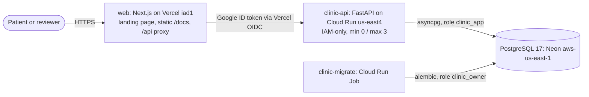
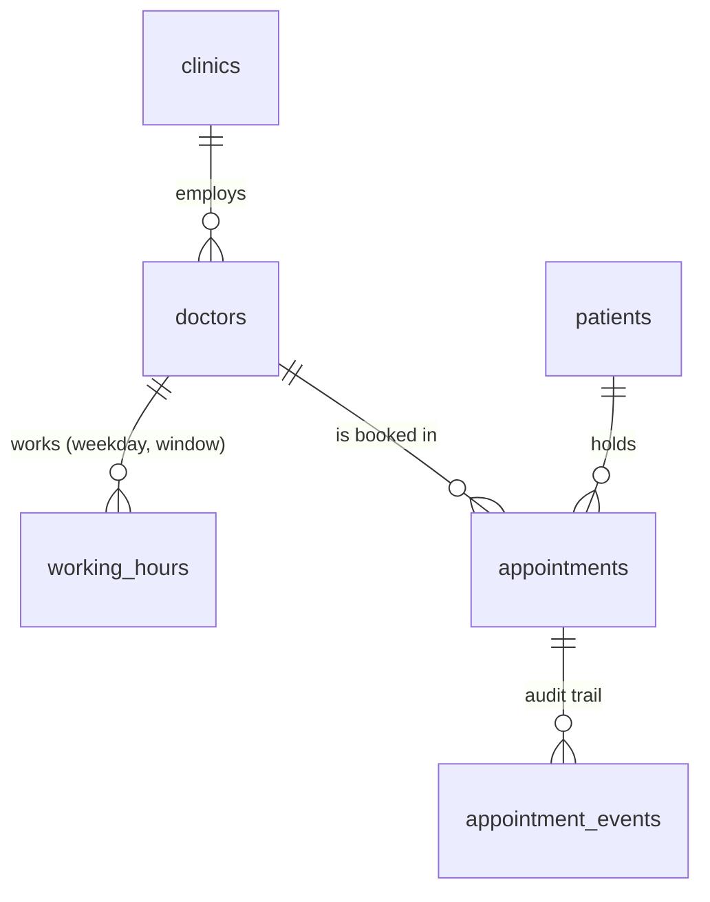
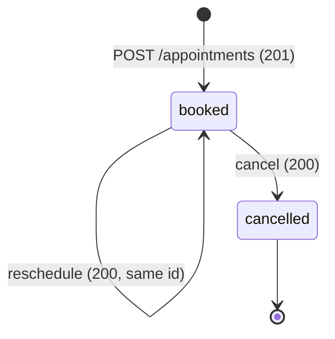

# Clinic Booking API

<!-- one-line pitch --> · CircleCI badge (main) · tag v1.0.0 @ &lt;sha&gt;

> Work in progress: sections are filled in as the corresponding work lands. The AI
> reflection (section 11) is written by the engineer; nothing here is auto-generated.

## 1. Live URLs

<!-- WEB landing page · API base · Swagger · ReDoc · openapi.json · booking UI (if shipped) · CircleCI pipelines -->

## 2. Verify the claims in 10 minutes

<!-- Step 0: create your own patient · Swagger walkthrough · `make verify URL=...` · `make test-race` -->

## 3. System design

This section is the shape of the system. Section 4 is why I chose it over the alternatives. Each decision links to its ADR in [`docs/adr/`](docs/adr/README.md); the long form is [`docs/architecture/PLAN.md`](docs/architecture/PLAN.md).

### 3.1 Context and containers



One service owns every business rule and one database holds the state. The browser never talks to Cloud Run directly: the Vercel project is the only public entry point, and Cloud Run has no `allUsers` invoker. The reasons are in 4.4 ([ADR-0014](docs/adr/0014-hosting-region-and-cost.md), [ADR-0023](docs/adr/0023-zero-cost-edge-front-door.md)). Code layers inside the API are `api/` (parse and serialize), `services/` (own the transaction), `domain/` (pure, no I/O) and `repositories/` (SQL and constraint mapping) ([ADR-0002](docs/adr/0002-fastapi-single-system-of-record.md)).

### 3.2 Data model



- `clinics.timezone` is an IANA name stored as data, seeded as `Africa/Nairobi`.
- `working_hours` is a clinic-local wall-time window per doctor and ISO weekday. A CHECK keeps both ends on :00 or :30.
- `appointments` carries `starts_at` and `ends_at` as `timestamptz`, `status` in (`booked`, `cancelled`), and CHECKs that pin `ends_at = starts_at + 30 min` and the half-hour grid.
- `appointment_events` is written in the same transaction as every state change. Nothing reads it yet; it is the audit trail and the source a realtime feed would use ([ADR-0009](docs/adr/0009-realtime-polling-now-sse-later.md)).
- Roles: migrations run as `clinic_owner`, the service runs as `clinic_app` with no DDL rights ([ADR-0015](docs/adr/0015-database-roles-and-migrations.md)).

### 3.3 Slots are computed, not stored

The brief gives working hours and a fixed 30-minute slot. I derive free slots on request: cut each working window into 30-minute steps in UTC, subtract the booked starts for that clinic-local day, and drop anything before `now + lead`. It is a pure function, `domain/slots.py::generate_slots`, backed by two indexed queries per request and at most 48 iterations ([ADR-0004](docs/adr/0004-computed-slots.md)).

| | |
|---|---|
| Alternatives | A materialized `slots` table filled by a cron; an RRULE recurrence engine |
| Why | The brief's "set working hours" sentence stays the only source of truth, so editing hours takes effect immediately and nothing can drift out of sync with a generated table |
| Cost | There is no slot row to lock, so uniqueness cannot live on the slot. It has to live on the appointment (3.4) |
| Revisit | A search across doctors ("anyone free at 10:00") at 50 or more doctors, which needs one batched query instead of one per doctor |

### 3.4 The concurrency guarantee

The brief says a booked slot must not be available to others. Two concurrent POSTs for the same slot is the case that breaks check-then-insert, and `SELECT ... FOR UPDATE` cannot lock a row that does not exist yet.

```sql
CREATE UNIQUE INDEX uq_appt_doctor_slot_booked
  ON appointments (doctor_id, starts_at) WHERE status = 'booked';
```

The database is the arbiter. The service inserts and maps the unique violation (SQLSTATE 23505, by constraint name) to `409 SLOT_TAKEN`. There is deliberately no "is it taken?" pre-check, because any such check is a window for a race and adds nothing the index does not already enforce. A cancelled row drops out of the partial index, so the slot is free again while the history stays. A second index on `(patient_id, starts_at)` stops one patient holding two slots at the same instant ([ADR-0003](docs/adr/0003-double-booking-partial-unique-index.md)).

The test is built so it cannot pass vacuously ([ADR-0018](docs/adr/0018-testing-strategy.md)). The race test releases 25 POSTs for one slot at an `asyncio.Barrier`, holds the transaction open for 200 ms with a test-only `pg_sleep`, and samples `pg_locks`. It repeats over 10 slots (with `DB_POOL_SIZE=30`, so all 25 requests can be in flight) and asserts that the peak count of transactions blocked on the uniqueness check, across them, is at least 5. Per slot it asserts exactly one 201, twenty-four 409s with code `SLOT_TAKEN`, and one booked row. The control releases the same barrier against a database with the index dropped, using a check-then-insert `NaiveBookingService`, and asserts more than one booked row, which shows the index is what holds. Run them with `make test-race` and `make test-control`.

### 3.5 Appointment state machine



`cancelled` is terminal, and cancelling or rescheduling a cancelled appointment is `409 APPOINTMENT_ALREADY_CANCELLED`. A reschedule is one `UPDATE` of `starts_at` under `SELECT ... FOR UPDATE`, using the same validator as a fresh booking. It frees the old slot and claims the new one atomically, and if the new slot is taken the transaction rolls back and the original booking is untouched. I chose an in-place update over cancel-and-reinsert so the appointment id stays stable for the client ([ADR-0008](docs/adr/0008-appointment-lifecycle-and-reschedule.md)). I left out `completed` and `no_show` because nothing in the brief tracks attendance.

### 3.6 Time model

- Storage is UTC `timestamptz`. The clinic's zone is data (`clinics.timezone`), so a second clinic needs no code change.
- Input must be RFC 3339 with an offset. A naive datetime is `422 TIMEZONE_REQUIRED` rather than a guess. Output is in the clinic offset plus a `timezone` field.
- "A day" means the clinic-local day, converted to a UTC range `[D 00:00, D+1 00:00)` for the booked-starts query.
- The clock is injected through a FastAPI dependency. Business SQL never calls `now()`; the current instant is a bind parameter. Ruff bans `datetime.now`, `utcnow` and friends outside `core/clock.py`, so a test pins time with a fake clock and passes on any weekday.
- Nairobi has no DST, so DST tests run in `Europe/Berlin`. The cost is one extra join to read the zone. I revisit this when a clinic in a DST zone appears ([ADR-0005](docs/adr/0005-time-and-timezone-model.md)).

### 3.7 Keeping the UI fresh

The booking UI is designed to poll availability every 15 s while the tab is visible, and to stop after 10 minutes without input, so an idle tab does not keep the database awake. Correctness never depends on this: a stale slot that loses the race gets `409 SLOT_TAKEN` and a refetch. A push channel for patients is deferred. Revisit with the SSE gateway (S1), or when polling load shows in Neon CU-hours ([ADR-0009](docs/adr/0009-realtime-polling-now-sse-later.md)).

## 4. Key decisions & trade-offs

Every entry reads: decision, what I weighed, why (4.1 to 4.4 are each tied to a line of the brief), what it costs, when I would revisit it.

### 4.1 Language and framework

**FastAPI, not Django/DRF, and not Go for the core** ([ADR-0002](docs/adr/0002-fastapi-single-system-of-record.md)).

- **Weighed.** FastAPI; DRF; FastAPI plus a Go service for availability or realtime.
- **Why FastAPI.** The brief says "FastAPI, DRF or Go" and weighs reasoning over volume. The surface is five endpoints, and DRF's strengths (admin, ORM conventions, serializers for large models) buy little at that size. FastAPI's pydantic models generate the OpenAPI 3.1 document, and that document is what the TypeScript client is generated from ([ADR-0011](docs/adr/0011-openapi-codegen-contract.md)), so the types are written once. The stack is async and typed end to end (SQLAlchemy async, asyncpg).
- **Why Go is not the core.** I wanted one language for the system of record. A second runtime doubles CI, images, SAST and deploy surface, and a separate availability service would put the uniqueness invariant on the far side of a network boundary.
- **The one job for Go.** If it ships, Go is the read-only SSE fan-out gateway for an admin feed (stretch S1, [ADR-0021](docs/adr/0021-go-realtime-gateway.md)). Holding many idle connections cheaply, with a small image and fast start, is what Go suits best. It is gated behind the required endpoints being live, it never writes, and the two services share only the `appointment_events` table. If S1 does not ship there is no Go in the repository, and the ADR says to delete the service rather than keep a second runtime for nothing.
- **Cost.** Python cold starts are slower than Go's. I mitigate with `--cpu-boost`, and plan lazy engine creation and lean imports; none of it is measured against a target yet. There is also no `/v1` prefix, so a breaking change later means introducing `/v2`. I would revisit on a measured p99 the Python service cannot meet, or a bounded context with different scaling needs.

### 4.2 API style

**REST with an OpenAPI 3.1 contract** ([ADR-0007](docs/adr/0007-api-style-rest-openapi.md), [ADR-0011](docs/adr/0011-openapi-codegen-contract.md)). The brief lists REST verbs, paths and HTTP status codes.

| Option | Verdict | Reason |
|---|---|---|
| tRPC | Rejected | It infers types from a TypeScript router, so the server must be TypeScript. With FastAPI it would need a redundant TS layer and a second contract. Pydantic to OpenAPI to generated TS, zod and TanStack Query hooks gives the same end-to-end types across languages, and a CI drift gate (regenerate, then `git diff --exit-code`) fails if they diverge |
| gRPC / Connect | Rejected for the browser path | Browsers cannot speak native gRPC, and Cloud Run would need end-to-end HTTP/2. Connect's Python implementation is pre-1.0. The brief says REST |
| GraphQL | Rejected | It returns 200 with an `errors` array, which works against "correct HTTP status codes", and it adds a DataLoader and N+1 surface for four resources |

Cost: type safety comes from codegen and a CI gate instead of inference, and the generator (hey-api) is 0.x, so I pin it exactly. I would revisit with three or more heterogeneous clients needing different projections would justify GraphQL. Service-to-service streaming would justify Connect.

### 4.3 Correctness over cleverness

- **The database prevents double booking, not application locks** ([ADR-0003](docs/adr/0003-double-booking-partial-unique-index.md)). Weighed: an `EXCLUDE USING gist` range constraint; SERIALIZABLE with retries; advisory locks; check-then-insert. I chose the partial unique index because it is the smallest mechanism the engine itself enforces, so it holds across instances without coordination. It costs generality: it is correct only for fixed, aligned 30-minute slots and whole or half-hour UTC offsets, and constraint names become part of the contract (a test asserts they exist). I revisit it for variable slot lengths or a +05:45 clinic, which means migrating to the `EXCLUDE` form.
- **Retry once on deadlock, then 409** ([ADR-0008](docs/adr/0008-appointment-lifecycle-and-reschedule.md)). Two appointments swapping slots can deadlock. The service retries the whole transaction once with 20 to 80 ms of jitter, then returns `409 CONCURRENT_UPDATE`, so a state conflict never surfaces as a 5xx. The cost is that a swap can end with both requests rejected and the original state kept, which a race test asserts as the accepted outcome. Revisit if `CONCURRENT_UPDATE` shows up in logs; the fix is locking both rows in id order, not more retries.
- **RFC 9457 problem details with a closed code catalogue** ([ADR-0006](docs/adr/0006-problem-details-error-model.md)). Alternative: FastAPI's default `{"detail": ...}`. Clients need a stable machine-readable `code`, and "meaningful errors + correct HTTP status codes" is a line in the brief. The status rule is exact: 404 means the resource in the path does not exist; 422 means the request is well-formed but resending it unchanged can never succeed; 409 means it conflicts with current state and might succeed later. The cost is a typed exception hierarchy rather than returned error values, which is the idiomatic FastAPI form of the same idea, with a test that the catalogue and the code agree. I would add localized titles keyed by `code` if a client needed them.

### 4.4 Hosting and cost

**A Vercel frontend that proxies to an IAM-only Cloud Run service in `us-east4`, with Neon in `aws-us-east-1`** ([ADR-0014](docs/adr/0014-hosting-region-and-cost.md), [ADR-0023](docs/adr/0023-zero-cost-edge-front-door.md)).

- **Weighed.** Cloud Run in `africa-south1` (my default region) with Neon in Frankfurt; Cloud Run in `europe-west3` with Neon beside it; Cloud SQL (rejected outright, it is always on).
- **Why.** I set a hard rule that total cost is zero, provable from official free-tier documents. On the shared billing account the other projects already use up the Artifact Registry and Secret Manager free tiers, so this project bills about $0.28 a month there; I accepted that and disclose it in section 10. The audit found that Cloud Run's free internet egress covers North America only, and `europe-west3` bills compute at Tier 2 and every egress byte from the first. A booking makes 4 to 6 sequential database round trips, so Cloud Run has to sit next to the database, and `us-east4` and `aws-us-east-1` are deduced to be in the same metro. With Cloud Run IAM-only and the Vercel proxy in front, the paid-egress path never opens: direct hits on `*.run.app` are denied requests, which are not billed (that denied requests add no egress line is unverified, [ADR-0023](docs/adr/0023-zero-cost-edge-front-door.md)). The brief does not require $0; the proxy exists so Cloud Run stays IAM-only, with no `allUsers` binding, and egress stays inside the free tier. That was my own constraint for this submission.
- **Cost.** Kenyan users pay for the long client hop to Virginia plus the proxy hop and its cold start. My estimate is roughly 100 to 150 ms more per warm request than a Frankfurt layout. That is an estimate, not a measurement. I accepted it because this is the layout that keeps compute and egress inside the free tier, and the brief sets no latency target. Neon's free compute is fixed at 0.25 CU and scales to zero, so the first request after idle is slower. The figures are in [section 10](#10-operations-cost--security-posture).
- **Revisit.** If this became a paid product, I would move the API to `africa-south1`, pair it with whichever database is nearest, and drop the proxy. Neon has no African region, so that pairing is its own trade-off.

### 4.5 What breaks at 10x and 100x

These are deductions from the configuration, not load tests.

- **10x.** Connections go first. Each instance holds a pool of 5 against Neon's direct endpoint, with at most 3 instances, so 15 connections. More instances multiply that against a 0.25 CU compute; the fix would be Neon's pooler, which needs asyncpg's statement cache turned off (unverified here). Cold starts are second: scale-to-zero is a cost choice, and `min-instances 1` is the knob when latency matters more than the free tier. Slot reads stay cheap, at two indexed queries.
- **100x.** One Postgres primary becomes the ceiling. The unique index contends only per doctor and slot, so it does not serialize unrelated bookings. Before sharding I would add a read replica for availability and keep writes on the primary.
- **Growth path.**
  - *Multi-clinic.* `clinics` and `clinics.timezone` already exist, so the work is scoping queries by `clinic_id` and adding tenant isolation, not rewriting the time logic.
  - *Per-doctor slot length.* This breaks the fixed-grid CHECKs and the unique index, and it is the trigger for the `EXCLUDE USING gist` constraint. Whether `btree_gist` is available on Neon is not yet verified.
  - *Realtime.* The gateway polls the events table once per instance, so poll load grows linearly with instances. Past 5 instances, 500 concurrent streams or a cursor query p95 above 50 ms, I would move to one poller publishing to Redis pub/sub ([ADR-0021](docs/adr/0021-go-realtime-gateway.md)).

### 4.6 What I deliberately did not build

- **Patient authentication** ([ADR-0012](docs/adr/0012-identity-and-abuse-controls-deferred.md)). The cost is an IDOR: anyone holding an appointment UUID can cancel or reschedule it, and the patient listing exposes personal data. I weighed optional bearer auth and mandatory OAuth. Mandatory auth would return 401 to a reviewer trying the brief's endpoints as written, and the brief does not mention auth. The gap is stated in [section 10](#10-operations-cost--security-posture), and the design for adding it is written down as one `current_principal` dependency that leaves the contract unchanged. It becomes mandatory the day there is real patient data.
- **Rate limiting.** Correct limiting needs a trustworthy client IP behind both Cloud Run and the Vercel proxy, and a limit tuned on traffic I do not have. I wrote down the key and a starting rate, and left it out rather than ship a limiter that header spoofing can bypass. Revisit on observed abuse in the logs.
- **Admin OAuth and a bot check (stretch S3, S4)** ([ADR-0022](docs/adr/0022-admin-auth-and-bot-protection.md)). Cut. The admin feed carries only aggregate, non-PII payloads, and a bot check on the UI route would not protect direct API callers anyway. I revisit if the admin area serves anything beyond aggregates or abuse shows up on the booking route.
- **A booking cap per patient.** The brief does not ask for one, and it would lock reviewers out of the shared demo patients ([ADR-0012](docs/adr/0012-identity-and-abuse-controls-deferred.md)).

## 5. API reference & error catalogue

<!-- endpoint table · status rule (404/422/409) · code -> status -> when (docs/api-errors.md) -->

## 6. Code structure

## 7. Testing

<!-- pyramid · race-test assertions · observed coverage % · how to run each layer -->

## 8. Ambiguities & decisions

## 9. Deployment & CI/CD

<!-- which branch deploys · pipeline steps · OIDC/WIF · migrations-first · tagged smoke + promote-by-tag · rollback · VERCEL_TOKEN debt -->

## 10. Operations, cost & security posture

**Cost disclosure.** The GCP project shares a billing account with other projects, whose use has already exhausted the shared Artifact Registry and Secret Manager free tiers, so this project bills about $0.28 a month there (accepted); Cloud Run compute and egress stay within the free tier.

<!-- cost table · latency · $0 proof (see docs/) · no-auth IDOR statement · phone-exists oracle · tech debt ledger · honest hours -->

## 11. AI reflection

### What I used AI for
<!-- ENGINEER: factual bullets + a per-WP table of how much code was agent-generated vs hand-written -->

### An example where AI improved my work
<!-- ENGINEER: verbatim prompt from the exported session transcript (prompt id from the AI usage summary in README §11), what changed, commit SHA -->

### An example where AI was wrong or incomplete, and how I caught it
<!-- ENGINEER: a real entry with its source; how it was caught (test / doc / observation); fix commit -->

### Two decisions I made without AI, and why
<!-- ENGINEER: decision 1 -- must predate or override AI output; cite the message/commit -->
<!-- ENGINEER: decision 2 -- same rule -->

### Note on commits

AI usage is summarized here in §11; commit messages carry no tooling trailers by convention.

## 12. Run locally

<!-- `make up` · `make test` · env vars table · prerequisites (Docker, uv, pnpm) -->
