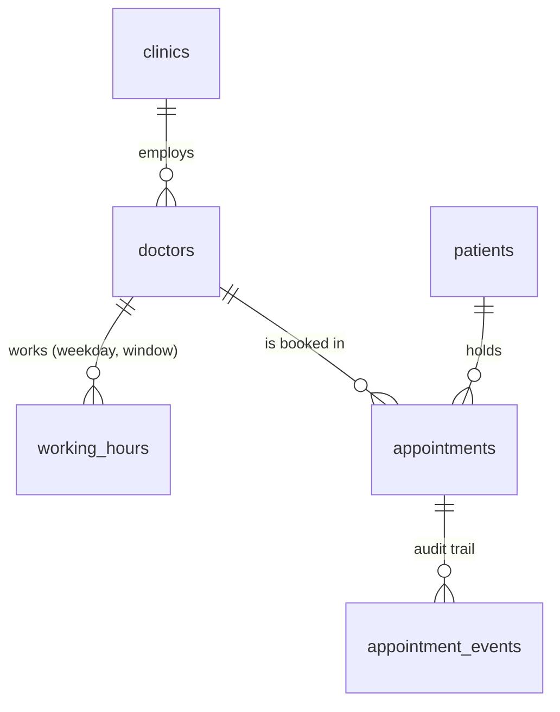
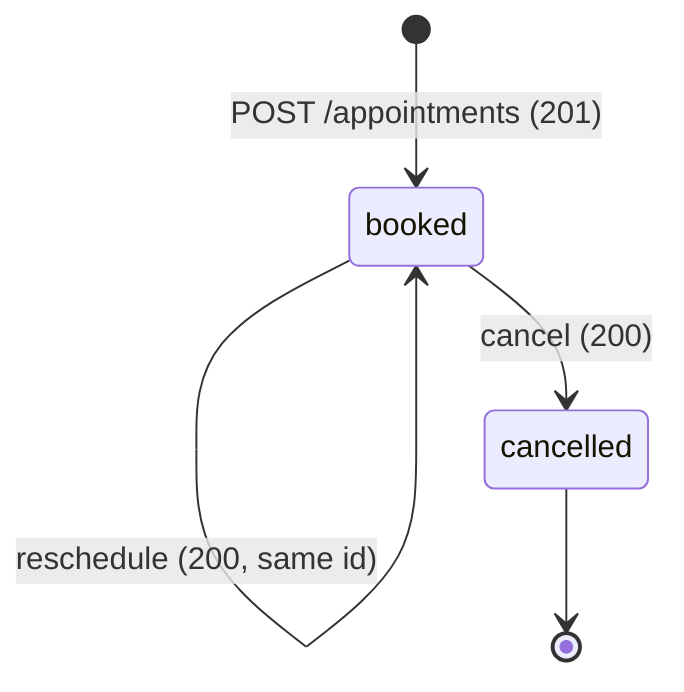

# Clinic Booking

A clinic appointment API in which the database, not application code, is what makes double booking impossible, with a Next.js booking app and an admin dashboard on top.

[](https://app.circleci.com/pipelines/github/ericgitangu/clinic-booking)

## Start here

- **What it is.** Doctors have working hours, a slot is 30 minutes, and a patient can book, cancel and reschedule. FastAPI and Postgres own every rule. The web apps are clients of the same API.
- **Click.** <https://clinic.ericgitangu.com/book> for the patient flow (Google sign-in), <https://clinic.ericgitangu.com/docs> for Swagger UI against the real API (no sign-in: the brief is silent on authentication, and I kept the public `/api` open so Try it out works).
- **Read first.** [3.4 The concurrency guarantee](#34-the-concurrency-guarantee) and the decision behind it, [double booking](https://clinic.ericgitangu.com/decisions#double-booking). The race test and its control are described in 3.4. If that logic is wrong, nothing else matters.
- **Run.** [Section 2](#2-verify-the-claims-in-10-minutes) is a copy-paste path against production: 20 simultaneous bookings of one slot, then cancelling twice.
- **Run it locally.** [Section 12](#12-run-locally) lists what you need and which commands work without my Vercel login: the API, the tests, the Postman collection and `make verify`.
- **Try the API.** `make api-check` runs a Postman collection of the whole booking journey against a local stack; the same files import into Postman ([Try the API](#try-the-api)).
- **Architecture.** One diagram and a table with the choice and the reason for each component, including the Go service: [Architecture](#architecture).
- **Depth.** Every decision has a one-line summary in [section 4](#4-key-decisions--trade-offs) and, for the headline choices, an entry on the [decisions page](https://clinic.ericgitangu.com/decisions) that names what it costs. [The Architecture tab](https://clinic.ericgitangu.com/decisions#architecture) has the diagrams (context, containers, booking, push, release, data handling), [the engineering decisions card](https://clinic.ericgitangu.com/decisions#engineering-decisions) the long decisions index, and [the verification card](https://clinic.ericgitangu.com/decisions#verification) how each pull request was checked, quoted from its review comments. [Section 4.2](#42-what-i-deliberately-did-not-build-and-the-known-limits) lists what I left out and the limits I know about.
- **Demo data.** A demo seed (`python -m app.scripts.seed_demo`, run after the core seed; on the local stack `docker compose exec -T api python -m app.scripts.seed_demo`) fills a database with about 100 invented patients and four weeks of bookings so the admin dashboard can be reviewed ([the demo data runbook](https://clinic.ericgitangu.com/decisions#demo-seed)). They are AI-generated, fictional and Nairobi-local, created to make the clinic reviewable; no real people. Production does not hold them: it holds only the rows from the release checks, which the admin views exclude (they are not deleted). The demo is for a local or staging stack.
- **The admin app** (<https://clinic-admin.ericgitangu.com>) only admits the allowlisted owner and the people the owner grants access to ([runbook](https://clinic.ericgitangu.com/decisions#admin-access)), so a reviewer needs an invitation or the reviewer pass link I send with the submission (see Reviewer access below).
- **Reviewer access.** Staff invitations are live (#63 and #68 are merged). The owner invites the reviewer as admin through `/access`; the invitation expires in 72 hours and must be accepted with the same Google email it was sent to. The owner can also make a reviewer pass on the same page: one link that any verified Google account can accept to become admin (or viewer), for up to 5 people and 14 days by default, and at most 10 and 30. Accepting needs a Google sign-in and a press of Accept, every use is audited and emailed to the owner, and revoking the pass stops new sign-ins but does not remove people who already joined. The trade-off is in [Decision 35](https://clinic.ericgitangu.com/decisions#decision-35).
- **AI use** is described by me in [section 11](#11-ai-reflection). The records it draws on (what I decided, what agents did, the stop rules) are in [the usage facts](https://clinic.ericgitangu.com/decisions#ai-usage).
- **Live versus declared.** What runs in production and what is only designed is stated in [the architecture overview](https://clinic.ericgitangu.com/decisions#containers) and in the status column of [the engineering decisions card](https://clinic.ericgitangu.com/decisions#engineering-decisions).

## Architecture

Every edge in this diagram is one I checked against the code. The relay is called synchronously by the API routes after each committing write, secrets reach Cloud Run through `--set-secrets` at deploy, and Vercel reaches Cloud Run by exchanging its OIDC token at Google STS and calling `generateIdToken` (`packages/api/src/proxy/gcp-id-token.ts`). The same diagram, pre-rendered, is on the booking app's landing page; its source is [`apps/booking/src/content/architecture.mmd`](apps/booking/src/content/architecture.mmd). Sequence diagrams, data handling and the release pipeline are in [the Architecture tab](https://clinic.ericgitangu.com/decisions#architecture).


| Component | Choice | Why |
| --- | --- | --- |
| Browser | Next.js pages with a shell-only service worker; polling as the fallback | A stale slot list is the UX failure of the race the brief names. Push is an optimisation and polling is the floor. |
| Booking and admin apps | Two Next.js apps on Vercel in one pnpm workspace | Separate auth surfaces and deploys without publishing shared packages. |
| Sign-in and roles | Better Auth with Google and stateless cookies; staff roles looked up on every request | Maintained, no auth database, and a revoke applies on the next request. |
| Calls to the API | Server-side BFF: Vercel's OIDC token exchanged at Google STS (workload identity federation) for a Cloud Run ID token, plus an HMAC-signed assertion of who is calling on /internal | No credential in the browser and no stored key; the API checks the role again. |
| API | FastAPI on Cloud Run, IAM-only, 0 to 3 instances | One system of record for every rule; a direct request gets a 403. |
| Database | Neon Postgres 17; a partial unique index decides double booking | The engine enforces it across instances, with no application lock. |
| Live updates | Outbox rows relayed to Ably right after each commit; the patient booking page subscribes over SSE with a 5 minute token (staff get their own feed from the Go service below) | Ably's free package needs no card, and no server of ours holds streams open. |
| Staff live feed | clinic-realtime, a small Go service on Cloud Run: read-only database role, 0 to 2 instances, one stream per instance, IAM-only, streaming to the admin app over SSE | Staff events carry patient names, so they stay inside Google Cloud instead of going to a third-party pub/sub. |
| Email | Resend, called from the booking app with a 5 second abort: after the response for booking, moving and cancelling (after()), and inline in the daily Vercel cron at 15:00 UTC for reminders; the admin app also emails a doctor when a patient is marked arrived, only if staff have set that doctor's address | A slow or failed email never fails a booking; the day (100) and month (3,000) allowances are reserved in the database before a send. |
| Human check | The browser gets a reCAPTCHA token; the booking server creates a reCAPTCHA Enterprise assessment for each booking, cancel and reschedule, with an access token it gets through the same Vercel OIDC federation | It runs on the server for every screen flow, and no secret is stored because the call uses the Vercel identity. |
| Migrations | clinic-migrate, a Cloud Run Job that runs alembic as the clinic_owner role with its own database secret, before each deploy | The running service has no DDL rights, and migrations are expand-only so the previous revision keeps working. |
| Images | Artifact Registry, with CircleCI pushing each image by digest and only the serving image and the one before it kept | A rollback needs the previous image, and the registry's free tier is small. |
| Delivery | CircleCI with keyless OIDC to workload identity federation for Cloud Run and a per-project token for Vercel; a tagged no-traffic deploy, a smoke test, promotion and automatic rollback | No long-lived GCP credential exists, and only a smoke-tested revision gets traffic. |
| Secrets | Secret Manager, mounted into Cloud Run and the migration job at deploy (database URLs, signing key, Ably key); the web apps keep theirs in Vercel environment variables | Nothing secret is in an image or in the repository; Cloud Run reads them through its runtime service account. |

Go: the staff live feed runs on a small read-only Go service, clinic-realtime on Cloud Run, which README section 3.7 describes. I first closed PR 37 without merging and reversed that on 2026-10-19. The cost reasoning is unchanged. The closing comment on PR 37 says: "The Cloud Run gateway billed about 900 vCPU-s per connected hour against roughly 21,619 vCPU-s of shared free-tier headroom, and capped the system at 2 concurrent streams." I read the 900 as per instance (0.25 vCPU for 3,600 seconds), and the service is built to that shape: 0.25 vCPU and at most 2 instances. The measured figure is still pending.

### Why each runtime

Four runtimes is a cost for an app this size, so each one has to earn its place: it does one job here that the others would do worse under the brief's constraints (correct booking, no personal data outside Google Cloud, $0 to run).

**Python and FastAPI** ([one API owns the rules](https://clinic.ericgitangu.com/decisions#one-api)). This is the single system of record. The booking rules, the one-hour rule, the partial unique index that decides double booking, idempotency keys and the problem+json errors all live here, and every write in the system goes through it. The brief's one hard requirement is that a booked slot is never offered or booked twice, so I wanted that guarantee in one codebase with one test suite.

**TypeScript and Next.js** ([a thin web layer](https://clinic.ericgitangu.com/decisions#thin-web-layer), [errors and the API contract](https://clinic.ericgitangu.com/decisions#rest-and-errors)). The booking and admin apps are thin UIs, and their server-side BFFs sign the staff assertion and hold the Google sign-in. They carry no booking rules. Their types, zod schemas and SDK are generated from the API's OpenAPI contract, and the lint job fails if the generated files differ from a fresh run, so a contract change that the UI has not picked up fails the build.

**Go** ([the Go service](https://clinic.ericgitangu.com/decisions#go)). The staff live feed. Its events carry patient names, cancellation reasons and who acted, so the feed stays inside Google Cloud and is read straight from Postgres with a `SELECT`-only role. It is a separate Cloud Run service so that open streams cannot use up clinic-api's concurrency and starve booking. Go earns its place with a small distroless image and a fast cold start, which matter on a service that scales to zero and whose first request is a browser waiting for a stream. Cheap idle streams (a goroutine each) are the usual argument for Go, but at two viewers it does not apply, and I have not measured it. The trade-off is stated plainly: Cloud Run requires concurrency 1 below 1 vCPU, and the service is capped at two instances to stay at $0, so two staff can watch at once. The admin app shares one stream per browser across its tabs.

**Ably** ([polling first, then push](https://clinic.ericgitangu.com/decisions#polling-then-push)). Patient slot events, which carry no personal data. It fans out to up to 200 patients at once on the free package, at $0, with no socket infrastructure of mine. Events reach it from the outbox relay in the API after each commit, and the booking page also polls every 60 seconds while push is healthy, so a missed message costs at most a minute of staleness and never a wrong booking.

## 1. Live URLs

| What | Where |
| --- | --- |
| Landing page | <https://clinic.ericgitangu.com> |
| Booking app | <https://clinic.ericgitangu.com/book> |
| API (a base path: `/api` itself is a 404, try `/api/doctors`) | <https://clinic.ericgitangu.com/api/doctors> |
| Swagger UI | <https://clinic.ericgitangu.com/docs> |
| ReDoc | <https://clinic.ericgitangu.com/redoc> |
| OpenAPI spec | <https://clinic.ericgitangu.com/openapi.json> |
| Admin app (allowlisted) | <https://clinic-admin.ericgitangu.com> |
| Pipelines | [](https://app.circleci.com/pipelines/github/ericgitangu/clinic-booking) <https://app.circleci.com/pipelines/github/ericgitangu/clinic-booking> |

The earlier address, <https://sil-clinic-booking.vercel.app>, answers its pages (`/`, `/book`, `/docs`) with a 308 redirect to the host above. Its `/api/...` paths are not redirected: they are answered directly (`/api/doctors` returns 200 there too). I checked both with plain GET requests on 2026-10-20. The public REST API is still the product, and the booking pages sit on top of it. Cloud Run itself is IAM-only and only the Vercel proxy can call it.

## 2. Verify the claims in 10 minutes

I ran everything below against production on 2026-10-18 (UTC). The commands are copy-paste. You need `curl`, `jq` and `python3`. Everything after this block uses `$API` and nothing sets it again, so to run the same steps against a local stack (`make up`, [section 12](#12-run-locally)) change this block only:

```bash
BASE=https://clinic.ericgitangu.com
API=$BASE/api
# local stack instead:  API=http://localhost:8080
```

If a request comes back as a 403 HTML page with `x-vercel-mitigated: challenge`, that is Vercel's bot protection reacting to a burst (the 20-way race below). Wait a minute, or run the same steps against localhost.

```bash
for p in /doctors /ready; do
  printf '%-10s ' $p; curl -s -o /dev/null -w '%{http_code} %{content_type}\n' $API$p
done
```

The next lines exist only on production (the web host serves `/`, `/docs` and the spec, and Cloud Run is the IAM-only service behind it):

```bash
for p in / /docs /openapi.json; do
  printf '%-14s ' $p; curl -s -o /dev/null -w '%{http_code} %{content_type}\n' $BASE$p
done
curl -s -o /dev/null -w 'direct Cloud Run: %{http_code}\n' https://clinic-api-2shno7sa7q-uk.a.run.app/ready
```

| Path | Observed |
| --- | --- |
| `/` | `200 text/html` |
| `/docs` (Swagger UI) | `200 text/html` |
| `/openapi.json` | `200 application/json` |
| `$API/doctors` | `200 application/json`, 5 doctors seeded, the first is "Dr. Achieng Otieno" |
| `$API/ready` | `200 application/json` (in production the proxy reaches Cloud Run) |
| Cloud Run directly, `/ready` | `403`: it is IAM-only |

**Step 0: your own patient and a free slot.** Use a patient of your own, not mine. The loop looks for the first day in the next week on which the first doctor has a free slot.

```bash
PATIENT=$(curl -s -XPOST $API/patients -H 'content-type: application/json' -d '{"full_name":"Your Name"}' | jq -r .id)
DOCTOR=$(curl -s $API/doctors | jq -r '.items[0].id')
for n in 3 4 5 6 7 8 9; do
  DAY=$(python3 -c "import datetime as d; print(d.date.today() + d.timedelta(days=$n))")
  SLOT=$(curl -s "$API/doctors/$DOCTOR/availability?date=$DAY" | jq -r '.slots[0].starts_at // empty')
  [ -n "$SLOT" ] && break
done; echo "$DAY $SLOT"
```

**One booking wins 20 simultaneous requests.**

```bash
BODY="{\"doctor_id\":\"$DOCTOR\",\"patient_id\":\"$PATIENT\",\"starts_at\":\"$SLOT\"}"
seq 20 | xargs -P20 -I{} curl -s -o /dev/null -w '%{http_code}\n' -XPOST $API/appointments \
  -H 'content-type: application/json' -d "$BODY" | sort | uniq -c
```

Observed: `1 201` and `19 409`. The partial unique index rejects the other 19 as `SLOT_TAKEN`. The same 20-way run on my local compose stack on 2026-10-16 also gave one 201 and 19 409s, and the slot then disappeared from availability. The committed test `backend/tests/concurrency/test_race_same_slot.py` fires 25 requests and expects one 201 and 24 409s; run it with `make test-race`.

**Cancelling twice.**

```bash
ID=$(curl -s "$API/patients/$PATIENT/appointments" | jq -r '.items[0].id')
curl -s -XPATCH $API/appointments/$ID/cancel -H 'content-type: application/json' -d '{"reason":"gate check"}' -o /dev/null -w '%{http_code}\n'
curl -s -XPATCH $API/appointments/$ID/cancel -H 'content-type: application/json' -d '{"reason":"gate check"}' -w '\n%{http_code} %{content_type}\n'
```

Observed: the first returns `200`. The second returns `409` as `application/problem+json` with code `APPOINTMENT_ALREADY_CANCELLED` and a `request_id`.

**Rerunning locally.** `make e2e` always starts from a fresh database (it runs `docker compose down -v && docker compose up -d --build --wait` first), so rerun it as often as you like. The fresh-database rule matters only if you run Playwright directly (`pnpm -C apps/booking test:e2e`) against a stack you kept, or `KEEP_STACK=1 make e2e-admin`: then run `make down` first (it runs `docker compose down -v`; `make down -v` would only print Make's version).

**The full script.** `make verify URL=$API` runs the end-to-end claims check (`scripts/verify_claims.py`) and needs `uv`. Observed on 2026-10-18, the script printed `17/17 passed` against production. The release pipeline runs the same script against each new revision before it gets traffic, and runs `cost_check.sh --live` after the deploy.

### Try the API

A Postman collection in [`collections/`](collections/README.md), run with newman, walks the reviewer path in order: health, doctors, a day's free slots, a booking with an `Idempotency-Key` and its replay, a double booking (`409 SLOT_TAKEN`), a slot inside the configured lead time, 60 minutes by default (`422 BOOKING_TOO_SOON`), reschedule and cancel, a change inside the lead time (`409 CHANGE_TOO_LATE`) and the validation errors. Every request checks the status, the content type (`application/problem+json` on errors), the key fields and the body against the contract's schema. Times are computed from now, so it does not go stale.

One command, Docker only (its own compose stack, removed afterwards):

```bash
make api-check
```

Observed on 2026-10-19: 42 requests (the 41 in the collection and one slot lookup), 219 assertions, 0 failed. `make api-check-prod` runs only the GET requests against production: 13 requests, 62 assertions, 0 failed on 2026-10-19. `API_WRITES=1 make api-check-prod` also runs the writes, and those leave two "Reviewer …" patients and two cancelled appointments in the production database.

To click through it instead, start the API with `make up` (or use production), then in Postman Import the three files in `collections/` and pick the `local` or `production` environment. newman and Postman are the supported tools; [`collections/README.md`](collections/README.md#postman-and-newman) says why Insomnia is not. Folder 08 needs the second API that only `make api-check` starts ([how to send it by hand](collections/README.md#the-journey)). No request needs a key.

## 3. System design

This section is the shape of the system. Section 4 is why I chose it over the alternatives. The headline decisions link to their entry on the [decisions page](https://clinic.ericgitangu.com/decisions), which gives the same choices in plain words.

### 3.1 Context and containers

The diagram for this section is the one in [Architecture](#architecture), so there is a single picture to keep true. In short: the browser reaches two Vercel apps, which call one IAM-only Cloud Run service over a federated identity, and that service owns the one Postgres database. One service owns every business rule and one database holds the state. The browser never talks to Cloud Run directly: the Vercel project is the only public entry point, and Cloud Run has no `allUsers` invoker ([the hosting and cost decision](https://clinic.ericgitangu.com/decisions#hosting-and-cost)). The admin app is a second Vercel project that reaches the same API the same way. Booking, moving and cancelling send the signed-in patient an email through Resend, from `Idyllic Clinic <reminders@mail.ericgitangu.com>` (the verified subdomain, which keeps the root domain's reputation separate) with replies going to my own address. Mail goes only to verified, linked Google accounts. A daily Vercel cron at 15:00 UTC (18:00 in Nairobi) emails a reminder for every appointment tomorrow. Emails are sent after the response with a 5-second abort, and the day (100) and month (3,000) allowances are reserved atomically in the database before a send, so a failed or slow email never fails a booking. `mail.ericgitangu.com` was the only domain showing Verified on my Resend Domains page when it was checked on 2026-10-18 ([the verification card](https://clinic.ericgitangu.com/decisions#verification)). Booking and cancellation emails were verified live on 2026-10-18 (recorded in [the verification card](https://clinic.ericgitangu.com/decisions#verification)); the daily reminder cron's first send is still unconfirmed. Code layers inside the API are `api/` (parse and serialize), `services/` (own the transaction), `domain/` (pure, no I/O) and `repositories/` (SQL and constraint mapping) ([one API owns the rules](https://clinic.ericgitangu.com/decisions#one-api)).

### 3.2 Data model



- `clinics.timezone` is an IANA name stored as data, seeded as `Africa/Nairobi`.
- `working_hours` is a clinic-local wall-time window per doctor and ISO weekday. A CHECK keeps both ends on :00 or :30.
- `appointments` carries `starts_at` and `ends_at` as `timestamptz`, `status` in (`booked`, `cancelled`), and CHECKs that pin `ends_at = starts_at + 30 min` and the half-hour grid.
- `appointment_events` is written in the same transaction as every state change. It is the audit trail, and the admin dashboard reads it for the appointment lineage view.
- Roles: migrations run as `clinic_owner`, the service runs as `clinic_app` with no DDL rights.

### 3.3 Slots are computed, not stored

The brief gives working hours and a fixed 30-minute slot. I derive free slots on request: cut each working window into 30-minute steps in UTC, subtract the booked starts for that clinic-local day, and drop anything before `now + 60 min`. It is a pure function, `domain/slots.py::generate_slots`, backed by two indexed queries per request. The cost is that there is no slot row to lock, so uniqueness cannot live on the slot. It has to live on the appointment, which is the next section.

**The 1-hour rule.** Nothing is booked, moved or cancelled less than 60 minutes before it starts (`BOOKING_MIN_LEAD_MINUTES`; exactly 60 is allowed). One shared helper, `domain/booking_rules.py::require_lead_time`, applies it to every operation:

- Free slots (`GET /doctors/{id}/availability`) never include a slot starting within 60 minutes.
- Book ([Swagger](https://clinic.ericgitangu.com/docs#/appointments/create_appointment_appointments_post)): `422 BOOKING_TOO_SOON` when the start is under 60 minutes away.
- Cancel ([Swagger](https://clinic.ericgitangu.com/docs#/appointments/cancel_appointment_appointments__appointment_id__cancel_patch)): `409 CHANGE_TOO_LATE` when the appointment starts in under 60 minutes.
- Reschedule ([Swagger](https://clinic.ericgitangu.com/docs#/appointments/reschedule_appointment_appointments__appointment_id__reschedule_patch)): `409 CHANGE_TOO_LATE` when its current start is under 60 minutes away, and `422 BOOKING_TOO_SOON` when the new start is (a new time is validated as for a fresh booking).
- Staff are exempt from this lead-time rule and from nothing else: an owner or admin can book, cancel and reschedule inside the last hour, always with a reason that is audited. They stay bound by the other checks (a start in the past, a visit that has begun, a taken slot, a patient double-booked, working hours and the 90-day horizon). The patient app disables cancel and reschedule inside the window and says why. A repeated request that already took effect (an idempotent booking, a reschedule to the time it already has) still returns its original result.

The rule is stated in the OpenAPI contract and tested against it.

### 3.4 The concurrency guarantee

The brief says a booked slot must not be available to others. Two concurrent POSTs for the same slot is the case that breaks check-then-insert, and `SELECT ... FOR UPDATE` cannot lock a row that does not exist yet.

```sql
CREATE UNIQUE INDEX uq_appt_doctor_slot_booked
  ON appointments (doctor_id, starts_at) WHERE status = 'booked';
```

The database is the arbiter. The service inserts and maps the unique violation (SQLSTATE 23505, by constraint name) to `409 SLOT_TAKEN`. There is deliberately no "is it taken?" pre-check, because any such check is a window for a race and adds nothing the index does not already enforce. A cancelled row drops out of the partial index, so the slot is free again while the history stays. A second index on `(patient_id, starts_at)` stops one patient holding two slots at the same instant ([the double booking decision](https://clinic.ericgitangu.com/decisions#double-booking)).

The test is built so it cannot pass vacuously. The race test releases 25 POSTs for one slot at an `asyncio.Barrier`, holds the transaction open for 200 ms with a test-only `pg_sleep`, and samples `pg_locks`. It repeats over 10 slots (with `DB_POOL_SIZE=30`, so all 25 requests can be in flight) and asserts that the peak count of transactions blocked on the uniqueness check, across them, is at least 5. Per slot it asserts exactly one 201, twenty-four 409s with code `SLOT_TAKEN`, and one booked row. The control (`_naive_book` in `backend/tests/concurrency/test_naive_control.py`) fires 10 requests at its own barrier against a database with the index dropped, using a raw check-then-insert, and asserts more than one booked row, which shows the index is what holds. Run them with `make test-race` and `make test-control`.

### 3.5 Appointment state machine



`cancelled` is terminal, and cancelling or rescheduling a cancelled appointment is `409 APPOINTMENT_ALREADY_CANCELLED`. A reschedule is one `UPDATE` of `starts_at` under `SELECT ... FOR UPDATE`, using the same validator as a fresh booking. It frees the old slot and claims the new one atomically, and if the new slot is taken the transaction rolls back and the original booking is untouched. I chose an in-place update over cancel-and-reinsert so the appointment id stays stable for the client. The brief does not track attendance, so the booking lifecycle stays at two states, `booked` and `cancelled`. Attendance is recorded separately by staff (arrived, or no-show once the visit has begun) in an append-only table and never changes the appointment's status; there is no `completed` state.

### 3.6 Time model

- Storage is UTC `timestamptz`. The clinic's zone is data (`clinics.timezone`), so a second clinic needs no code change.
- Input must be RFC 3339 with an offset. A naive datetime is `422 TIMEZONE_REQUIRED` rather than a guess. Output is in the clinic offset plus a `timezone` field.
- "A day" means the clinic-local day, converted to a UTC range `[D 00:00, D+1 00:00)` for the booked-starts query.
- The clock is injected through a FastAPI dependency. Business SQL never calls `now()`; the current instant is a bind parameter. Ruff bans `datetime.now`, `utcnow` and friends outside `core/clock.py`, so a test pins time with a fake clock and passes on any weekday.
- Nairobi has no DST, so DST tests run in `Europe/Berlin` ([the time model decision](https://clinic.ericgitangu.com/decisions#time)).

### 3.7 The live feed: a Go service beside FastAPI


`services/realtime` is a small Go service that streams the booking log to the staff dashboard over server-sent events. It only reads. Its database role has `SELECT` on a few columns and nothing else (migration `0014`, tested with a real login), and no line of the Go code sends a write. Every write still goes through FastAPI, so the booking rules and the double-booking guarantee live in one codebase with one test suite.

- **Why a second language.** The brief allows FastAPI or Go. I kept all the rules in FastAPI and used Go for the one job it suits best: a small distroless image and a fast cold start on a service that scales to zero, with every connection read-only. I have not claimed cheaper idle streams, because at two viewers I have not measured it. The cost is a second runtime to build, scan and deploy: a CI job (`go-quality`), an image scan, and a `ship-realtime` job with a smoke test and a rollback.
- **Why not Ably for staff too.** Patient events say only that a time was taken or freed. The model forbids any other field and a test fails if a field name hints at a person (`backend/app/schemas/events.py`, `backend/tests/unit/test_realtime_domain.py`), so a third-party pub/sub is fine for them. Staff events carry the patient's name and a cancellation reason. That is health-adjacent personal data, so it stays inside our Google Cloud boundary: Go reads Postgres directly and streams to the IAM-protected admin app. A viewer gets the same events without the name, the reason or the appointment id; that is tested on the wire and in the browser.
- **What I gave up.** Cloud Run bills an instance while a stream is open. Below 1 vCPU Cloud Run allows one request per instance at a time ([the CPU limits page](https://docs.cloud.google.com/run/docs/configuring/services/cpu)), so the service scales from zero to at most two instances on demand and back to zero when idle. That means at most two live staff streams. A third client sees "Live feed busy, refreshing every 30 s" and the dashboard falls back to refreshing. One connected hour at 0.25 vCPU is about 900 vCPU-seconds (0.25 x 3,600, deduced) against roughly 21,619 vCPU-seconds of shared free-tier headroom. The server closes every stream itself (at 290 s because Vercel Hobby caps the admin route at 300 s, and after four quiet minutes), and the browser lets go of its stream after five minutes in a hidden tab.
- **Measured cost.** <!-- realtime-cost:start -->Measured cost of one connected hour: not measured yet.<!-- realtime-cost:end --> (`bash scripts/ops/measure_realtime_cost.sh` holds a few streams, reads Cloud Monitoring and rewrites this line; it fails above 1,100 vCPU-seconds per connected hour.)
- **When I would revisit.** More than two staff viewing at once, or more than one clinic. Then each connection should not hold an instance, and the gateway would move to pooled pub/sub inside Google Cloud (Pub/Sub or Redis).
- **How this was decided.** I first designed the Go gateway. The realtime design then moved everything to Ably and the gateway was marked superseded, which I had not signed off. On 2026-10-19 I reversed that, because the staff view needs names and those should not leave Google Cloud.

## 4. Key decisions & trade-offs

### 4.1 The headline decisions

Each row is the decision, what it costs me, and the entry on the [decisions page](https://clinic.ericgitangu.com/decisions) that weighs it where there is one. [The engineering decisions card](https://clinic.ericgitangu.com/decisions#engineering-decisions) adds the alternative I rejected on each row.

| Decision | What it costs | Decisions page |
| --- | --- | --- |
| A partial unique index on `(doctor_id, starts_at) WHERE status = 'booked'` decides double booking, with no application lock | Correct only for fixed, aligned 30-minute slots; variable lengths mean migrating to an `EXCLUDE USING gist` constraint | [double booking](https://clinic.ericgitangu.com/decisions#double-booking) |
| Slots are computed from working hours, never stored | No slot row to lock, so uniqueness lives on the appointment | [double booking](https://clinic.ericgitangu.com/decisions#double-booking) |
| FastAPI is the single system of record; Go serves only the read-only staff live feed (3.7) | Python cold starts are slower than Go's; I mitigate with `--cpu-boost` and have not measured it | [one API](https://clinic.ericgitangu.com/decisions#one-api), [the Go decision](https://clinic.ericgitangu.com/decisions#go) |
| UTC `timestamptz`, the clinic zone as data, naive datetimes rejected, an injected clock | One extra join to read the zone; no DST zone is in the seed data | [time model](https://clinic.ericgitangu.com/decisions#time) |
| REST with OpenAPI 3.1, RFC 9457 errors with a closed code catalogue, and a TypeScript client generated from the contract | Type safety comes from codegen and a CI drift gate instead of inference; the generator is 0.x and pinned; no `/v1` prefix | [REST contract](https://clinic.ericgitangu.com/decisions#rest-and-errors) |
| Reschedule is an in-place update under a row lock with one deadlock retry; a booking retry replays through an idempotency key stored on the appointment | A slot swap can end with both requests rejected; a key is bound to one doctor and time | [3.5](#35-appointment-state-machine) |
| Cloud Run is IAM-only behind a Vercel proxy, in `us-east4` beside Neon | An estimated 100 to 150 ms more per warm request for Kenyan users than a Frankfurt layout (not measured), and about $0.41 a month against a $0.50 ceiling on the shared billing account | [hosting and cost](https://clinic.ericgitangu.com/decisions#hosting-and-cost) |
| CircleCI, keyless OIDC to workload identity federation, promote by tag after a smoke test, roll back automatically | `VERCEL_TOKEN` is long-lived; a release on `main` takes about 28 minutes (measured, section 9) | [section 9](#9-deployment--cicd) |
| The brief is silent on authentication; I kept the public API unauthenticated so Swagger's Try it out works, while patients and staff sign in with Google in the web apps, with one reCAPTCHA check per action and roles checked on every request | Anyone holding an appointment id can change it through the public API (an IDOR I disclose in section 10) | [the thin web layer decision](https://clinic.ericgitangu.com/decisions#thin-web-layer) |
| Real Postgres in every test, a race harness that fails if it stops being concurrent, and a control that proves the index is what holds | Slower suites and a compose database in CI; no mocks to hide behind | [3.4](#34-the-concurrency-guarantee) |

**What breaks at 10x and 100x.** These are deductions from the configuration, not load tests. Connections go first: each instance holds a pool of 5 against Neon's direct endpoint, with at most 3 instances, so 15 connections. More instances multiply that against a 0.25 CU compute; the fix would be Neon's pooler, which needs asyncpg's statement cache turned off (unverified here). Cold starts are second: scale-to-zero is a cost choice, and `min-instances 1` is the knob when latency matters more than the free tier. At 100x one Postgres primary is the ceiling. The unique index contends only per doctor and slot, so it does not serialize unrelated bookings, and a read replica for availability comes before any sharding. Multi-clinic needs `clinic_id` scoping and tenant isolation, not new time logic.

### 4.2 What I deliberately did not build, and the known limits

- **Patient authentication on the public API** ([the thin web layer decision](https://clinic.ericgitangu.com/decisions#thin-web-layer)). The brief says nothing about authentication; I left the brief's endpoints unauthenticated so Swagger's Try it out works. The cost is an IDOR: anyone holding an appointment or patient UUID can read or change it there, and a duplicate-phone error tells a caller whether a number is registered. The signed-in screens close this in the web path only.
- **Rate limiting in the API.** There is a per-client limit in the Vercel proxy (120 requests a minute by default, per instance, `packages/api/src/proxy/rate-limit.ts`) and none inside the API, where a trustworthy client IP is not available behind Cloud Run and the proxy.
- **A booking cap per patient.** The brief does not ask for one, and it would lock reviewers out of shared demo patients.
- **Variable slot lengths, multiple timezones per request, and a `completed` state.** Fixed 30 minutes and two appointment states match the brief. Attendance (`arrived`, `no_show`) is a separate staff record, not an appointment state.
- **Early session revocation.** Sessions are stateless cookies, so a role is looked up in `staff_access` on every request instead of living in the cookie ([the thin web layer decision](https://clinic.ericgitangu.com/decisions#thin-web-layer)).
- **Measured latency and load.** The latency and 10x figures above are estimates and are labelled as such.
- **Admin events on Ably.** The relay still publishes the PII-free admin events to Ably and nothing subscribes to them now, because the staff feed goes through the Go service in [3.7](#37-the-live-feed-a-go-service-beside-fastapi). Turning that publish off would save Ably messages.
- **End-to-end tests assume a fresh database per run.** CI provides one, and `make e2e` recreates the compose volume itself. Running Playwright directly on a reused database (`pnpm -C apps/booking test:e2e`, or `KEEP_STACK=1 make e2e-admin`) fails the double-booking specs and the fixed-slot `booking.spec` test (also on `main`); run `make down` first. Per-run port and database isolation is descoped for time.
- **The daily reminder has not been seen live.** Booking and cancellation emails were verified live on 2026-10-18, but the first send of the 15:00 UTC reminder cron is still to be confirmed in the Resend logs.
- **Doctor notifications are narrow** ([the doctor notifications card](https://clinic.ericgitangu.com/decisions#notifications)). Marking a patient arrived emails the doctor, but only if staff have set that doctor's address on the doctor's card: seeded doctors have none, so nothing is emailed from seed data, and the dashboard says "email not sent (no doctor email)". The email goes out through the same sender and the same daily and monthly allowance as acknowledgements and reminders (100 a day, 3,000 a month, shared), so a busy day can use it up and the row then says so (staff emails and the doctor's arrival email stop `EMAIL_ACK_RESERVE`, 20, short of the day's limit, so booking acknowledgements always have room). Nothing runs in the background, so a send that was cut off stays pending until staff press "Send the email again" on the appointment sheet, which they are offered after two minutes if nothing ever claimed the send, or after 15 minutes if a sender claimed it and died (until then the sheet says it is on its way, and an open sheet stops looking after about two minutes). There is no per-doctor preference, no morning digest yet and no bounce handling. **Named limit:** the doctor's email shows the patient's first name and the first letter of the last ("Amina W."), and reads "Surname, First" when there is a comma; a name written surname-first without a comma, or a Chinese, Japanese or Korean name, still shows its family name, because a patient has one free-text name field. The fix is a given-name field on patients.
- **The admin app cannot be tried without an invitation or a reviewer pass**, for the reason in the Start here list.

**Known gap: largest contentful paint on `/book`.** The bar is 2.5 s on mobile Lighthouse. Measured locally (the repo's `lighthouse.sh`, mobile preset, production build, 5-run medians): `/book` 2.80 s, `/` 2.71 s, and the static pages that carry only the shell 2.49 s; CircleCI measured `/book` at 2.91 s. The LCP element is text, and the time is dominated by the first-load JavaScript of the shared shell (React and the Next client are about 117 KB gzip), so the pages with more content sit above the floor. I trimmed first-load JS (about 25 KB on `/`), streamed the `/book` heading before the API answers and sized the portraits by `srcset`, but did not reach 2.5 s; the budget is unchanged. Next step: load the header menus on demand instead of on every page.

### 4.3 Beyond the brief

- **Race-proof tests with a naive control** that must fail without the index: `make test-race`, `make test-control`.
- **Idempotency keys** on booking: a retry after a lost response returns the original booking instead of telling the real booker they lost the slot.
- **Immutable releases and rollback.** Every release is a tagged Cloud Run revision that is smoke-tested before it gets traffic. After both web deploys, `verify-release` checks the public URL and records the result; `rollback-api`, `rollback-realtime`, `rollback-booking` and `rollback-admin` act only when that result is `failed`, and stand down otherwise. They run on every release on `main`. None has had to move traffic back yet, so the move itself is proven by the CI script tests (`make ci-test`), not by a real rollback ([rollback runbook](https://clinic.ericgitangu.com/decisions#rollback)).
- **Keyless deploy.** No long-lived GCP credential exists; CircleCI exchanges its OIDC token for a short-lived one, and only for `main`.
- **Security gates in CI.** gitleaks, semgrep, pip-audit, a trivy image and config scan and a ZAP API scan, each wired as a CI job that fails on findings (ZAP fails on exit codes 1 and 3; warnings only pass).
- **Cost guards.** `cost_check.sh` runs statically on every PR and live after each deploy, and has a self-test that mutates the config to prove it fails. The [hosting and cost decision](https://clinic.ericgitangu.com/decisions#hosting-and-cost) summarises the limits it guards.
- **Admin dashboard** with three roles and an appointment lineage view ([the thin web layer decision](https://clinic.ericgitangu.com/decisions#thin-web-layer)).
- **Google sign-in and a reCAPTCHA check per action** on the patient screens ([the thin web layer decision](https://clinic.ericgitangu.com/decisions#thin-web-layer)).
- **A generated, validated client.** Types, zod schemas and the SDK come from the OpenAPI contract, and CI fails on drift ([the REST contract decision](https://clinic.ericgitangu.com/decisions#rest-and-errors)).
- **Request-id logging** with no PII in logs, and branding, a web manifest and a sitemap.
- **A shell-only PWA and slot lists that stay current.** The booking page subscribes to live slot events and polls every 60 seconds while push is healthy; when push is blocked or refused it polls every 15 seconds with backoff, and it keeps the idle stop ([the polling then push decision](https://clinic.ericgitangu.com/decisions#polling-then-push), [the thin web layer decision](https://clinic.ericgitangu.com/decisions#thin-web-layer)).
- **Live slot events.** The API publishes them through an outbox relay to Ably, with a hard monthly publish budget (25,000) and polling as the fallback ([diagram](https://clinic.ericgitangu.com/decisions#slot-push)). Both sides are live. Publishing: on 2026-10-18 one booking and one cancel in production moved the Ably message count from 17 to 21. Subscribing: the booking page subscribes with a short-lived, subscribe-only token and falls back to the 15 second polling when the push host is blocked or a token is refused (PR 44; its acceptance cases passed in CI, a booked and a cancelled slot reaching a second browser through the real service in `e2e-real` job 3110). Patient live push is on in production (observed after release `748d7d8`: the token endpoint returned 200 with `no-store` for the site origin and 403 for a cross-site origin, and a real Chrome on a booking page went from `data-stream="polling"` on load to `data-stream="live"` after a scroll and a key press, because no token is minted before user input). The staff live feed is a separate path: the Go service in [3.7](#37-the-live-feed-a-go-service-beside-fastapi), not Ably.
- **Live notifications on the dashboard.** Each live event (a booking, a change, an arrival, a no-show, a veto) shows a toast to the staff who did not make it, an unread count on the live feed and a short highlight on the doctor's card; a burst collapses into one "N updates" toast and viewers never see patient names. It uses the existing stream, so it opens no new connection.
- **Booking emails and a daily reminder** through Resend, sent only to verified, linked accounts. Merged (PR 27). Booking and cancellation emails verified live on 2026-10-18; the daily reminder's first send is unconfirmed.
- **Swagger UI, ReDoc and fonts served from the repo**, so the first click does not depend on a CDN.
- **A production ZAP baseline, Lighthouse budgets, an image prune and a kill switch** for the deployed services ([rollback runbook](https://clinic.ericgitangu.com/decisions#rollback)). The Lighthouse `/` performance rule is a warning: CI medians varied from 77 to 89 run to run.

The status of each item (shipped, declared, descoped) and what it costs is in [the engineering decisions card](https://clinic.ericgitangu.com/decisions#engineering-decisions).

## 5. API reference & error catalogue

The live, interactive reference is [Swagger UI](https://clinic.ericgitangu.com/docs); the contract is committed at `contracts/openapi.json`. The public base is `/api` (`https://clinic.ericgitangu.com/api`), and the brief's paths sit under it unchanged: `POST /api/appointments` is the brief's `POST /appointments`. The public endpoints:

| Method and path | Purpose | Success |
| --- | --- | --- |
| `GET /doctors`, `GET /doctors/{id}` | Doctors with clinic and working hours | 200 |
| `GET /doctors/{id}/availability?date=` | Free 30-minute slots on a clinic-local day | 200 |
| `POST /patients` | Create a patient | 201 |
| `POST /appointments` | Book a slot | 201 |
| `GET /appointments/{id}`, `GET /patients/{id}/appointments` | Read one, or a patient's list | 200 |
| `PATCH /appointments/{id}/cancel`, `/reschedule` | Change state | 200 |
| `GET /health`, `GET /ready`, `GET /problems/{slug}` | Liveness, readiness (`SELECT 1`), error type documents | 200 |

The one-hour rule uses two codes: `422 BOOKING_TOO_SOON` for a too-soon slot (a booking, or a reschedule's new time) and `409 CHANGE_TOO_LATE` for changing or cancelling a visit that starts within the hour ([section 8](#8-ambiguities--decisions)).

The `/internal/*` endpoints serve the web apps and need a signed assertion; they are in the contract but not callable from Swagger. Every non-2xx is `application/problem+json` with a stable `code` and a `request_id`. The status rule: 404 means the resource in the path does not exist; 422 means the request is well-formed but resending it unchanged can never succeed; 409 means it conflicts with current state and might succeed later. The full code table is in [`contracts/api-errors.md`](contracts/api-errors.md), which a test checks against the code ([the REST contract decision](https://clinic.ericgitangu.com/decisions#rest-and-errors)).

## 6. Code structure

| Path | What is in it |
| --- | --- |
| `backend/app/` | FastAPI service: `api/`, `services/`, `domain/` (pure rules), `repositories/`, `models/`, `schemas/`, `core/` |
| `backend/migrations/`, `backend/tests/` | Alembic (expand-only, linted by `scripts/migration_lint.sh`); unit, integration, concurrency, contract, migration tests |
| `apps/booking/`, `apps/admin/` | The two Next.js apps |
| `packages/api/`, `packages/ui/` | Generated client and the `/api` proxy; shared UI |
| `services/realtime/` | The Go service behind the staff live feed ([3.7](#37-the-live-feed-a-go-service-beside-fastapi)) |
| `collections/` | The Postman collection and its two environments, run by `make api-check` ([Try the API](#try-the-api)) |
| `contracts/` | The committed contract: the OpenAPI spec, the error catalogue ([`api-errors.md`](contracts/api-errors.md)) and the event schemas in `events/` |
| `infra/`, `.circleci/`, `scripts/` | Terraform and bootstrap, the pipelines, verification and cost scripts |

`make help` lists every task.

### Doctor portraits (AI-generated)

These are **AI-generated portraits of fictional doctors**: the five seeded doctors do not exist, and the images are not photographs of anyone real. Patients never get a generated face: a patient's avatar is their Google picture, or their initials.

- **Model and run.** Z-Image-Turbo (`Tongyi-MAI/Z-Image-Turbo`) through the Hugging Face Space `mcp-tools/Z-Image-Turbo` (gradio `/generate`), on 2026-10-18. 1024x1024, steps 8, shift 3.0, fixed seed 2026. The files served are WebP at 128, 256 and 512 px with EXIF stripped; the 1024 px originals are not kept in the repository.
- **Licence.** Apache License 2.0. The model card (`Tongyi-MAI/Z-Image-Turbo`, revision `f332072aa78be7aecdf3ee76d5c247082da564a6`) declares `license: apache-2.0` ([model card](https://huggingface.co/Tongyi-MAI/Z-Image-Turbo)), confirmed with the Hugging Face CLI on 2026-10-19; the Space listed as running that model is `mcp-tools/Z-Image-Turbo`; the card is not gated and adds no terms about generated images. Apache 2.0 allows commercial use and does not restrict outputs.
- **Prompt template** (verbatim): "Professional corporate headshot photograph, {who}, wearing a crisp white doctor's coat over {wear}, stethoscope around neck, warm genuine smile, looking at camera, soft even studio lighting, plain light grey background, head and shoulders, centered, sharp focus, photorealistic, 85mm lens"

| Doctor | {who} | {wear} |
| --- | --- | --- |
| Dr. Achieng Otieno | a Kenyan Black woman in her late 30s, general practitioner, short natural hair, small gold stud earrings | navy blouse |
| Dr. Brian Kamau | a Kenyan Black man in his mid 30s, paediatrician, short cropped hair, friendly expression | light blue shirt |
| Dr. Chebet Rotich | a Kenyan Black woman in her early 30s, dermatologist, neat braids tied back, clear radiant skin | teal scrubs |
| Dr. David Mwangi | a Kenyan Black man in his late 40s, obstetrician gynaecologist, short greying hair, trimmed beard, reassuring expression | white shirt and dark tie |
| Dr. Esther Njeri | a Kenyan Black woman in her early 40s, dentist, shoulder-length relaxed hair, bright smile | lilac scrubs |

Fallbacks if a portrait fails to load: the CC0 illustration, then initials. Regenerate with `make avatars` ([`scripts/avatars/portraits.py`](scripts/avatars/portraits.py)); details and sources in [`packages/ui/assets/doctors/README.md`](packages/ui/assets/doctors/README.md) and [the third-party card](https://clinic.ericgitangu.com/decisions#third-party).

## 7. Testing

**Everything runs against the real thing.** Backend tests use real Postgres 17 with no mocked repositories. The web gate is the `e2e-real` CI job: it brings up the real API and Postgres with docker compose (migrations and seed included) and runs the browser scenarios (`apps/booking/e2e`) and the generated client's tests (`packages/api/tests/real-api.test.ts`) against them: booking, a double booking, cancelling, cancelling twice, rescheduling, a past time, a time under an hour away, and the typed error for each. Stand-ins exist only where a real response cannot be produced or the service is a third party: Google's token endpoint in the sign-in tests, and a damaged real response in the generated client's drift test, each labelled in the test. The reCAPTCHA check is switched off for test runs only (`apps/booking/src/lib/human-check.ts`), and its verifier is unit-tested on every reject path.

Four flakes were root-caused rather than retried: the script tests' shared fixed ports and the `CIRCLE_BRANCH` leak ([PR 49](https://clinic.ericgitangu.com/decisions#verification), [PR 43](https://clinic.ericgitangu.com/decisions#verification)), the live admin-channel test ([PR 45](https://clinic.ericgitangu.com/decisions#verification)) and the fonts spec ([PR 47](https://clinic.ericgitangu.com/decisions#verification)); the booking double-submit test is fixed in PR 48, which blocks the service worker in that spec. Test counts, coverage and the mutation checks that proved the tests can fail are quoted from each pull request's review in [the verification card](https://clinic.ericgitangu.com/decisions#verification). The backend job fails under 85% coverage and a separate unit-only gate holds the pure domain code at 95%. The race harness is described in [3.4](#34-the-concurrency-guarantee).

**Generated client.** The types, zod schemas and SDK in `packages/api/src/generated` come from `contracts/openapi.json` (`make gen-client`, `@hey-api/openapi-ts`), and the lint job fails if they differ from a fresh run ([the REST contract decision](https://clinic.ericgitangu.com/decisions#rest-and-errors)).

Run each layer locally: `make lint lint-go hygiene`; backend tests with `cd backend && uv run pytest` against the compose database; web unit tests with `pnpm -r test` (add `REAL_API_URL=http://127.0.0.1:8080` to include the real-API client tests); browser tests with `make e2e`, which recreates the compose stack and its volume first, so it always runs on a fresh database.

Observed in production on 2026-10-18: 20 parallel `POST /api/appointments` for one slot returned one 201 and 19 409s (`SLOT_TAKEN`), the same as the local race test.

## 8. Ambiguities & decisions

The brief leaves these open. I picked an answer, and each is a one-line change if you disagree.

- **Overlap.** With fixed 30-minute slots, "overlapping" means "same `starts_at`", so a unique index is enough ([the double booking decision](https://clinic.ericgitangu.com/decisions#double-booking)).
- **Lead time and horizon.** A booking needs at least 60 minutes of notice and at most 90 days ahead (`BOOKING_MIN_LEAD_MINUTES`, `BOOKING_HORIZON_DAYS`).
- **I extended the bonus rule to changes.** The brief's bonus is "prevention of bookings within 1 hour of now"; it does not mention cancelling or moving a visit. I extended it (decided 2026-10-18): a patient cannot cancel, or reschedule from, a visit that starts within the hour. Contract: `422 BOOKING_TOO_SOON` for a too-soon slot (a booking, or a reschedule's new start, validated as for a fresh booking); `409 CHANGE_TOO_LATE` for changing a visit that starts within the hour (cancel, or a reschedule's current start). One line per operation:
  - book: `422 BOOKING_TOO_SOON` under 60 minutes ([Swagger](https://clinic.ericgitangu.com/docs#/appointments/create_appointment_appointments_post));
  - cancel: `409 CHANGE_TOO_LATE` when the appointment starts in under 60 minutes ([Swagger](https://clinic.ericgitangu.com/docs#/appointments/cancel_appointment_appointments__appointment_id__cancel_patch));
  - reschedule: `409 CHANGE_TOO_LATE` when the current start is under 60 minutes away, `422 BOOKING_TOO_SOON` when the new start is ([Swagger](https://clinic.ericgitangu.com/docs#/appointments/reschedule_appointment_appointments__appointment_id__reschedule_patch));
  - staff are exempt from the lead-time rule (both codes), and only from that rule; see the bullet in section 3.3.
- **Cancelling or rescheduling an appointment that has started** is `409 APPOINTMENT_ALREADY_STARTED`.
- **Which timezone is "a day".** The clinic's, stored as data ([the time model decision](https://clinic.ericgitangu.com/decisions#time)).
- **Who may cancel.** Through the public API, anyone with the id (the brief has no auth). In the web apps, only the signed-in patient who owns it, or staff ([the thin web layer decision](https://clinic.ericgitangu.com/decisions#thin-web-layer)).

## 9. Deployment & CI/CD

**CI runs on CircleCI, not GitHub Actions.** GitHub Actions was not available on my account because of a billing issue, so the pipeline runs on CircleCI; the repository stays on GitHub.

**Which branch deploys.** Only `main`. Pull requests run the verify jobs: lint, backend quality, tests and contract tests, the real-Ably test (`ably-real`), gitleaks, semgrep, pip-audit, an image build with a trivy scan, the ZAP API scan (`dast`), web quality, `e2e-real`, `admin-e2e` and the static cost check, plus `go-quality` for the Go service and `api-check`, which runs the Postman collection with newman. A push to `main` runs the same jobs except `dast`: the ZAP API scan is a pull-request job, and the release runs a ZAP baseline against the public URL (`zap-prod`) after the deploy instead. Then it ships: build and push the image by digest, run migrations (expand-only, as `clinic_owner`), deploy a no-traffic revision, run `scripts/verify_claims.py` against its tagged URL, and promote it only if the commit is still the head of `main`. The booking and admin apps deploy to Vercel after the API. The deploy contexts are restricted to `main` and so is the workload identity federation condition, so a branch pipeline cannot deploy even if someone edits the config file.

**How long it takes, and what you can skip.** Measured on 2026-10-21 from the last ten finished CircleCI workflows (eight pull request runs, two releases): a pull request pipeline takes 18 to 19 minutes from push to the last check, and a release on `main` 28 to 29, because the jobs run in parallel and the slowest sets the pace. The three long ones are the end-to-end suites, and I keep them on every pull request because they are the ones that run the real thing:

| Job | Typical time | What it proves |
| --- | --- | --- |
| `e2e-real` | 18 to 19 min | The booking app in a real browser against the real API and Postgres, including the double booking and the one-hour rule |
| `admin-e2e` | 11 to 13 min | The admin dashboard against the same stack, roles and the live feed included |
| `backend-test` | 8 to 10 min | The full backend suite on real Postgres, with the race test and its control |

Everything else finishes in under 5 minutes. If you rerun the checks yourself and want a quick answer, `make test` (about 2.5 minutes on my machine), `make api-check` and `make verify` cover the booking rules and the API contract without a browser; `make e2e` and `make e2e-admin` are the slow ones, and the latest release on `main` passed all three in CI. I have not turned any of them off or made them optional, and I would not: `backend-test`, for example, failed 19 tests on a migration that would have broken staff invitations, and stopped it before it merged.

**Rollback.** Going back is a traffic move, not a rebuild. What has and has not run is in section 4.3. After the web deploy, `verify-release` checks the public URL with no credentials (including `/ready`, which runs `SELECT 1` against Neon); if that fails, one job puts the API back on the revision that was live before and a second job, run only if the first succeeded, points the Vercel alias at the previous deployment, then the release stays red. It refuses to roll back to the placeholder image or when something else has already moved traffic. Deploys are also recorded as CircleCI deploy markers, and `.circleci/rollback.yml` is the one-click version for the CircleCI UI. The runbook is [the rollback runbook](https://clinic.ericgitangu.com/decisions#rollback).

**Release status.** A release on `main` runs 51 jobs: the ships, `verify-release`, `smoke-public`, `zap-prod`, the rollback guards and the live `cost-check`. The badge at the top shows the latest one. One kind of failure is worth knowing about: `cost-check` allows each image repository only the live image and one rollback, and when one release was replaced by another seconds later, the replaced release's image used to be kept as if it were still on its way, so the count went one over. The prune step now keeps a newer image only when it belongs to the current head of `main`. The live check also reports C11 (budgets), C13 and C14 as UNVERIFIED, because CI has no billing role for them, so a run ends "PARTIAL, not OK" even when everything it can check passes.

## 10. Operations, cost & security posture

**Security note.** Signing in with Google and the reCAPTCHA check protect the web screens and the web app's own `/internal` routes: a patient reaches only their own appointments (the API answers 404 for anyone else's), and the patient is always derived from the account, never from the browser. The public REST API at `/api` is intentionally unauthenticated: the brief is silent on authentication, and I kept it open so Swagger's Try it out works. It is rate-limited per IP at the proxy, and patient-scoped reads there rely on unguessable UUIDs, so anyone who has an appointment or patient id can read or change it there. That is accepted debt, and it also means the phone-number check on patient creation (a duplicate phone returns `PATIENT_PHONE_EXISTS`) tells an API caller whether a number is registered. Review trigger: any real patient data, or a need to authenticate the public API (see [the thin web layer decision](https://clinic.ericgitangu.com/decisions#thin-web-layer)).

**Cost disclosure.** The GCP project shares a billing account with other projects, whose use has already exhausted the shared Artifact Registry and Secret Manager free tiers, so this project bills about $0.41 a month there: six Secret Manager versions at $0.06 are $0.36 (the sixth is the Go service's database URL), and the Artifact Registry is about $0.05 while it holds layers of deleted images that it reclaims only about a day later. The approved ceiling was about $0.34; on 2026-10-19 I raised it to $0.50 a month, because the old figure could not hold with five secrets. `cost-check` C5 works the registry's share out from the live secret count (($0.50 minus $0.06 per version) / $0.10 per GiB, 1.4 GiB with six versions) and fails if it is exceeded or if the count cannot be read. Cloud Run compute and egress stay within the free tier. A $3 Cloud Run spend cap is set in the cloud console (status Configured, recorded in [`infra/evidence/spend-cap-2026-10-18.md`](infra/evidence/spend-cap-2026-10-18.md)), and `cost_check.sh --live` checks that the two budgets exist (it needs a billing login, so it runs locally); that the cap action is on can only be confirmed in the console. Ably's free package needs no payment method ([evidence](infra/evidence/ably-no-payment-method-2026-10-18.md)). The $0 rule was my own constraint, not the brief's. I chose `us-east4` because `europe-west3` is billed at Tier 2 (about 29% less free compute, deduced from the two prices, and every byte sent to Kenya, Vercel or Neon is charged), while `us-east4` is Tier 1 (read from the Cloud Billing catalog on 2026-10-16). The [hosting and cost decision](https://clinic.ericgitangu.com/decisions#hosting-and-cost) summarises the choice; `cost_check.sh` is the guard.

## 11. AI reflection

### What I used AI for

Much of the code in this repository was generated by AI. I directed it, reviewed it and gated it; I did not type most of it.

- **Planning and decision records.** A higher-tier model ran research, a design panel and a red-team over the plan, and wrote the plan and the decision records. I decided what stayed in, what was cut and what the constraints were.
- **Red-team reviews.** At each milestone the main session ran adversarial reviews against the decision records, the brief, security, CI and cost, and produced fix lists.
- **Implementation.** Once the decision records were locked, I had the implementation delegated to a lower-cost model, working package by package in a forked session, with the main session as gatekeeper. A smaller model did mechanical work such as markdown linting.
- **CI and infrastructure drafting.** The CircleCI pipeline, the Terraform, the bootstrap script, the cost checks and the runbooks were drafted by AI. Work that would create or change a cloud resource was held until I approved it.
- **The rule.** No claim was accepted on the AI's word. Each one had to be backed by a real command, test or live check before merge.

I did not keep a running count of agent-written against hand-written lines, and git cannot tell them apart, so I will not put a percentage on it. By area:

| Area | Who wrote it | How it was checked before merge |
| --- | --- | --- |
| Plan and decision records | AI drafts from my constraints; I cut, reversed and signed off | My sign-off on each record before any code |
| Backend: FastAPI, migrations, tests | AI | Real Postgres in every test, the race test with its naive control, a review round per pull request |
| Booking and admin apps | AI | Browser tests against the real API and database, accessibility checks |
| Go live-feed service | AI | `go-quality`, race-enabled tests against a real database |
| CI, Terraform, cost guards | AI | `cost-check` live after each deploy; anything that creates or changes a cloud resource waited for my approval |
| README and the decisions page | AI drafts from my notes; I edited them | Every claim tied to a command, a test or a live check |

### An example where AI improved my work

At the start of the build I gave the main session this instruction:

> You are the main agent - you are to delegate and proctor the forked implementation - red team when we land milestones, act as the main dispatch agent and the the gatekeeper

The first red-team pass over the lean core found that the deadlock retry in the booking transaction never ran. The code retried on `OperationalError`, but the asyncpg dialect surfaces a Postgres deadlock as a plain `DBAPIError`, so a real deadlock came back as a 500. The fix classifies the error by SQLSTATE, retries 40P01 and 40001 once, and returns 409 `CONCURRENT_UPDATE` if the deadlock persists. A test forces a real deadlock in Postgres, with nothing mocked. The implementing session reported that with the old `OperationalError`-only logic both tests failed (`[500, 201]` instead of `[201, 201]`, and `500` instead of `409`). Commit `baf576f7`.

### An example where AI was wrong or incomplete, and how I caught it

The first plan put Cloud Run in europe-west3, next to a Frankfurt Neon database, to keep the database round trips short. Its cost had not been checked against official pricing, and I had told the AI that cost must be nothing:

> Clarification this is an interview - 0 cost is a prime directive!

The AI replied with a list of cost risks and said they were from memory and unverified. I had it audit them against the official pricing pages. The audit, using the Cloud Billing Catalog API, found that europe-west3 is a Tier 2 compute region and that Cloud Run's only free egress is North America to North America, so every byte sent to a client in Kenya is billed from the first byte. No Europe setup could be shown to cost $0, so the region and the edge design changed. The reasoning is on the decisions page, under [hosting and cost](https://clinic.ericgitangu.com/decisions#hosting-and-cost).

It happened again on the last day, in code. The pull request that added the doctor's arrival email (#112) added a new audit action, `doctor_email`, but the audit trail's response model kept its own copy of the action names and missed it. Six review rounds passed it, because no test read the trail back after a doctor's email was set. Once a doctor's email was set in production, the audit page on my phone said "The dashboard could not load". The Cloud Run logs showed a validation error on `GET /internal/admin/audit`. The fix makes the response model use the same list the service writes and the database allows, and adds a test that sets a doctor's email and then reads the trail. Commit `fa5a2383` (#118).

### Two decisions I made without AI, and why

1. **Vercel for the frontend and GCP for the backend.** After the cost audit, the AI raised running everything on Vercel as an option it had not been asked to evaluate. I replied "Vercel for frontend and GCP for the backend", and the plan was amended to match. Why I trusted my judgment: I run both clouds every day, so I know where each free tier ends; Vercel serves Next.js with nothing for me to keep warm, and GCP lets me keep patient data behind IAM with keyless deploys, which Vercel alone would not.
2. **Zero cost as a prime directive.** I set this after the first plan was written ("0 cost is a prime directive"), and it overrode the plan's europe-west3 hosting. Why I trusted my judgment: a reviewer clicking around must never be able to run up a bill, and I have paid before for an always-on resource nobody needed, so I made $0 something the plan had to prove, not something I hoped for.

### Note on commits

Commit messages carry no tool trailers. Disclosure lives in this section.

The design came before the code: the design and decision records were committed on 2026-10-16 at 15:43 EAT, before the first code commit at 15:53. That folder was later moved out of the repository to keep it lean, so the first design commit no longer appears on `main`; its content is on the [decisions page](https://clinic.ericgitangu.com/decisions), and I can show the original commit on request.

## 12. Run locally

### What you need

| Tool | Version | Needed for |
| --- | --- | --- |
| Docker with Compose v2 | any recent release (I used Docker 29 and Compose v5) | `make up`, `make api-check`, `make e2e` |
| `uv` | any recent release (0.11 here); it installs Python 3.12 from `backend/pyproject.toml` | `make test`, `make verify` |
| Node | 24 (CircleCI runs 24.14) | the web apps |
| `pnpm` | 12.5.1, the version CircleCI installs | `pnpm install` for the web apps and shared packages |
| Go | 1.26 (`services/realtime/go.mod`) | only to build or test the gateway outside Docker |
| Chrome | the installed Chrome; Playwright uses `channel: "chrome"` | `make e2e` and `make e2e-admin` |

newman needs no install: `make api-check` runs it from a pinned Docker image.

The slowest local commands are the browser suites (`make e2e`, `make e2e-admin`); [section 9](#9-deployment--cicd) has the times for each CI job and which ones you can skip for a quick check.

### Without my Vercel login

These need Docker or `uv` and nothing from my accounts:

- the API and its database: `make up` (migrations and seed included);
- the backend tests: `make test`, `make test-race` and the rest of `make help`;
- the Postman collection: `make api-check` starts its own stack and removes it afterwards;
- the claims script: `make verify URL=http://localhost:8080`;
- the Go service, through the compose `realtime` profile: `docker compose --profile realtime up -d --build --wait`;
- [section 2](#2-verify-the-claims-in-10-minutes) against localhost, by changing the one `API=` line.

```bash
make up                      # Postgres, migrations plus seed, the API on :8080
curl -s localhost:8080/ready
make test                    # backend suite against that database
make verify URL=http://localhost:8080
make api-check               # own stack, Docker only
```

`make test` empties `appointments`, `appointment_events`, the staff access and invitation tables and every patient that is not seed data, in the database it connects to. Run it only against a stack you can throw away, never against one you have been clicking around in.

If 5432 or 8080 is already taken on your machine, move the stack and give `make test` the same database port:

```bash
DB_HOST_PORT=5433 API_HOST_PORT=8081 make up
DB_HOST_PORT=5433 make test
make verify URL=http://localhost:8081
```

### What needs my Vercel login

The two web apps sign in with Google, and the values for that are in my Vercel project. `make env-pull` (needs the Vercel CLI, signed in as the project owner) fills `apps/booking/.env.local` from the Development environment. Vercel does not return variables marked Sensitive (the Google client, the auth secret, the signing key, the Resend key and the cron secret), so those are copied by hand. A reviewer without that access cannot sign in locally; that includes the admin app.

What does work without it: `apps/booking/.env.example` already points `API_URL` at `http://localhost:8080` and leaves every secret empty, so with that one value the public pages render (the landing page, `/decisions`, `/about`), and `/book` lists the doctors from your local API (no ID token is minted outside Vercel). I checked those four with `next dev` and no other variable set. The routes that need Google sign-in (`/auth`, `/appointments`, the details step and the confirmation) answer a plain 503 "Sign-in is not configured" page, and the server log names the missing variables (`apps/booking/src/proxy.ts`). To see the booking journey in a browser without Google, use the Playwright suite, which starts the app with test values: `make e2e`.

### The environment files

Each one lists the variables that part of the code reads, with a comment on what each does and its local default. Secrets are always empty, with a note on where the value comes from or how to generate it. Variables whose code default follows another setting are commented out, so copying the file never pins them. A script (`scripts/check_env_example.py`) fails CI when a file drifts from the code, when a secret has a value, or when anything in the file looks like a real key.

- [`.env.example`](.env.example): the union of all of them, plus Terraform and CI variables;
- [`backend/.env.example`](backend/.env.example): the API;
- [`apps/booking/.env.example`](apps/booking/.env.example): the booking app;
- [`apps/admin/.env.example`](apps/admin/.env.example): the admin app;
- [`services/realtime/.env.example`](services/realtime/.env.example): the Go gateway.
