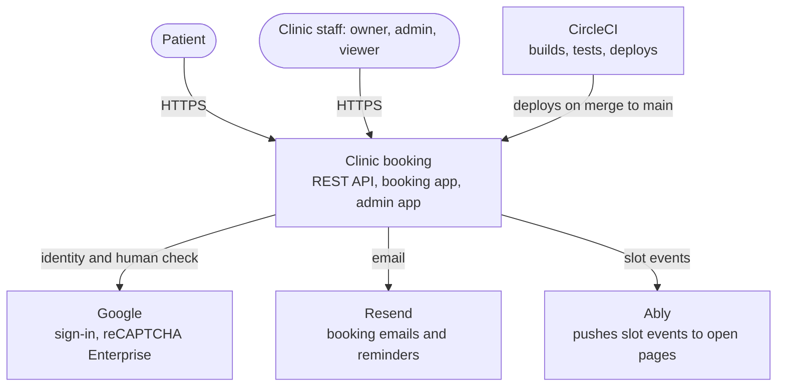
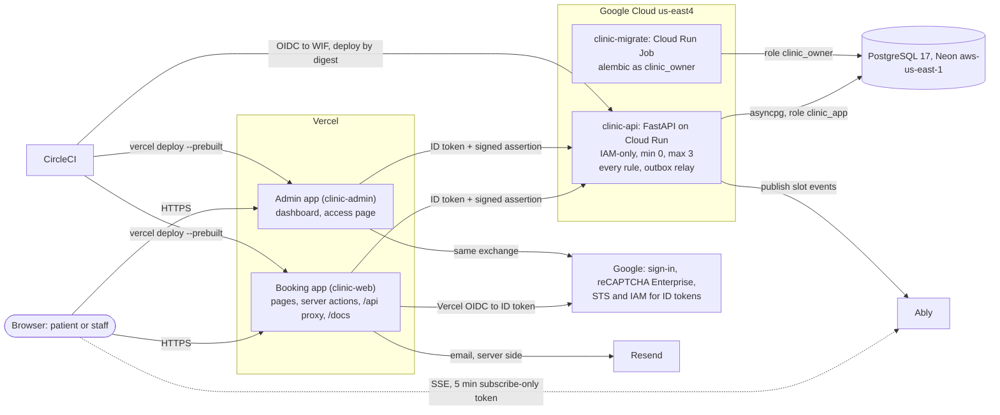
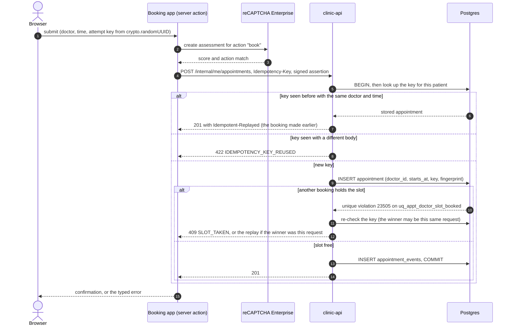
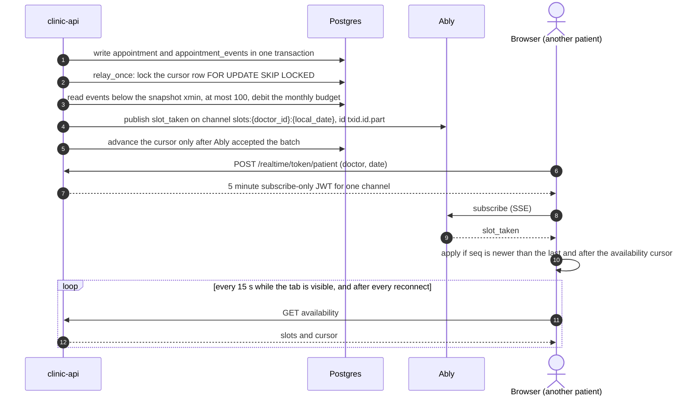
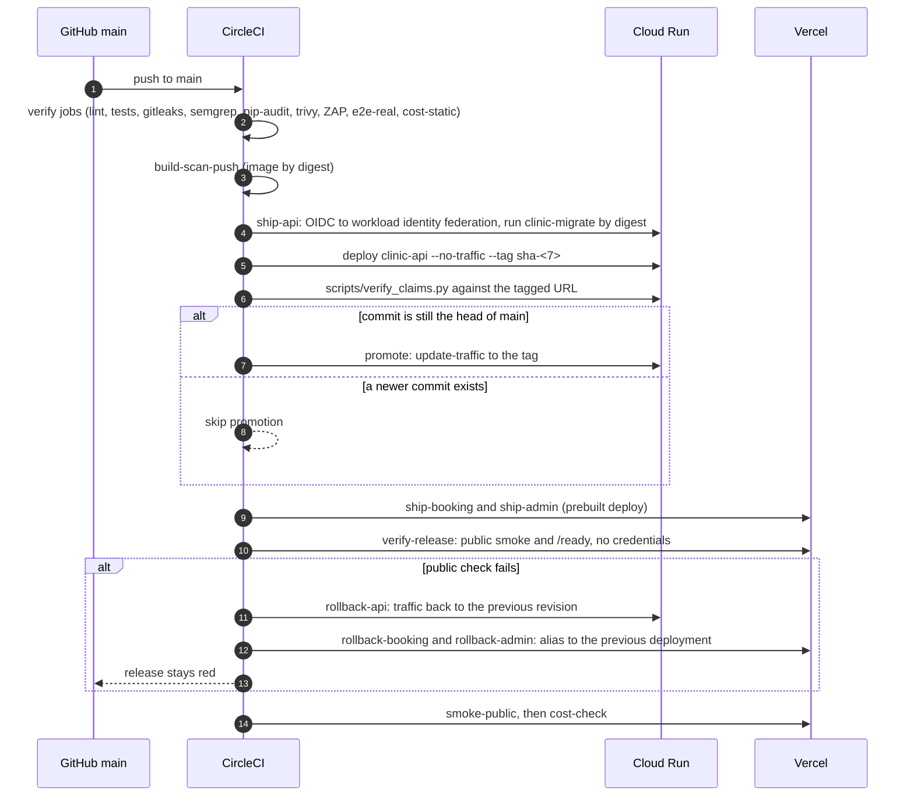

# Architecture overview

Diagrams for the system as built, checked against the code and the ADRs. Names in the diagrams are the real ones (jobs in `.circleci/config.yml`, services in `infra/`, modules under `backend/app/`). Status of each part is in the table after the container diagram, because three parts are described in ADRs and pull requests that may not be running yet.

## 1. Context

## 2. Containers

Reading it:

- **The browser never calls Cloud Run.** The only public entry points are the two Vercel projects. Cloud Run has no `allUsers` invoker; a direct request gets a 403 ([ADR-0023](../adr/0023-zero-cost-edge-front-door.md)).
- **Vercel to Cloud Run uses federation, not a key.** The app exchanges Vercel's OIDC token at Google STS and then calls IAM `generateIdToken` for the `clinic-api` audience (`packages/api/src/proxy/gcp-id-token.ts`). The token is cached until five minutes before it expires.
- **Two layers on `/internal/*`.** The ID token gets the request past IAM. A second, signed assertion (`X-Internal-Assertion`, `packages/api/src/assertion.ts`) says who the caller is and with which role; the API checks it and checks the role again in the database ([ADR-0030](../adr/0030-staff-roles-and-access.md)).
- **The public `/api` proxy** forwards the brief's REST endpoints, denies `/internal` in every spelling, and rate-limits per client at 120 requests a minute per instance (`packages/api/src/proxy/rate-limit.ts`).

### What is running and what is declared

| Part | Status | Where it is described |
|---|---|---|
| FastAPI service, Neon, the two Vercel apps, Google sign-in, reCAPTCHA per action | Running | ADRs 0002, 0014, 0023, 0024, 0029 |
| Idempotency keys, shell-only PWA, 15 second polling | Running | ADRs 0013, 0010, 0009 |
| Resend email and reminders | Declared: PR 27 is open | [ADR-0025](../adr/0025-email-with-resend.md) |
| Outbox relay publishing to Ably | Running (PR 39; Ably's 24 hour count went from 17 to 21 on one booking and one cancel) | ADR-0031 (in PR 29) |
| Browser subscription to the Ably channel, polling as the safety net | Running (PR 44) | ADR-0031 |
| Self-hosted Swagger UI, ReDoc and fonts; production polish; production ZAP and Lighthouse; image prune | Running (PRs 36, 38, 32) | ADRs 0007, 0026, 0017 |
| Go SSE gateway and the admin live feed | Descoped (PR 37 closed) | [ADR-0021](../adr/0021-go-realtime-gateway.md) |

## 3. Booking, with an idempotency key and the unique index

The server action sends the same attempt key for every retry of one attempt and a new key when the doctor or time changes, because the API binds a key to the doctor and time it first came with (`apps/booking/src/components/booking/use-attempt-key.ts`). There is no "is the slot free?" query before the insert: the partial unique index is the arbiter ([ADR-0003](../adr/0003-double-booking-partial-unique-index.md), [ADR-0013](../adr/0013-idempotency-keys.md), `backend/app/services/booking.py`).

## 4. A booked slot reaching other open pages

Push is an optimisation, not the source of truth. The relay runs synchronously after each committing write with a short timeout, because Cloud Run throttles CPU once the response is sent; an event stuck behind an open transaction waits for the next trigger, and the polling loop covers the gap. After three failed publishes the relay stops for a minute. A reload or a poll always shows the database's answer, and a stale click that loses the race still gets `409 SLOT_TAKEN`. Steps 1 to 5 (the relay) and 6 to 7 (the token endpoint) are running (`backend/app/services/relay.py`, `realtime_tokens.py`, `contracts/events/README.md`). The browser subscribing and applying messages, steps 8 to 10, shipped in PR 44. With the push host blocked the page shows `data-stream=polling` and converges within 15 s, and a refused token leaves polling running. The admin live feed is descoped: the relay can publish admin events, and no admin screen reads them.

## 5. The release pipeline

Only `main` can deploy: the deploy contexts are restricted to the branch, and so is the workload identity federation condition, so editing the config on a branch gains nothing ([ADR-0016](../adr/0016-cicd-circleci-keyless-deploy.md)). The release also prunes Artifact Registry to the serving image and the rollback image (the first real run on 2026-10-18 kept exactly those two). The admin half of the web deploy, its rollback and the public checks that follow need `VERCEL_ADMIN_TOKEN` in the `vercel-prod` context (PR 46 split the Vercel token per project); until it is added they have not run on a release. Rollback refuses to go to the placeholder image or when something else has moved traffic ([`docs/runbooks/rollback.md`](../runbooks/rollback.md)).

## 6. Data handling

| Data | Where | Why | Notes |
|---|---|---|---|
| Patient name, optional phone and email, appointments, cancellation reason | Neon Postgres | The product | `appointment_events` is the audit trail; logs carry a `request_id` and no PII ([ADR-0019](../adr/0019-observability.md)) |
| Google subject, verified email, display name | Neon (`patient_accounts`, `staff_access`); a stateless session cookie in the browser | Sign-in and ownership of appointments | Better Auth keeps no auth database ([ADR-0024](../adr/0024-google-sign-in-with-better-auth.md)) |
| reCAPTCHA token | Sent to Google for an assessment, never stored by the app | The human check on book, cancel and reschedule | No secret is stored: the call uses the Vercel identity ([ADR-0029](../adr/0029-booking-flow.md)) |
| Slot events: doctor, local date, start time, `taken` or `freed`, a sequence id | Ably | Live slot lists | No appointment or patient identifier; contract in `contracts/events/`. Running |
| Patient name, doctor and time, sent to the signed-in patient's own verified address | Resend | Acknowledgements and a reminder the evening before, from `reminders@mail.ericgitangu.com` (a verified subdomain) | Only linked, verified accounts are mailed; Resend keeps sent-mail records under its own retention ([ADR-0025](../adr/0025-email-with-resend.md)). Declared: PR 27 is open |

The public REST API has no patient authentication, as the brief requires. Anyone holding an appointment or patient UUID can read or change it there ([ADR-0012](../adr/0012-identity-and-abuse-controls-deferred.md)); the README's section 10 states this.
