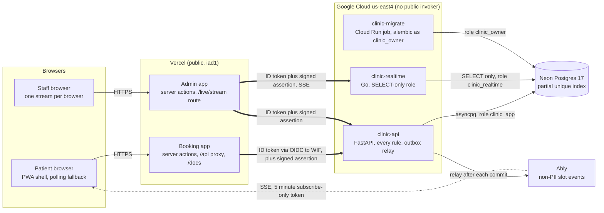
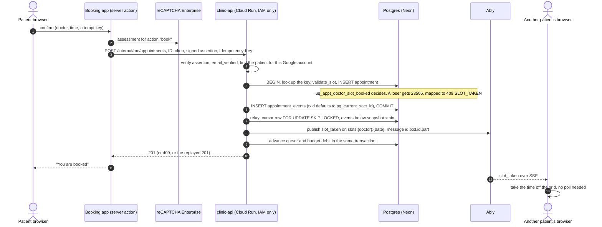
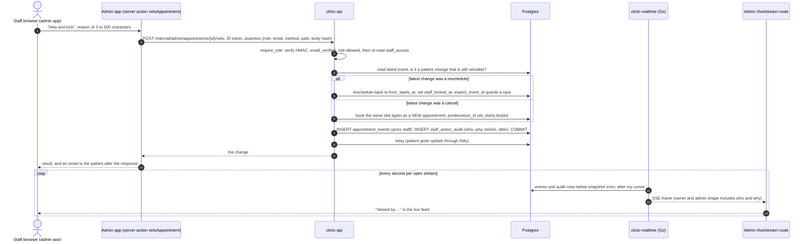

# Idyllic Clinic: interview walkthrough

My notes for the live session, and the source for the generated Interview Walkthrough PDF. The repository keeps this as a reviewer pack, not as product documentation; the README is the source of truth for current status, CI figures and commands.

The code walkthroughs are pinned to `main` at `cc42629` (PR #73, 2026-10-20), so line numbers may drift as the tree moves. The first pass was against `fc14dc4` (PR #66); this refresh checked every code block against `cc42629` with `git show HEAD:<path>` (the first pass had 46 blocks: 40 still matched, 3 had moved and 3 had changed, namely the assertion signer, the relay's drain loop and the booking proxy; the file now has 60, and a script confirmed each one matches its path and lines exactly) and replaced every claim that PRs #67 to #102 made stale. Every code block below is copied from that commit, with its path and line numbers, so the numbers are right for that commit and will drift as main moves. Everything is merged except PR #22 (README section 11), so "not on main" now means only that. Section 4.16 lists what changed since the first pass. The ADRs: read the corrected copy in `docs/internal/adr/` (every audit finding fixed against this code, dated "Amendment, 2026-10-20" paragraphs, plus ADR-0034), not `docs/adr/`, which a planned history rewrite will remove. Figures come from the docs, the CI config or a PR body, and the source is named next to each one. Where I could not check a claim I say so.

Contents

1. The five-minute narrative
2. Architecture tour, request by request
3. Why each runtime and service
4. Core code walkthroughs (16 of them; 4.16 is what changed since the first pass)
5. Infrastructure and delivery
6. Testing strategy
7. Incidents and what I learned
8. Known debt and limits
9. Question bank (reviewer questions with short answers)
10. Demo script

## Read this first: what is on main and what is not

Main is `cc42629`. Every pull request that was open on the first pass (#67, #69, #73, #74, #75, #76, #87, #94, #96, #97) is merged, and so are #98 to #102. The only open one I know of is #22.

| Thing a reviewer may ask about | State | Where |
|---|---|---|
| Replay store for signed assertions, per-person throttle on staff writes | On main (#87): migration `0015_write_guard`, a random `jti` in the MAC, 60 staff writes per 600 s per person | 4.9, `backend/app/services/write_guard.py` |
| App-wide Content-Security-Policy with a per-request nonce, app shell on every route | On main (#74, `310d8f1`) | 4.13, `packages/ui/src/lib/csp.ts`, `apps/booking/src/proxy.ts` |
| Relay waits (up to 0.25 s) for an older open transaction before giving up a pass | On main (#97): `HORIZON_WAIT = 0.25` | 4.7, `backend/app/services/relay.py:129` |
| `/decisions` page, repointed doc links, staleness sweep | On main (#69, #73, #75) | `apps/booking/src/app/decisions/page.tsx` |
| Doctor portraits in the admin app, locked visits in the patient UI, patient avatar for admin | On main (#94, #67) | |
| Fixed-height live feed, row-click test through the row's link | On main (#95, #100) | 4.16, 7.6 |
| Zone label and its contract test | On main (#99) | 4.16 |
| Cost-check waits for both ship jobs; the public smoke is read-only | On main (#101, #102) | 4.16, 5.3, ADR-0034 |
| Go live-feed gateway, one stream per browser, `supportsCancellation`, outbox relay with drain, Ably push, idempotency keys, staff veto and audit, Postman collection | On main | PRs #71, #89, #82, #80/#92, #39/#44, #31, #63, #86 |
| README section 11 (the AI reflection the brief's Section 4 asks for) | **Not on main.** Open PR #22. On main the section is only headings with comments | `README.md` on main, section 11 |

Observed by the engineer on 2026-10-20 (reported to me; I did not re-read it myself and the repo holds no log of it): production runs `f6b4094` with the ship, verify, smoke and ZAP jobs of the release workflow all green (so the `VERCEL_ADMIN_TOKEN` problem of 2026-10-19 is over), and at 22:18 UTC the owner's veto stream was watched working in a real browser (a booking, then a reschedule, then an owner veto, each streamed within seconds). Both are the engineer's own observation, not unverified hearsay; still re-read CircleCI and load the site before the session.

Two things stay open. The synthetic-data purge script (`scripts/ops/purge_synthetic.sh`) has never been run: it flags rows, it never deletes them. And `REALTIME_URL` on the booking project is unchecked: I have not confirmed it is set there.

### Docs on main that disagree with the code

I should not quote these in the session. The first pass found nine; the staleness sweep (#75) and the other docs PRs fixed most. These are what I found still stale at `cc42629`:

| Where | What it says | What is true |
|---|---|---|
| `scripts/cost_check.sh` header, line 13 | `--live` "NOT YET EXECUTED against a real project" | The release workflow runs `cost-check` after `ship-api` and `ship-realtime` (`.circleci/config.yml:1354-1358`) |
| `docs/architecture/overview.md` lines 70 and 132, `docs/engineering/decisions.md` line 41 | Polling "every 15 s" | 60 s while push is healthy, 15 s with backoff when it is not (README 4.3, ADR-0031) |
| `scripts/cost_check.sh` near line 308 | `AR_GO_PACKAGE`: the Go package is "not built yet (#71)" | The check counts the projected Go images only until a `clinic-realtime` package exists; `ship-realtime` pushes it. I did not read the live registry |
| `packages/ui/src/lib/csp.ts` header comment | The inline-script hashes are written by `apps/booking/scripts/csp-hashes.mjs` | The script is `packages/ui/scripts/csp-hashes.mjs` |
| ADR status lines such as "Build status (2026-10-18, main 748d7d8)" in `docs/adr/` | A snapshot | Read the dated amendments below the Decision. The corrected copy, with every audit finding fixed and a 2026-10-20 amendment where a decision changed, is `docs/internal/adr/` |

Fixed since the first pass, so do not repeat the old criticism: the `assertion.py` docstring now documents the replay store; README 4.2 and `decisions.md` no longer say the live feed is descoped; README 9 no longer says main is red on `VERCEL_ADMIN_TOKEN`.

One more thing to know about the repo itself: `docs/adr/` is going to be taken out of the history (the plan is a history rewrite once the remaining work is merged, with the curated `/decisions` page, which is on main, replacing it for reviewers). My reference copy is `docs/internal/adr/`. It is untracked like this file. Until the rewrite, reviewers can read `docs/adr/` as it is, stale status lines included, so I should know both.

## How the brief maps to what is in the repo

The brief (Savannah Informatics, Backend Developer Take-Home, 3 to 5 days, "AI tools permitted and expected") has four sections.

| Brief | Where it lives |
|---|---|
| Section 1, system design in the README before code | README sections 3 and 4, ADR-0001 to ADR-0008 |
| Section 2, `POST /appointments`, `GET /doctors/{id}/availability`, `PATCH /appointments/{id}/cancel`, `PATCH /appointments/{id}/reschedule`; bonus `GET /patients/{id}/appointments` and "prevention of bookings within 1 hour of now" | `backend/app/api/routers/`, the public base is `/api` on the booking site (README 5) |
| Section 3, public URL, tests on every PR, auto-deploy on merge | CircleCI `pr` and `release` workflows; `https://clinic.ericgitangu.com` |
| Section 4, AI reflection | README section 11, which is mine to write (PR #22) |

The brief says "when requirements are ambiguous, make a decision and note it" and "we evaluate how you think". That is why README section 8 is a list of decisions and why the ADRs name what each choice costs.

## 1. The five-minute narrative

Say this out loud once before the session. It is meant to take about five minutes at a normal pace.

**What the brief asked for.** A small clinic with five doctors, each with working hours, booked in 30-minute slots. A patient sees which slots are free for a doctor on a day, picks one and books it. Once booked, nobody else can have it. A patient can cancel, and a cancelled slot is bookable again. Four endpoints are required: book, availability, cancel, reschedule. The bonus is a patient's upcoming appointments and no bookings within an hour of now. Then deploy it, run tests on every pull request, deploy on merge, and write down how I used AI.

**What I built.** A FastAPI service on Cloud Run with Postgres on Neon that owns every rule. Two Next.js apps on Vercel sit on top of it: a booking app for patients and an admin app for clinic staff. A small Go service streams a live feed of bookings to the staff dashboard. Patients' open pages learn about taken slots through Ably. CircleCI tests every pull request and, on merge to main, deploys the API, the Go service and both apps, with a smoke test and an automatic rollback.

I built more than the brief asked for. I will say which parts those are, and what each one costs, before anyone has to ask.

**The decisions that define it.**

1. **The database decides who gets the slot.** A partial unique index on `(doctor_id, starts_at) WHERE status = 'booked'`. There is no "is it free?" query before the insert, because any such query is a window for a race. The insert either works or the engine raises a unique violation, and I map that to `409 SLOT_TAKEN`. I do not just claim it holds under concurrency: a test fires 25 simultaneous requests at one slot, 10 times over, asserts exactly one 201, and a control run against a database with the index dropped shows a check-then-insert implementation double-books. Source: ADR-0003, ADR-0018, `backend/tests/concurrency/`.
2. **One system of record, and nothing public can bypass it.** Every rule lives in FastAPI. The Next.js apps are clients of the same API. Cloud Run has no public invoker, so the only way in is through Vercel, which proves its identity with a short-lived federated token. That is also how the project stays near $0: Cloud Run egress is only free inside North America, so the browser never talks to it directly. Source: ADR-0002, ADR-0014, ADR-0023.
3. **Live updates are an optimisation, never the source of truth.** A booking writes an event row in the same transaction. After the commit, a relay publishes it to Ably for patients, and a small Go service reads the same table for staff. If push fails, pages poll, and a stale click still loses cleanly with a 409. Source: ADR-0009, ADR-0031, ADR-0021.
4. **Releases are reversible.** Every deploy is a tagged Cloud Run revision with no traffic. It gets a smoke test on its own URL, and traffic moves only if the commit is still the head of main. After the web apps ship, a check from the public internet runs, and if it fails the pipeline moves traffic back to the previous revision. Migrations are expand-only so the old revision still runs. Source: ADR-0015, ADR-0016, `docs/runbooks/rollback.md`.
5. **The one-hour rule has two error codes on purpose.** `422 BOOKING_TOO_SOON` when the time you ask for is too soon, `409 CHANGE_TOO_LATE` when the visit you are changing starts within the hour. The brief only says "prevention of bookings within 1 hour of now"; applying it to cancel and reschedule is my extension, and I say so in the README. Source: ADR-0008 amendment.

**What I would tell them is not done.** The public REST API has no patient authentication because the brief's endpoints are unauthenticated and Swagger "Try it out" has to work. That leaves an IDOR on the public path, disclosed in README section 10 and ADR-0012; the signed-in screens close it only for the web path. The live feed holds at most two staff viewers at once. And "$0" is not literally true: the project shares a billing account whose other projects already use up the Secret Manager and Artifact Registry free tiers, so this one bills about $0.35 a month (README section 10), under a $0.50 ceiling that `scripts/cost_check.sh` enforces.

## 2. Architecture tour, request by request

### The map



Three trust boundaries to keep in your head: the browser never calls Cloud Run; Vercel proves who it is to Google with a federated token (no key stored anywhere); and the API still checks who is acting with a signed, request-bound assertion and re-reads the role from the database.

### 2.1 A patient books



What to say while pointing at it:

- Steps 4 and 5 are one transaction. The event row cannot exist without the appointment, and the other way round.
- The relay runs after the commit and before the response. I do not use a background task because Cloud Run throttles CPU once the response is sent (`relay.py` docstring). The cost is that a booking waits for the relay, so the relay has a hard 2-second budget, a loser path that returns at once, and a circuit breaker.
- Another patient's page is told about the taken slot, but that is only a hint. If the stale page clicks anyway, the unique index answers 409 and the page refetches.
- Source for the flow: `docs/architecture/overview.md` sections 3 and 4, `backend/app/services/booking.py`, `backend/app/services/relay.py`.

### 2.2 A staff veto

A veto means: the patient changed their own appointment, the clinic disagrees, staff undo the change and lock the appointment so the patient cannot change it again until an owner or admin unlocks it. ADR-0033 has the rules.



Points to make:

- The veto reuses `booking.reschedule` and `booking.book` with a staff flag. It does not have its own copy of the booking rules (ADR-0033, option 3 rejected for exactly that reason). The staff flag lifts the lead-time rule and nothing else.
- The audit row and the event are written in the same transaction as the change. The application role has SELECT and INSERT on the audit table, UPDATE on its single `notified` column, and no DELETE (migration `0009_staff_crud_invites.py:74-76`).
- The Go service never sees the veto request. It only reads the rows the API committed. That is the whole point of keeping it read-only.
- This was observed end to end on production twice on 2026-10-20. First at `649103c` (ADR-0021, consequences): a patient's booking reached the admin feed about 4 seconds later, a reschedule streamed as "Rescheduled ... (was 13:30)", and the owner's veto streamed as "Vetoed by ..." with the row showing "Locked by staff" while the patient side went back to 13:30. Then again at 22:18 UTC, in a real browser, on production at `f6b4094`: a booking, then a reschedule, then an owner veto, each streamed within seconds. That second observation was made by the engineer (reported to me; no log or screenshot in the repo), so rehearse it again before the session (demo D).

### 2.3 The one-hour rule

One helper, `require_lead_time` in `backend/app/domain/booking_rules.py`, called from every operation. The lead time is `BOOKING_MIN_LEAD_MINUTES`, default 60, and exactly 60 minutes away is allowed.

| Operation | Which time is tested | Refused with |
|---|---|---|
| Availability | each slot's start | never offered inside the window |
| Book | the new start | `422 BOOKING_TOO_SOON` (and `422 SLOT_IN_PAST` first if it is already past) |
| Cancel | the appointment's current start | `409 CHANGE_TOO_LATE` |
| Reschedule | the current start first, then the new start | `409 CHANGE_TOO_LATE` for the current, `422 BOOKING_TOO_SOON` for the new |
| Reschedule to the time it already has | none | `200`, a no-op, so a retry of a move that happened still succeeds |
| Staff (owner, admin) | not tested | exempt from both codes; every other check still applies (ADR-0033) |

Why two codes. This is the answer I would give, and it is in ADR-0008's amendment of 2026-10-18 and the README status rule (404 the path resource does not exist, 422 well-formed but resending unchanged can never succeed, 409 conflicts with current state):

- A *new time* that is too soon is a validation failure of the request, exactly like a fresh booking. The brief says a reschedule's new slot is "validated as you would for a fresh booking", so it must give the same code as `POST /appointments`: 422.
- A *visit that is too near to change* is the state of the existing resource forbidding the operation. That is the same family as `APPOINTMENT_ALREADY_CANCELLED` and `APPOINTMENT_ALREADY_STARTED`, which are 409s. I did not reuse `APPOINTMENT_ALREADY_STARTED` because it would be untrue before the start.
- The weak point of the 409 argument: ADR-0008 says the answer "changes as time passes", but once a visit is inside the hour, waiting makes the refusal permanent. Be straight about that if pressed. The defence is consistency with the other resource-state conflicts and that the two codes let a client tell "pick another time" from "ring the clinic".
- The earlier version of #59 answered 409 for a too-soon new time as well. The brief-compliance review I ran (`docs/internal/BRIEF_COMPLIANCE.md`, finding on #59) caught that against the brief's wording and I changed it on 2026-10-19. The same review caught that the PR quoted "no changes within 1 hour" as if it came from the brief. It does not. The brief only says "Prevention of bookings within 1 hour of now"; applying it to cancel and reschedule is my extension.
- A visit inside the hour stays booked and keeps holding its slot. Patients cannot change it in the app; they ring the clinic. Staff can, because they are exempt (ADR-0008 corrections of 2026-10-19).

### 2.4 Idempotency keys

Only `POST /appointments` and `POST /internal/me/appointments` read an `Idempotency-Key`, one to 255 visible ASCII characters.

- The key and a fingerprint (sha256 of canonical JSON of the doctor and the start in UTC) are stored on the appointment row. There is no keys table and no expiry job: a key lives exactly as long as its booking (migration `0005_idempotency_keys.py`).
- Uniqueness is `(patient_id, idempotency_key)`, so two people can never collide on a key.
- Same key and same fingerprint and the appointment is still booked: `201` with the current appointment and `Idempotent-Replayed: true`. Same key and a different doctor or time: `422 IDEMPOTENCY_KEY_REUSED`. Same key for an appointment that has since left `booked`: `409 IDEMPOTENCY_KEY_CONSUMED`.
- The replay is answered before any validation, so a retry after the slot has since passed still returns the booking it made.
- If the insert hits any unique violation, the service looks the key up again before it reports a conflict, because Postgres may name the doctor-slot index even when the real cause is a duplicate of this very request. Without that, a lost response would read as "your slot was taken" to the person who holds it.
- The booking app creates one attempt key per booking dialog and sends the same one on every retry, and a new key when the doctor or time changes (`apps/booking/src/components/booking/use-attempt-key.ts`, per `overview.md`).
- Reschedule has no key: moving to the time it already has returns 200 as a no-op (ADR-0013 amendment).

### 2.5 RFC 9457 problem+json

Every non-2xx response is `application/problem+json` with `type`, `title`, `status`, `detail`, `instance`, `code`, `request_id` and an `errors` list for validation. `code` is a closed catalogue in `backend/app/domain/errors.py`, and `docs/api-errors.md` is checked against it by `tests/unit/test_error_catalogue.py`. `type` is a URL under `/problems/<slug>` that resolves.

Things worth knowing: a request that fails validation because the datetime has no offset becomes `422 TIMEZONE_REQUIRED` rather than a generic validation error; Starlette's 400 for an unparseable body is turned into 422 because "we never emit 400" (found by schemathesis); any unhandled exception becomes a `500 INTERNAL_ERROR` that carries the `request_id` and nothing else, and the trace is logged with that id and no bound parameters; a database outage is `503 DB_UNAVAILABLE` with `Retry-After: 2`.

## 3. Why each runtime and service

Four runtimes is a cost for an app this size, so each has to earn its place. The README says the same (section "Why each runtime"): each does one job that the others would do worse under three constraints, correct booking, no personal data outside Google Cloud, and $0 to run. For every item: what it does here, the alternative I turned down, and what I accepted by choosing it.

### Python and FastAPI (the system of record)

- **Job.** Every rule and every write: working hours, the 30-minute grid, the one-hour rule, the unique index mapping, idempotency, the problem+json errors, the outbox, staff audit. The apps and the Go service never write.
- **Rejected.** Django REST Framework; FastAPI plus a Go service in the write path (ADR-0002). The brief also allows a Go API; the ADR does not weigh a Go-only API, so do not claim it did. I picked the one where the OpenAPI document comes from the typed models, because the TypeScript client is generated from it. A Go availability service would put the uniqueness invariant on the far side of a network boundary.
- **Accepted.** Python cold starts are slower than Go's. I mitigate with `--cpu-boost`, a lazily created engine, lean imports and a single uvicorn worker, and I have not measured the result (ADR-0002, README 4.1). No `/v1` prefix, so a breaking change later means a `/v2`.
- **Layering.** `api/` parses and serializes, `services/` owns the transaction, `domain/` is pure with no I/O, `repositories/` holds SQL and the SQLSTATE mapping. That is why `slots.py` and `booking_rules.py` can be unit-tested without a database.

### TypeScript and Next.js (two thin apps and their servers)

- **Job.** The booking app for patients and the admin app for staff, each a Next.js app on Vercel. Their server side is the BFF: it holds the Google sign-in, runs the reCAPTCHA check, mints the Cloud Run token, and signs the assertion. They carry no booking rules.
- **Rejected.** One app with an `/admin` route group, or two repositories (ADR-0027); tRPC, GraphQL and gRPC (ADR-0007: the brief says REST, tRPC needs a TypeScript server, GraphQL hides status codes); a hand-written client.
- **Accepted.** Two Vercel projects to keep in step. A pinned 0.x code generator (`@hey-api/openapi-ts`); the lint job regenerates the client and fails on any diff, so a contract change the UI has not picked up cannot merge (ADR-0011). More server-side code means more surface to review.

### Go (the staff live feed)

- **Job.** `services/realtime` streams the booking log to the staff dashboard over server-sent events. Read-only: its database role has column-level SELECT and no write privilege, and a test fails if any Go source sends a non-SELECT statement.
- **Rejected.** SSE inside FastAPI (streams would share `clinic-api`'s concurrency with `POST /appointments`); a managed provider for staff events (staff events carry patient names and cancellation reasons, which I want inside Google Cloud); a second Python service (the cost of a second deploy unit without the runtime advantage). Source: ADR-0021.
- **Accepted.** A second toolchain: a `go-quality` job, an image scan, `ship-realtime`, a rollback job. Cloud Run bills an instance while a stream is open and requires concurrency 1 below 1 vCPU, so the service runs at most two instances and two staff can watch at once.
- **The honest part.** The usual argument for Go is cheap idle connections. At two viewers that argument does not apply, and I have not measured it (README, "Why each runtime"). What I do rely on: a small static image (the pipeline refuses one over 25,000,000 bytes), a fast cold start on a scale-to-zero service, the standard library covering HTTP, SSE and HMAC, and isolation from the API's concurrency.
- **How it was decided.** I first designed the gateway. A later plan moved everything to Ably and marked Go superseded without my sign-off. I reversed that on 2026-10-19 because the staff view needs names and those should not leave Google Cloud. If they ask, that is the true story and it is in README 3.7.

### Ably (patient slot events)

- **Job.** Tell other patients' open pages that a time was taken or freed. Events carry only `doctor_id`, `local_date`, `starts_at`, `kind` and `seq` (`backend/app/schemas/events.py`, `extra="forbid"`; a test fails if a field name hints at a person).
- **Rejected** (ADR-0031 table): Cloudflare Durable Objects over WSS (held in reserve as the move if Ably's terms change); Go on Cloud Run for patients too (a compute cost and an operational surface of my own); Vercel function SSE (bounded at 5 minutes per connection and billed per open viewer); Upstash Redis (not a browser fan-out service); Pusher (half the free connections); Supabase Realtime (ties push to a second backend).
- **Accepted.** A new data processor, though it sees only non-personal events. Ably counts a published message as one plus one per subscriber, so the monthly count grows with viewers. The provider documents nothing at the monthly cap, so I cap my own publishing at 25,000 a month; with at most 200 subscribers that is 25,000 x 201 = 5,025,000, under the 6,000,000 free allowance (ADR-0031). The relay runs on the request path instead of an always-on worker, which is the price of having no always-on resource.

### Neon (Postgres 17)

- **Job.** The one database. Its features carry design weight: partial unique indexes, `xid8` and `pg_snapshot_xmin` for the outbox cursor, `citext`, `timestamptz`.
- **Rejected.** Cloud SQL (an always-on cost, so not $0); Neon in Frankfurt (a continent away from Cloud Run); SQLite for tests (forbidden: a mock cannot show a unique violation under contention). Source: ADR-0014, ADR-0003.
- **Accepted.** Neon Free: 100 CU-hours a month, compute fixed at 0.25 CU, and it suspends rather than bills when the hours run out (ADR-0014). An always-awake 0.25 CU would use 186 CU-hours a month (744 x 0.25, deduced), so scale-to-zero must keep working and nothing may ping the database on a schedule. That is why `/health` never touches the database and `/ready` does. I use the direct endpoint, not the pooler; moving to the pooler needs asyncpg's statement cache turned off, which I have not verified (README 4.1). One Postgres primary is the ceiling at 100x.

### Cloud Run (API, gateway, migrations)

- **Job.** Runs `clinic-api` (min 0, max 3, concurrency 80, 1 vCPU, 512Mi), `clinic-realtime` (min 0, max 2, concurrency 1, 0.25 vCPU, 256Mi, gen1) and the `clinic-migrate` job. Settings are in section 5.
- **Rejected.** A public Cloud Run in `africa-south1` or `europe-west3`. Egress from Cloud Run to a browser in Kenya is billed from byte 0 whichever region it runs in; the only free egress tier is North America to North America (ADR-0023, from the Cloud Billing Catalog on 2026-10-16). My own default region for GCP work is `africa-south1`, and I chose `us-east4` anyway, next to Neon in `aws-us-east-1`, because the $0 rule was mine and the database needs to sit beside the API (four to six round trips per booking).
- **Accepted.** An estimated 100 to 150 ms more per warm request for Kenyan users than a Frankfurt layout (an estimate, not measured). Cold starts. And the project shares a billing account, so it is not literally $0 (README 10).

### Vercel (front door and both apps)

- **Job.** The only public entry. It serves both Next.js apps, proxies `/api/*` to Cloud Run with a minted Google ID token, and serves `/docs`, `/redoc` and `/openapi.json` from static builds so a reviewer's first click never costs Cloud Run egress.
- **Rejected.** A public Cloud Run with `allUsers` invoker (any hit from Kenya bills Africa egress); `--no-invoker-iam-check` (silently undoes the gating, so `scripts/cost_check.sh` bans it).
- **Accepted.** Hobby limits, which pause rather than bill: a function cap of 300 s (this sets the gateway's 290 s stream lifetime), 1M invocations, 100 GB transfer. A held stream bills provisioned memory, so the stream route is set to 256 MB (`apps/admin/vercel.json`); ADR-0014 notes it is unverified whether Hobby honours a memory setting below its default. The CI token for Vercel is long-lived, the one long-lived credential in the delivery path (ADR-0016).

### CircleCI

- **Job.** Tests on every pull request; on main, build, scan, migrate, deploy by tag, smoke, promote, verify, roll back.
- **Rejected.** GitHub Actions: unavailable to me because of a billing issue on the account (README 9; the repository stays on GitHub). Cloud Build (a second CI system). A long-lived service-account JSON key (ADR-0016).
- **Accepted.** `.circleci/config.yml` can be edited by anyone who can push a branch, so a `when:` clause in it protects nothing. The protection is outside the file: the deploy contexts are restricted to `main`, and the workload identity federation condition on GCP names the project, the repository, `refs/heads/main` and the `gcp-deploy` context id (`infra/terraform/wif.tf:6-13`). Free-plan credits are a budget: medium machines cost twice the credits of small, which is why only the jobs that were OOM-killed moved up (#83, #85).

### Smaller choices you may be asked about

- **Better Auth with Google and stateless cookies** (ADR-0024). Auth.js v5 was a beta; roles in the cookie cannot be revoked early, so the role is looked up on every request instead. Cost: one table lookup per request.
- **reCAPTCHA Enterprise per action, called from the server** (ADR-0022, ADR-0029). The browser gets a token, the booking server creates the assessment, and it authenticates with the Vercel identity so no secret is stored. Turnstile was designed and never built.
- **Resend for email** (ADR-0025), called after the response with a 5-second abort, daily 100 and monthly 3,000 caps reserved in the database before a send (README 3.1). A failed email never fails a booking.
- **Terraform** for IAM, secrets containers, registry, alerting and the two identity pools. Cloud Run services are deliberately not in Terraform: `infra/plan_gate.sh` and the cost check ban every Cloud Run resource there, so no plan can loosen a cost setting.
- **Two database roles** (ADR-0015): `clinic_owner` runs migrations, `clinic_app` has no DDL, no DELETE grant, and cannot rewrite `alembic_version` (migration `0001_initial.py:134-140`). A third, `clinic_realtime`, is SELECT-only on named columns.

## 4. Core code walkthroughs

Each walkthrough has the real code (copied by path and line from `main` at `cc42629`) and then four short parts: what it does, why it is written this way, what would break otherwise, and the question I expect with my answer.

### 4.1 The double-booking guard

`backend/migrations/versions/0001_initial.py:77-105`

```python
    op.execute("""
        CREATE TABLE appointments (
          id                   uuid PRIMARY KEY DEFAULT gen_random_uuid(),
          doctor_id            uuid NOT NULL REFERENCES doctors(id),
          patient_id           uuid NOT NULL REFERENCES patients(id),
          starts_at            timestamptz NOT NULL,
          ends_at              timestamptz NOT NULL,
          status               text NOT NULL DEFAULT 'booked',
          cancellation_reason  text NULL,
          cancelled_at         timestamptz NULL,
          created_at           timestamptz NOT NULL DEFAULT now(),
          updated_at           timestamptz NOT NULL DEFAULT now(),
          CONSTRAINT ck_appt_status    CHECK (status IN ('booked','cancelled')),
          CONSTRAINT ck_appt_duration  CHECK (ends_at = starts_at + interval '30 minutes'),
          CONSTRAINT ck_appt_alignment CHECK ((extract(epoch FROM starts_at))::numeric % 1800 = 0),
          CONSTRAINT ck_appt_cancel_consistency CHECK (
               (status = 'booked'    AND cancelled_at IS NULL     AND cancellation_reason IS NULL)
            OR (status = 'cancelled' AND cancelled_at IS NOT NULL
                AND length(btrim(cancellation_reason)) BETWEEN 3 AND 500))
        );
    """)
    op.execute(
        "CREATE UNIQUE INDEX uq_appt_doctor_slot_booked "
        "ON appointments (doctor_id, starts_at) WHERE status = 'booked';"
    )
    op.execute(
        "CREATE UNIQUE INDEX uq_appt_patient_slot_booked "
        "ON appointments (patient_id, starts_at) WHERE status = 'booked';"
    )
```

`backend/app/repositories/errors.py:30-44`

```python
_UNIQUE_MAP: dict[str, type[DomainError]] = {
    "uq_appt_doctor_slot_booked": SlotTaken,
    "uq_appt_patient_slot_booked": PatientDoubleBooked,
    "uq_patients_phone": PatientPhoneExists,
}


def map_integrity_error(exc: BaseException) -> DomainError:
    """Map a known unique violation to its DomainError, else re-raise (-> 500)."""
    sqlstate, constraint = extract_sqlstate_constraint(exc)
    if sqlstate == UNIQUE_VIOLATION and constraint == IDEMPOTENCY_KEY_CONSTRAINT:
        raise IdempotencyKeyRaced() from exc
    if sqlstate == UNIQUE_VIOLATION and constraint in _UNIQUE_MAP:
        return _UNIQUE_MAP[constraint]()
    raise exc
```

`backend/tests/concurrency/test_race_same_slot.py:39-59`

```python
    overall_peak = 0
    for slot in slots:

        async def task(client: httpx.AsyncClient, i: int, slot: str = slot) -> httpx.Response:
            return await client.post(
                "/appointments",
                json={"doctor_id": OTIENO, "patient_id": patients[i], "starts_at": slot},
            )

        async with LockSampler() as sampler:
            responses = await race(app, task, N)
        overall_peak = max(overall_peak, sampler.peak)

        created = [r for r in responses if r.status_code == 201]
        conflicts = [r for r in responses if r.status_code == 409]
        assert len(created) == 1, [r.status_code for r in responses]
        assert len(conflicts) == N - 1
        assert all(r.json()["code"] == "SLOT_TAKEN" for r in conflicts)
        assert await count_booked_at(OTIENO, slot) == 1

    assert overall_peak >= 5, f"expected >= 5 blocked waiters, saw {overall_peak}"
```

**What it does.** The `appointments` table pins what a slot is: `ck_appt_duration` says `ends_at` is exactly `starts_at` plus 30 minutes, and `ck_appt_alignment` says the start is a multiple of 1,800 seconds since the epoch. Two partial unique indexes then say a doctor cannot have two booked rows at one start (`uq_appt_doctor_slot_booked`) and a patient cannot be in two places at one instant (`uq_appt_patient_slot_booked`). Both are `WHERE status = 'booked'`, so a cancelled row drops out of the index and the slot is free again while the history stays. The repository maps a unique violation (SQLSTATE 23505) to a domain error by constraint name: the doctor index to `SlotTaken` (409), the patient index to `PatientDoubleBooked` (409). There is no "is it taken?" query in the booking path.

**Why this way.** `SELECT ... FOR UPDATE` cannot lock a row that does not exist yet, and any check followed by an insert has a window. The engine is the one thing every instance shares, so it should be the arbiter (ADR-0003, option 1; the other options were an `EXCLUDE USING gist` constraint, SERIALIZABLE with retries, advisory locks, and check-then-insert). Because the CHECKs fix the duration and alignment, "same `starts_at`" is the same thing as "overlapping", so a plain btree index is enough. The partial indexes are written as raw SQL because Alembic autogenerate is not trusted for them, and a test asserts the constraint names exist, since the names are now part of the contract (`test_constraints_exist.py`, `test_constraint_name_path.py`).

**What would break otherwise.** Without the index, two concurrent POSTs for one slot both read "free" and both insert. I did not leave that as an argument: `backend/tests/concurrency/test_naive_control.py` creates a second database, drops this index, runs a check-then-insert `NaiveBookingService` with a `pg_sleep(0.1)` between the check and the insert behind the same barrier, and asserts more than one booked row. Without the two CHECKs, a 45-minute booking at 09:15 would overlap a neighbour without sharing its start, and the index would never see it.

**How I know it holds.** The race test above (25 requests released at an `asyncio.Barrier`, over 10 slots, `DB_POOL_SIZE=30` so all 25 are in flight) asserts exactly one 201 and 24 `SLOT_TAKEN`, one booked row, and that the sampler saw at least 5 transactions blocked on the uniqueness check at once, which is direct evidence the requests overlapped. A test that would pass with sequential requests proves nothing, so the harness fails if it stops racing (ADR-0018). The same shape on production: 20 parallel `POST /api/appointments` gave one 201 and 19 409s on 2026-10-18 (README section 2).

**The question you'll get.** "Why not an exclusion constraint on a `tstzrange`?" It is the right tool the day slots stop being fixed, and it is the migration path (ADR-0003 review trigger: variable durations, or a clinic in a non-half-hour offset such as +05:45, where the epoch-modulo CHECK stops meaning "on the half hour"). It needs `btree_gist`; I checked on the live Neon project on 2026-10-18 that the extension is available (1.7) but not installed. For fixed 30-minute slots the btree index is the smaller mechanism and there is nothing to install. I name the cost: the guarantee is correct only for fixed, aligned slots.

### 4.2 Computed slots

`backend/app/domain/slots.py:26-49`

```python
def grid_for_date(
    windows: Sequence[Window], tz: ZoneInfo, local_date: date, slot: timedelta = SLOT
) -> list[datetime]:
    """Aligned slot starts (UTC) for the date, before lead/booked filtering.

    De-duplicated by clinic-local wall time, so a fall-back repeated hour yields one slot.
    """
    starts: list[datetime] = []
    seen_local: set[tuple[int, int]] = set()
    for start_t, end_t in windows:
        start_utc = datetime.combine(local_date, start_t, tzinfo=tz).astimezone(UTC)
        end_utc = datetime.combine(local_date, end_t, tzinfo=tz).astimezone(UTC)
        cur = start_utc
        while cur + slot <= end_utc:
            local_wall = cur.astimezone(tz)
            # A slot start derived from a real UTC instant always round-trips; the spring-
            # forward gap never appears because UTC stepping jumps over it.
            key = (local_wall.hour, local_wall.minute)
            if key not in seen_local:
                seen_local.add(key)
                starts.append(cur)
            cur += slot
    starts.sort()
    return starts
```

`backend/app/domain/slots.py:98-108`

```python
    intervals = _utc_intervals(booked)
    threshold = now.astimezone(UTC) + lead
    out: list[Slot] = []
    for start in grid_for_date(windows, tz, local_date, slot):
        end = start + slot
        if start < threshold:
            continue
        if _overlaps(start, end, intervals):
            continue
        out.append(Slot(starts_at=start, ends_at=end))
    return out
```

**What it does.** For one clinic-local date, `grid_for_date` walks each working window in 30-minute steps in UTC, not in local time, and de-duplicates by clinic-local wall time. `generate_slots` then drops any candidate that starts before `now + lead` and any candidate whose `[start, start + slot)` overlaps a booked interval. A sibling, `taken_starts`, returns the grid slots that are booked, so the UI can show them as inactive instead of letting the patient click and lose.

**Why this way.** Slots are computed, not stored (ADR-0004): the brief's working hours stay the only source of truth, so there is no slot table to drift, no generator job, and no migration when hours change. It is a pure function with no I/O, which is why the pure domain package can be held to a 95% coverage gate by unit tests alone (`.circleci/config.yml:164`). Stepping in UTC means a spring-forward gap never appears (UTC jumps over it) and a fall-back repeated hour yields one slot. Overlap is tested with intervals rather than equality so the function stays right if the slot length differs from the length the bookings were made with; production wires only 30 minutes.

**What would break otherwise.** A materialised slot table needs a job to fill it and a way to keep it in step with hours and bookings. Stepping in local time breaks on DST days; the unit tests cover Berlin spring-forward and fall-back because Nairobi has no DST (ADR-0005).

**The cost.** There is no slot row to lock, which is the reason uniqueness has to live on the appointment (4.1). Say that sentence unprompted; it connects the two decisions.

**The question you'll get.** "What happens to existing bookings when a doctor's hours change?" Hours are rows in `working_hours`, and I did not build an editor. A booking is not touched; from reading `grid_for_date` it would stop appearing on the grid if it fell outside the new windows, but I have not tested that case, so I say it is deduced.

### 4.3 The time and timezone model

`backend/app/services/availability.py:35-55`

```python
    tz = ZoneInfo(clinic.timezone)
    now = clock.now()
    today_local = now.astimezone(tz).date()
    if on_date > today_local + timedelta(days=settings.BOOKING_HORIZON_DAYS):
        raise DateOutOfRange()

    weekday = on_date.isoweekday()
    windows = [
        (wh.start_time, wh.end_time)
        for wh in await working_hours_for(session, doctor_id)
        if wh.weekday == weekday
    ]

    day_start = datetime.combine(on_date, time.min, tzinfo=tz).astimezone(UTC)
    next_day_start = datetime.combine(on_date + timedelta(days=1), time.min, tzinfo=tz).astimezone(
        UTC
    )
    booked = await booked_intervals_for_doctor(session, doctor_id, day_start, next_day_start)

    lead = timedelta(minutes=settings.BOOKING_MIN_LEAD_MINUTES)
    slots = generate_slots(windows, booked, tz, on_date, now, lead)
```

`backend/app/schemas/common.py:42-53`

```python
# A string-only aware datetime: numbers/objects -> VALIDATION_ERROR; naive -> TIMEZONE_REQUIRED.
# AwareDatetime must sit next to datetime; the str guard wraps it (runs first on input).
StrAwareDatetime = Annotated[
    datetime, AwareDatetime, BeforeValidator(_require_str), AfterValidator(_representable_in_utc)
]

# Output instants for resources that belong to no clinic (a patient's created_at, a staff grant),
# rendered in the configured default zone. Stays a date-time in the schema (return_type=datetime).
ClinicDatetime = Annotated[
    datetime,
    PlainSerializer(lambda d: d.astimezone(default_zone()), return_type=datetime, when_used="json"),
]
```

`backend/app/core/clock.py:13-34`

```python
class Clock(Protocol):
    def now(self) -> datetime:
        """Return an aware UTC instant."""
        ...


class SystemClock:
    def now(self) -> datetime:
        return datetime.now(UTC)


class FakeClock:
    """A fixed clock for tests. ``FakeClock(datetime(2026,10,19,4,0,tzinfo=UTC))`` is
    Monday 07:00 EAT."""

    def __init__(self, fixed: datetime) -> None:
        if fixed.tzinfo is None:
            raise ValueError("FakeClock requires an aware datetime")
        self._fixed = fixed.astimezone(UTC)

    def now(self) -> datetime:
        return self._fixed
```

**What it does.** Storage is UTC `timestamptz`. The clinic's zone is data (`clinics.timezone`, `Africa/Nairobi` in the seed) read through the doctor, so a second clinic needs no code change. "A day" means the clinic-local day: the service builds `[D 00:00, D+1 00:00)` in the clinic zone, converts both ends to UTC, and asks for the booked intervals in that range. Input must be RFC 3339 with an offset: a non-string is a `VALIDATION_ERROR`, a naive string is `422 TIMEZONE_REQUIRED` (the handler maps pydantic's `timezone_aware` error), never a guess. Output is rendered in the clinic zone with a `timezone` field (`ClinicZoned`). Things with no clinic, such as a patient's `created_at` or a staff grant, use the configured default zone (`backend/app/core/clinic_zone.py`).

**The clock.** The current time comes from an injected `Clock`. Ruff bans `datetime.now`, `utcnow`, `today` and `time.time` everywhere outside `app/core/clock.py` (`backend/pyproject.toml:56-61`), so a test pins time with a `FakeClock` and passes on any weekday. The integration suite fixes the clock at `2026-10-19T04:00Z`, which is Monday 07:00 in Nairobi (ADR-0018).

**What would break otherwise.** Naive local datetimes silently shift by the server's zone. A zone in an environment variable makes the second clinic a deploy. Business rules that call the wall clock cannot be tested at the 59 and 60 minute boundaries that the one-hour rule lives on.

**The question you'll get.** "Why not store local time?" Because an instant is the only thing two people in different zones agree on, and DST makes local wall time ambiguous; I convert at the edges and keep one representation inside. "What about DST?" Nairobi has none, so the DST cases are tested in `Europe/Berlin` at the unit level (README 3.6, ADR-0005).

### 4.4 The booking service and the one-hour rule

`backend/app/domain/booking_rules.py:46-70`

```python
def require_lead_time(
    starts_at: datetime, now: datetime, lead: timedelta, error: type[DomainError]
) -> None:
    """The one-hour rule, in one place: raise ``error`` when ``starts_at`` is less than ``lead``
    from ``now``. Exactly ``lead`` away is allowed. Booking and a reschedule's new time call this
    through ``validate_slot`` (BOOKING_TOO_SOON); cancel and a reschedule's current time call it
    directly (CHANGE_TOO_LATE)."""
    if starts_at.astimezone(UTC) < now.astimezone(UTC) + lead:
        raise error()


def validate_slot(
    starts_at: datetime,
    windows: Sequence[Window],
    tz: ZoneInfo,
    now: datetime,
    lead: timedelta,
    horizon_days: int,
) -> None:
    starts_at = starts_at.astimezone(UTC)
    now = now.astimezone(UTC)

    if starts_at <= now:
        raise SlotInPast()
    require_lead_time(starts_at, now, lead, BookingTooSoon)
```

`backend/app/services/booking.py:407-443`

```python
    lead = (
        timedelta(0)
        if staff and staff.lead_exempt
        else timedelta(minutes=settings.BOOKING_MIN_LEAD_MINUTES)
    )

    async def _do() -> Appointment:
        appt = await appt_repo.get_for_update(session, appointment_id)
        if appt is None:
            raise AppointmentNotFound()
        await _staff_may_touch(session, appt.patient_id, staff)
        if staff is None and appt.staff_locked_at is not None:
            raise AppointmentLocked()
        if expect_event_id is not None:
            # A veto decided what to undo from the latest event; if another change landed since,
            # undoing the old one would be wrong.
            latest = await event_repo.latest_event(session, appointment_id)
            if latest is None or latest["id"] != expect_event_id:
                if latest is not None and latest["actor"] == "staff":
                    raise NothingToVeto()  # another veto (or a staff move) got there first
                raise ConcurrentUpdate()
        if appt.status == "cancelled":
            raise AppointmentAlreadyCancelled()
        now = clock.now()
        if appt.starts_at <= now:
            raise AppointmentAlreadyStarted()
        if appt.starts_at == new_starts_at:
            return appt  # same-start no-op: a retry of a move that already happened
        require_lead_time(appt.starts_at, now, lead, ChangeTooLate)  # the current time
        tz = await _clinic_tz(session, appt.doctor_id)
        weekday = new_starts_at.astimezone(tz).isoweekday()
        windows = [
            (wh.start_time, wh.end_time)
            for wh in await doctor_repo.working_hours_for(session, appt.doctor_id)
            if wh.weekday == weekday
        ]
        validate_slot(new_starts_at, windows, tz, now, lead, settings.BOOKING_HORIZON_DAYS)
```

**What it does.** `require_lead_time` is the whole rule in one place: raise the error you hand it when the start is less than `lead` from now; exactly `lead` away is allowed (`<`, not `<=`). `validate_slot` runs the checks in a fixed order so the API returns the earliest, most specific reason: past, too soon, beyond the 90-day horizon, off the grid, outside working hours. `reschedule` shows the order the service uses under a row lock: lock the row, 404, staff checks, the veto lock, cancelled, already started, the same-start no-op, then the lead time of the *current* start (`CHANGE_TOO_LATE`), the doctor still active, and finally `validate_slot` on the *new* start (`BOOKING_TOO_SOON` among others).

**Why this way.** One helper called from every operation means the rule cannot drift between endpoints. It did drift once: the first version applied it to a new booking and a reschedule's new time, while cancel and reschedule refused only once the visit had already started (ADR-0008 amendment). The no-op comes before the lead-time check so a retry of a move that already happened still returns the appointment. Staff pass `lead = timedelta(0)` through the same function (`booking.py:407-411`), which is the "one implementation with a flag" decision in ADR-0033; the exemption lifts the lead rule and nothing else.

**What would break otherwise.** Without `get_for_update`, a cancel and a reschedule on one appointment could both succeed against stale state. `_run_txn` (`booking.py:66-87`) retries a deadlock or serialization failure once with 20 to 80 ms of jitter and then answers `409 CONCURRENT_UPDATE`; a swap of two appointments can legitimately end with both requests rejected and the original state kept, and race case 7 asserts exactly that (ADR-0008). The race tests for it are `test_race_cancel_vs_reschedule.py`, `test_race_swap.py` and `test_deadlock_retry.py`.

**The question you'll get.** "Why does the brief's one-hour rule have two error codes?" See 2.3. The short form: the *requested* time failing is a 422, the same as a fresh booking; the *existing visit* being too close to change is a 409, like already-cancelled and already-started. And: "the brief says bookings only, why did you block cancel?" Because a patient cancelling ten minutes before the visit hands the clinic a hole it cannot fill; it is my extension, stated as mine in README section 8, and the cost is that the patient cannot free the slot themselves inside the hour (ADR-0008, trade-off accepted).

### 4.5 Idempotency

`backend/app/services/booking.py:318-335`

```python
    try:
        return await _run_txn(session, _do)
    except (SlotTaken, PatientDoubleBooked, IdempotencyKeyRaced) as conflict:
        if idempotency_key is None or fingerprint is None or key_patient is None:
            if isinstance(conflict, IdempotencyKeyRaced):  # pragma: no cover - needs a key
                raise ConcurrentUpdate() from conflict
            raise
        # Step 2: on any unique violation re-check the key before reporting a conflict.
        # Postgres may name the doctor-slot index first even when the real cause is a duplicate
        # of this very request, and a lost response must never read as "your slot was taken".
        async with session.begin():
            winner = await _replay(session, key_patient, idempotency_key, fingerprint)
        if winner is not None:
            return Booked(winner, replayed=True)
        if isinstance(conflict, IdempotencyKeyRaced):
            # The key row existed a moment ago and cannot have been removed (no DELETE grant).
            raise ConcurrentUpdate() from conflict  # pragma: no cover
        raise
```

`backend/app/domain/idempotency.py:28-51`

```python
def request_fingerprint(doctor_id: uuid.UUID, starts_at: datetime) -> str:
    """Stable across offsets: the same instant written as +03:00 or Z fingerprints the same."""
    canonical = json.dumps(
        {
            "doctor_id": str(doctor_id),
            "starts_at_utc": starts_at.astimezone(UTC).strftime("%Y-%m-%dT%H:%M:%S.%fZ"),
        },
        sort_keys=True,
        separators=(",", ":"),
    )
    return hashlib.sha256(canonical.encode("utf-8")).hexdigest()


def check_replay(*, stored_fingerprint: str, stored_status: str, fingerprint: str) -> None:
    """Decide what a request carrying an already-used key means.

    Returns normally when the stored appointment should be replayed. A different payload is
    ``IDEMPOTENCY_KEY_REUSED`` (checked first: it can never succeed). The same payload for an
    appointment that has left ``booked`` is ``IDEMPOTENCY_KEY_CONSUMED``.
    """
    if stored_fingerprint != fingerprint:
        raise IdempotencyKeyReused()
    if stored_status != "booked":
        raise IdempotencyKeyConsumed()
```

`backend/migrations/versions/0005_idempotency_keys.py:26-42`

```python
def upgrade() -> None:
    op.execute("ALTER TABLE appointments ADD COLUMN idempotency_key text NULL;")
    op.execute("ALTER TABLE appointments ADD COLUMN request_fingerprint text NULL;")
    # 1-255 visible ASCII characters (0x21-0x7E), the same rule the API applies to the header.
    op.execute(r"""
        ALTER TABLE appointments ADD CONSTRAINT ck_appt_idempotency_key
          CHECK (idempotency_key IS NULL OR idempotency_key ~ '^[\x21-\x7e]{1,255}$');
    """)
    # A key without its fingerprint (or the reverse) could never be checked on replay.
    op.execute("""
        ALTER TABLE appointments ADD CONSTRAINT ck_appt_idempotency_pair
          CHECK ((idempotency_key IS NULL) = (request_fingerprint IS NULL));
    """)
    op.execute(
        "CREATE UNIQUE INDEX uq_appt_patient_idempotency_key "
        "ON appointments (patient_id, idempotency_key) WHERE idempotency_key IS NOT NULL;"
    )
```

**What it does.** The key, plus a fingerprint of what it first arrived with, lives on the appointment row. The unique index is `(patient_id, idempotency_key) WHERE idempotency_key IS NOT NULL`; a CHECK makes key and fingerprint appear together. When an insert fails on a unique violation the service does not report a conflict at once. It looks the key up again in a fresh transaction, because Postgres may name the doctor-slot index first even when the real cause is a duplicate of this very request. If it finds a winner whose fingerprint matches, it returns that booking as a replay.

**Why this way.** The problem: a mobile client's first POST succeeds, the response is lost, and the retry gets `409 SLOT_TAKEN`, which tells the real booker they lost the slot they hold. A separate table of stored responses needs an expiry job and a second store (ADR-0013, options 2 and 3). Putting the key on the row means the key lives as long as the booking, and the runtime role needs no new privilege. The fingerprint is the sha256 of canonical JSON of the doctor and the UTC start, so the same instant written as `+03:00` or `Z` is the same request (`request_fingerprint` docstring).

**What would break otherwise.** Without the second look after a 23505 you would sometimes return 409 to the person who actually holds the slot. Without the fingerprint a client could reuse one key for a different slot and get the wrong appointment back.

**Costs I accept.** No stored response bodies, so a replay returns the *current* appointment, which may have been rescheduled since; documented in ADR-0013. A key is bound to one doctor and time. Only the two booking POSTs take a key.

**The question you'll get.** "What if two identical requests arrive at the same moment?" There is no IN_PROGRESS state. The second blocks on the unique index until the first transaction commits, then gets 23505, re-reads the key, and replays the winner. `backend/tests/concurrency/test_race_idempotency.py` covers the replay storm. "Why not make cancel and reschedule idempotent too?" A repeated reschedule to the same start is already a 200 no-op, and a repeated cancel is a deliberate `APPOINTMENT_ALREADY_CANCELLED`.

### 4.6 The problem+json handlers

`backend/app/core/problems.py:50-76`

```python
def build_problem(
    request: Request,
    code: str,
    *,
    detail: str | None = None,
    errors: list[dict[str, Any]] | None = None,
    headers: dict[str, str] | None = None,
) -> JSONResponse:
    spec = CATALOGUE_BY_CODE[code]
    problem_code_ctx.set(code)
    body: dict[str, Any] = {
        "type": f"{_public_base_url(request)}/problems/{spec.slug}",
        "title": spec.title,
        "status": spec.status,
        "detail": detail or spec.description,
        "instance": request.url.path,
        "code": code,
        "request_id": _request_id(request),
        "errors": errors,
    }
    # A problem describes this one request and must never be stored or shared.
    return JSONResponse(
        status_code=spec.status,
        content=body,
        media_type=PROBLEM_MEDIA_TYPE,
        headers={"Cache-Control": "no-store", **(headers or {})},
    )
```

`backend/app/core/problems.py:110-143`

```python
async def _validation_handler(request: Request, exc: Exception) -> JSONResponse:
    exc = cast(RequestValidationError, exc)
    raw = exc.errors()
    errors = [
        {"loc": list(e.get("loc", [])), "msg": _plain_message(e), "type": e.get("type", "")}
        for e in raw
    ]
    all_tz = bool(raw) and all(e.get("type") == "timezone_aware" for e in raw)
    if all_tz:
        return build_problem(request, "TIMEZONE_REQUIRED")
    # One length problem reads best as the sentence itself.
    only_length = len(raw) == 1 and raw[0].get("type") in (
        "string_too_short",
        "string_too_long",
        "too_short",
        "too_long",
    )
    detail = errors[0]["msg"] if only_length else None
    return build_problem(request, "VALIDATION_ERROR", detail=detail, errors=errors)


async def _http_exception_handler(request: Request, exc: Exception) -> JSONResponse:
    exc = cast(StarletteHTTPException, exc)
    if exc.status_code == 405:
        return build_problem(request, "METHOD_NOT_ALLOWED")
    if exc.status_code == 404:
        return build_problem(request, "NOT_FOUND")
    # FastAPI raises HTTPException(400) when it cannot parse the body (e.g. invalid UTF-8,
    # which it does not convert to a RequestValidationError). We never emit 400; a body-parse
    # failure is a client validation error -> 422. (Found by schemathesis.)
    if exc.status_code in (400, 422):
        return build_problem(request, "VALIDATION_ERROR")
    code = "DB_UNAVAILABLE" if exc.status_code == 503 else "INTERNAL_ERROR"
    return build_problem(request, code)
```

**What it does.** `build_problem` is the only place an error body is made: the `type` URL points at `/problems/<slug>`, `code` and `title` and `status` come from one catalogue entry, `request_id` comes from the request scope, and the response is `no-store` because a problem describes one request. The validation handler turns pydantic errors into the plain-words `errors` list, maps an all-`timezone_aware` failure to `TIMEZONE_REQUIRED`, and turns a single length error into one readable sentence. The HTTP handler turns Starlette's 400 and 422 into `VALIDATION_ERROR` and 404 and 405 into the catalogue codes.

**Why this way.** The brief asks for "meaningful error messages with correct HTTP status codes". A closed catalogue with stable `code` values is what a client can switch on; `docs/api-errors.md` is checked against `domain/errors.py` by a unit test, and the OpenAPI contract carries a `ProblemCode` enum that the same test checks. The status rule is written down: 404 the path resource does not exist, 422 well-formed but resending unchanged can never succeed, 409 conflict with current state that might clear (ADR-0006). The 400 to 422 mapping exists because schemathesis found a body-parse failure that FastAPI raised as 400, and I do not emit 400.

**What would break otherwise.** FastAPI's default `{"detail": ...}` has no stable code, and an unhandled exception would return a Starlette 500 outside the request-context middleware, with no `X-Request-ID` and no access-log line. `UnhandledErrorMiddleware` is installed innermost so the outer middleware sees a normal 500 (`problems.py:172-205`).

**The question you'll get.** "Why 422 and not 400 for a validation failure?" FastAPI's convention, and the status rule above gives it a meaning: well-formed JSON whose content can never succeed unchanged. "Does a 500 leak anything?" The body is `INTERNAL_ERROR` plus the `request_id`; the trace is logged under that id with SQL parameters hidden (`hide_parameters=True`, ADR-0019), and a test forces a CHECK violation and asserts neither the reason nor the patient id reaches the logs.

### 4.7 The outbox relay, `SKIP LOCKED`, and the `xmin` horizon

`backend/migrations/versions/0006_realtime_outbox.py:41-61`

```python
def upgrade() -> None:
    op.execute(
        "ALTER TABLE appointment_events ADD COLUMN txid xid8 NOT NULL DEFAULT pg_current_xact_id();"
    )
    op.execute("CREATE INDEX ix_events_txid_id ON appointment_events (txid, id);")

    op.execute("""
        CREATE TABLE event_relay_cursor (
          singleton  boolean PRIMARY KEY DEFAULT true CHECK (singleton),
          txid         xid8   NOT NULL,
          id           bigint NOT NULL,
          debited_txid xid8   NOT NULL,
          debited_id   bigint NOT NULL,
          updated_at   timestamptz NOT NULL DEFAULT now()
        );
    """)
    op.execute("""
        INSERT INTO event_relay_cursor (txid, id, debited_txid, debited_id)
        SELECT pg_current_xact_id(), m.max_id, pg_current_xact_id(), m.max_id
        FROM (SELECT coalesce(max(id), 0) AS max_id FROM appointment_events) AS m;
    """)
```

`backend/app/services/relay.py:66-86`

```python
_CURSOR = text(
    """
    SELECT txid::text AS txid, id, debited_txid::text AS debited_txid, debited_id
    FROM event_relay_cursor WHERE singleton FOR UPDATE SKIP LOCKED
    """
)
# One statement, so the horizon and the read agree. txid travels as text: asyncpg has no xid8 codec.
_EVENTS = text(
    """
    SELECT e.id, e.txid::text AS txid, e.doctor_id, e.event_type, e.from_starts_at,
           e.to_starts_at, e.local_date, e.from_local_date, e.occurred_at,
           COALESCE(p.synthetic, false) AS synthetic
    FROM appointment_events e
    LEFT JOIN appointments a ON a.id = e.appointment_id
    LEFT JOIN patients p ON p.id = a.patient_id
    WHERE e.txid < pg_snapshot_xmin(pg_current_snapshot())
      AND (e.txid, e.id) > (CAST(:txid AS text)::xid8, CAST(:id AS bigint))
    ORDER BY e.txid, e.id
    LIMIT :limit
    """
)
```

`backend/app/services/relay.py:102-113`

```python
# The cursor row WITHOUT the lock, and whether any visible event sorts after it: the holder's last
# look, taken after it released the cursor row (see ``_pending_after_release``).
_PENDING = text(
    """
    SELECT EXISTS (
        SELECT 1 FROM appointment_events e, event_relay_cursor c
        WHERE c.singleton
          AND e.txid < pg_snapshot_xmin(pg_current_snapshot())
          AND (e.txid, e.id) > (c.txid, c.id)
    )
    """
)
```

`backend/app/services/relay.py:114-130`

```python
# Committed events past the cursor that the ``xmin`` guard still hides (an OLDER transaction is
# open).
_HELD_BACK = text(
    """
    SELECT EXISTS (
        SELECT 1 FROM appointment_events e, event_relay_cursor c
        WHERE c.singleton
          AND e.txid >= pg_snapshot_xmin(pg_current_snapshot())
          AND (e.txid, e.id) > (c.txid, c.id)
    )
    """
)
# How long a holder waits for an older open transaction to end, when a committed event is owed.
# A lost booking race ends in a rollback and triggers no relay, so without this the event waits for
# some later trigger. Short on purpose: transactions here last milliseconds.
HORIZON_WAIT = 0.25
HORIZON_STEP = 0.025
```

`backend/app/services/relay.py:333-378`

```python
    async def _held_back(self) -> bool:
        """A committed event is owed but an older open transaction hides it (see ``_HELD_BACK``)."""
        async with self.sessionmaker() as session:
            return bool((await session.execute(_HELD_BACK)).scalar_one())

    async def _drain(self, clock: Clock, progress: _Progress) -> None:
        """One trigger. A loser returns at once. A holder passes again from a fresh snapshot after
        every pass that moved the cursor, until a pass finds nothing, ``MAX_PASSES``, or too little
        time is left for another pass of the length seen so far: it never starts a publish the
        time budget would cancel in flight (a cancelled publish may be accepted over there with the
        cursor not moved, so the next trigger would send it again). A failed publish ends it.
        ``progress`` collects what was sent, so a later failure or timeout cannot hide it."""
        loop = asyncio.get_running_loop()
        deadline = loop.time() + self._timeout
        slowest = 0.0
        waited = 0.0
        for attempt in range(MAX_PASSES):
            begun = loop.time()
            if attempt > 0 and deadline - begun < max(slowest * PASS_MARGIN, PASS_FLOOR):
                return  # the remainder goes out with the next trigger (see the module docstring)
            result = await relay_once(
                self.sessionmaker, self.publisher, self.budget, clock, max_age=self._max_age
            )
            slowest = max(slowest, loop.time() - begun)
            progress.published += result.published
            _log.debug(
                "realtime relay pass %s: contended=%s consumed=%s published=%s failed=%s",
                attempt,
                result.contended,
                result.consumed,
                result.published,
                result.failed,
            )
            if result.failed:
                progress.failed = True
                return
            if result.contended:
                return
            if result.consumed == 0 and not await self._pending_after_release():
                # Nothing visible. An older open transaction may still be hiding a committed event;
                # that transaction can end without triggering any relay, so wait for it, bounded.
                if waited >= HORIZON_WAIT or not await self._held_back():
                    return
                while waited < HORIZON_WAIT and await self._held_back():
                    await asyncio.sleep(HORIZON_STEP)
                    waited += HORIZON_STEP
```

**What it does.** Every state change writes an `appointment_events` row in the same transaction as the change. Its `txid` column defaults to `pg_current_xact_id()`, so no insert code changed when I added it. After a commit the API calls `Relay.run`, which takes the single cursor row `FOR UPDATE SKIP LOCKED`, reads events after the cursor (ordered by `(txid, id)`) whose `txid` is below the current snapshot's `xmin`, at most 100, debits the monthly publish budget in the same transaction, publishes with deterministic ids `<txid>.<id>`, and advances the cursor only after the push service accepted the batch.

**Why the horizon.** A sequence value alone cannot order events for a reader: transaction A can take a lower id, B a higher one, and B can commit first, so a reader that remembers the highest id seen skips A for ever. Everything below `pg_snapshot_xmin` belongs to a transaction that has finished, so no earlier event can still appear. That is the commit-safe cursor. The Go gateway uses the same trick against the same table (4.10), and the availability endpoint hands the client the same kind of cursor (4.8).

**Why `SKIP LOCKED` and why the roles.** Two requests can finish at once on one instance or on two. The one that gets the cursor row is the holder and drains; the one that does not is a loser and returns at once, so a booking never pays for another request's slow publish. The loser's event is picked up by the holder's next pass.

**Why it is synchronous.** The relay runs on the request path with a 2-second budget (`REALTIME_RELAY_TIMEOUT_SECONDS`, `config.py:94`) because Cloud Run throttles CPU once the response is out, so a background task would not run. It never raises (`Relay.run` swallows and logs), and after three failed publishes a circuit breaker stops trying for 60 seconds.

**At-least-once, not exactly-once.** A failed publish leaves the cursor where it was. A repeat inside the push service's duplicate window is dropped by message id, and consumers also order by `seq`. If the caller's time runs out with a batch possibly accepted over there, the relay shields a commit of the debit rather than count the batch twice later (`relay_once`, `asyncio.CancelledError` branch).

**The stranded-event bugs.** These are real incidents. Each race was reproduced by a failing test before it was fixed, which is what the story is for.

- **#80** (`ca146a8`). The relay could return having published nothing while a committed event was unsent: another relay held the cursor row, `SKIP LOCKED` made this one return at once, and the holder had read its batch before this event committed. No later trigger was guaranteed, and the open page only polls every 60 seconds while push is live, so a taken slot could show free for up to a minute. Fix: the roles above. The holder passes again from a fresh snapshot after every pass that moved the cursor, up to 8 passes inside the 2-second budget, and starts another pass only if the time left is at least 1.25 times the slowest pass so far (floor 50 ms), so a publish is never cancelled mid-flight. The token mints also run the relay, so an open page asking for a token flushes what is stranded. Tests: `backend/tests/concurrency/test_race_relay_stranded.py` with 2 and 5 concurrent bookers at publish round trips of 0.1, 0.4, 0.6 and later 1.0 seconds, and mutations that make them fail (holder not draining, losers sleeping, no mint flush, no deadline guard). Loser tail measured over 32 losers at five bookers: p50 19 ms and p95 37 ms at a 0.4 s round trip (ADR-0031 amendment).
- **#92** (`7e553d2`). Two races in one flake (`realtime.spec.ts` "a cancellation frees the time"). *Server:* the holder ended its drain after an empty pass while still holding the cursor row, so an event that committed during that pass, whose own relay was refused the row, waited for a later trigger. Now, after an empty pass, the holder releases the row and makes one lock-free check (`_PENDING`) for any visible event after the cursor, and passes again if there is one. I chose that over a per-process dirty flag because a flag cannot see a loser in another instance. *Client:* the refetch after a "freed" event was dropped, because the client had moved its cursor to the event's `txid.id` while the server's own cursor is `<xmin>.0`, which sits behind it while another writer is open. The fix is in 4.8.
- **#97** (merged, `46a6357`). A third path: the `xmin` guard hides a committed event while an *older* transaction is still open, for example a booking that lost the race and rolls back with a 409. That rollback triggers no relay, so the event waits for some later trigger. The fix is `HORIZON_WAIT = 0.25` (`relay.py:129`): after a pass that finds nothing visible, if `_HELD_BACK` says a committed event is still above the snapshot horizon (an older transaction is open), the holder sleeps in 25 ms steps (`HORIZON_STEP`) for at most 0.25 s in total and passes again (`relay.py:371-378`). It only waits when a committed event is owed, so an idle booking pays nothing, and the cost is at most 0.25 s on the request that holds the cursor. The PR said that this being the cause of the failing job 7717 was *deduced, not observed* (the artifacts were 0 bytes); it is the only stranding path the author found that fits. The race test now times the relay, not the booking (`backend/tests/concurrency/test_race_relay_stranded.py`). Say all of that if asked.

**What can still wait on main** (ADR-0031, with the 2026-10-20 amendment of case 3): the holder stops at the eighth pass; the holder stops at the deadline (with a round trip near 0.8 s the second pass does not fit); or an older transaction stays open longer than `HORIZON_WAIT` (0.25 s). In each case the next booking's relay, the next token mint, or at the latest the clients' 60-second poll sends it. Nothing is lost and nothing goes out twice.

**The questions you'll get.** "Why not LISTEN/NOTIFY?" NOTIFY is lost for anyone not connected, so reconnect catch-up still has to read the table with this same cursor; it needs a trigger or `pg_notify` inside the booking transaction; NOTIFY takes a global lock at commit that serializes committing writers; and LISTEN needs a dedicated session held open even with zero clients, which Neon's pooled endpoint does not support and which keeps compute awake (ADR-0009, ADR-0021). "Why not a queue or CDC?" The ADRs do not evaluate Debezium or logical replication; my reason is that one table, one cursor and an existing database fit a $0 budget and no extra moving part. "What is `txid` as `xid8`?" A 64-bit transaction id (`pg_current_xact_id()`), carried as text because asyncpg has no codec for it (`relay.py:70` comment).

### 4.8 The live-availability cursor logic in the booking page

`backend/app/services/availability.py:19-33`

```python
async def get_availability(
    session: AsyncSession,
    clock: Clock,
    settings: Settings,
    doctor_id: uuid.UUID,
    on_date: date,
) -> Availability:
    # First, so the cursor can only be older than the data read below, never newer.
    cursor = await horizon_cursor(session)
    doctor = await get_active_doctor(session, doctor_id)
    if doctor is None:
        raise DoctorNotFound()
    clinic = await get_clinic(session, doctor.clinic_id)
    if clinic is None:  # referential integrity guarantees this, but keep mypy and reality honest
        raise DoctorNotFound()
```

`apps/booking/src/lib/cursor.ts:1-28`

```ts
// Ordering of the push service's cursors and sequence numbers: "<txid>.<id>" for an availability
// response, "<txid>.<id>.<part>" for a pushed message. All parts are integers; compare them as
// BigInt, txid first (a string compare would put 10 before 9).
export type Seq = readonly [bigint, bigint, bigint];

export function parseSeq(s: string): Seq | null {
  if (!/^\d+\.\d+(\.\d+)?$/.test(s)) return null;
  const [a, b, c] = s.split(".");
  return [BigInt(a), BigInt(b), BigInt(c ?? "0")];
}

const cmp = (x: bigint, y: bigint) => (x < y ? -1 : x > y ? 1 : 0);

/** Compare two sequences over their first `parts` parts (2 = the cursor, 3 = the full sequence). */
export function compareSeq(a: Seq, b: Seq, parts: 2 | 3 = 3): number {
  return (
    cmp(a[0], b[0]) || cmp(a[1], b[1]) || (parts === 3 ? cmp(a[2], b[2]) : 0)
  );
}

/** True when `next` is not older than `old`. An unreadable cursor never wins over a readable one. */
export function cursorNotOlder(next: string, old: string): boolean {
  const n = parseSeq(next);
  const o = parseSeq(old);
  if (!o) return true;
  if (!n) return false;
  return compareSeq(n, o, 2) >= 0;
}
```

`apps/booking/src/lib/live-availability.ts:39-68`

```ts
export function applyEvent(
  data: Availability,
  lastSeq: string | null,
  ev: SlotEventLike,
): EventResult {
  const seq = parseSeq(ev.seq);
  const ignored = { effect: "ignored", data, lastSeq } as const;
  if (!seq) return ignored;
  if (ev.doctor_id !== data.doctor_id || ev.local_date !== data.date)
    return ignored;
  const last = lastSeq ? parseSeq(lastSeq) : null;
  if (last && compareSeq(seq, last) <= 0) return ignored;
  const cursor = parseSeq(data.cursor);
  if (cursor && compareSeq(seq, cursor, 2) <= 0)
    return { ...ignored, lastSeq: ev.seq };

  if (ev.kind === "slot_freed")
    return { effect: "freed", data, lastSeq: ev.seq };
  return {
    effect: "taken",
    lastSeq: ev.seq,
    data: {
      ...data,
      slots: data.slots.filter((s) => !sameInstant(s.starts_at, ev.starts_at)),
      taken: data.taken.some((t) => sameInstant(t, ev.starts_at))
        ? data.taken
        : [...data.taken, ev.starts_at],
    },
  };
}
```

`apps/booking/src/lib/live-availability.ts:75-87`

```ts
export function reapplyTaken(
  data: Availability,
  taken: readonly { startsAt: string; seq: string }[],
): Availability {
  const cursor = parseSeq(data.cursor);
  let out = data;
  for (const t of taken) {
    const seq = parseSeq(t.seq);
    if (cursor && seq && compareSeq(seq, cursor, 2) <= 0) continue;
    out = withTaken(out, t.startsAt);
  }
  return out;
}
```

**What it does.** The availability response carries a cursor taken *before* the data is read, so the cursor can be older than the data but never newer. The client keeps three rules. Rule 1: a polled or refetched response replaces what is on screen only if its cursor is not older. Rule 2: a pushed event is applied only if its `seq` is after the last applied and its `(txid, id)` is after the cursor of the response on screen. A taken slot is removed at once; a freed slot is not added locally, because whether a time is offerable (lead time, working hours, other bookings) is the server's call, so the client refetches once. Rule 3: when the API answers 409 for a time, or the patient's own booking took it, patch the grid at once. `reapplyTaken` keeps a time taken by an event off any response whose cursor has not reached that event, so a slow poll cannot bring a taken time back.

**Why this way.** A polled response and a pushed event can arrive in any order. The pure functions in this file decide which one may change what is on screen, and they are unit-tested without a browser (`apps/booking/tests/live-availability.test.ts`). Cursors are compared as `BigInt`, txid first, because a string compare puts 10 before 9.

**The bug that shaped it (#92).** `applyEvent` used to move the on-screen cursor to the event's `txid.id`. The server's cursor is `<xmin>.0`, which sits behind that while another writer is open, so the refetch after a freed event looked older and was dropped, and a cancelled time stayed shown as taken for up to 60 seconds. Now the response's own cursor is kept, order is tracked by `lastSeq`, and a dropped response is counted in `data-dropped` on the live marker (the repo bans `console.debug` on production paths). The regression test fails on the old code and passes now.

**What would break otherwise.** An older poll could resurrect a time that a newer event had taken, so a patient would click a slot that is gone. It would be harmless to correctness (the index still answers 409) but it is the exact stale-list failure the race in the brief creates.

**The question you'll get.** "Why not just refetch on every event?" It would be simpler and correct, and it costs a request per event per open page. Patching a taken time locally is instant and free; refetching only for freed times keeps the server as judge of what is offerable. "Is push guaranteed?" No, by design: push is an optimisation and polling is the floor (60 seconds while push is healthy, 15 seconds with backoff when it is not), and a stale click that loses the race still gets a clean 409.

### 4.9 The staff assertion: TypeScript signer, Python verifier, role re-check

`packages/api/src/assertion.ts:42-65`

```ts
export function signAssertion(claims: AssertionClaims, key: string): string {
  const iat = Math.floor(claims.now.getTime() / 1000);
  const payload = Buffer.from(
    canonicalJson({
      aud: ASSERTION_AUDIENCE,
      sub: claims.sub,
      email: claims.email,
      role: claims.role,
      iat,
      exp: iat + ASSERTION_TTL_SECONDS,
      m: claims.method.toUpperCase(),
      p: claims.path,
      bh: createHash("sha256").update(claims.body, "utf8").digest("hex"),
      // Unique per assertion and bound by the MAC: the API accepts a signed write once.
      jti: claims.jti ?? randomBytes(16).toString("base64url"),
      ...(claims.emailVerified === undefined
        ? {}
        : { ev: claims.emailVerified }),
    }),
    "utf8",
  ).toString("base64url");
  const mac = createHmac("sha256", key).update(payload).digest("base64url");
  return `v1.${payload}.${mac}`;
}
```

`backend/app/core/assertion.py:110-163`

```python
    expected = _b64(hmac.new(key, payload.encode("ascii", "replace"), hashlib.sha256).digest())
    if not hmac.compare_digest(expected.encode("ascii"), mac.encode("ascii", "replace")):
        raise InvalidAssertion("bad signature")

    try:
        claims = json.loads(_unb64(payload))
    except (UnicodeDecodeError, json.JSONDecodeError) as exc:
        raise InvalidAssertion("bad payload") from exc
    if not isinstance(claims, dict):
        raise InvalidAssertion("bad payload")

    if claims.get("aud") != AUDIENCE:
        raise InvalidAssertion("wrong audience")
    iat, exp = claims.get("iat"), claims.get("exp")
    if not isinstance(iat, int) or isinstance(iat, bool):
        raise InvalidAssertion("bad times")
    if not isinstance(exp, int) or isinstance(exp, bool):
        raise InvalidAssertion("bad times")
    # Epoch seconds a long way from now are refused before any arithmetic, so no verifier (the Go
    # gateway uses int64) can overflow on them; 2**40 s is about 34,800 years.
    if abs(iat) > TIME_BOUND or abs(exp) > TIME_BOUND:
        raise InvalidAssertion("bad times")
    if exp - iat > MAX_TTL_SECONDS or exp < iat:
        raise InvalidAssertion("lifetime too long")
    now_s = int(now.timestamp())
    if iat > now_s + SKEW_SECONDS:
        raise InvalidAssertion("issued in the future")
    if now_s > exp + SKEW_SECONDS:
        raise InvalidAssertion("expired")

    if claims.get("m") != method.upper():
        raise InvalidAssertion("method mismatch")
    if claims.get("p") != path_with_query:
        raise InvalidAssertion("path mismatch")
    bh = claims.get("bh")
    if not isinstance(bh, str) or not hmac.compare_digest(
        bh.encode("ascii", "replace"), body_hash(body).encode("ascii")
    ):
        raise InvalidAssertion("body mismatch")

    sub, email, role = claims.get("sub"), claims.get("email"), claims.get("role")
    if not (isinstance(sub, str) and isinstance(email, str) and isinstance(role, str)):
        raise InvalidAssertion("missing identity")
    jti = claims.get("jti")
    if not isinstance(jti, str) or not MIN_JTI <= len(jti) <= MAX_JTI:
        raise InvalidAssertion("missing jti")
    return Principal(
        sub=sub,
        email=email,
        role=role,
        email_verified=claims.get("ev") is True,
        jti=jti,
        valid_until=exp + SKEW_SECONDS,
    )
```

`backend/app/services/write_guard.py:86-122`

```python
async def guard(
    session: AsyncSession,
    settings: Settings,
    now: datetime,
    *,
    jti: str,
    valid_until: int,
    email: str,
    throttle: bool,
) -> None:
    """Record the assertion as used and count the write; raise if either is refused."""
    window = settings.STAFF_WRITE_WINDOW_SECONDS
    async with session.begin():
        await session.execute(_CLEANUP, {"now": now, "batch": CLEANUP_BATCH})
        fresh = await session.execute(
            _REMEMBER,
            {
                "key": replay_key(jti),
                "expires": datetime.fromtimestamp(valid_until, tz=UTC) + REPLAY_MARGIN,
            },
        )
        if fresh.first() is None:
            raise AssertionReplayed()
        if throttle:
            epoch = int(now.timestamp())
            window_id = epoch // window
            counted = await session.execute(
                _THROTTLE,
                {"k": actor_key(email), "w": window_id, "cap": settings.STAFF_WRITE_LIMIT},
            )
            if counted.first() is None:
                wait = (window_id + 1) * window - epoch
                raise RateLimited(
                    max(wait, 1),
                    f"At most {settings.STAFF_WRITE_LIMIT} changes every "
                    f"{window // 60} minutes. Wait and try again.",
                )
```

`backend/app/api/deps.py:162-195`

```python
def require_role(
    *allowed: Role, when_crud_off: tuple[Role, ...] | None = None
) -> Callable[..., Awaitable[assertion.Principal]]:
    """Gate for ``/internal/admin/*``: the assertion must be valid and bound to the request, its
    role must be one of ``allowed``, and the database must agree the caller holds that role right
    now. The second check is what makes a revoke take effect on the next request, even if a web
    app still believed an older role."""

    async def dependency(
        request: Request,
        clock: Clock = Depends(get_clock),
        session: AsyncSession = Depends(get_session),
    ) -> assertion.Principal:
        principal = _verify(request, clock, await request.body())
        if not principal.email_verified:
            _refuse("email not verified", "FORBIDDEN")
            raise Forbidden()
        settings: Settings = request.app.state.settings
        permitted = (
            when_crud_off if (when_crud_off and not settings.STAFF_CRUD_ENABLED) else allowed
        )
        if principal.role not in permitted:
            _refuse("role not allowed for this endpoint", "FORBIDDEN")
            raise Forbidden()
        current = await access.resolve_role(session, request.app.state.settings, principal.email)
        # The lookup began a transaction on the request's session; end it so the handler can open
        # its own (booking.cancel and reschedule use session.begin()).
        await session.rollback()
        if current != principal.role:
            _refuse("role is not the one currently held", "FORBIDDEN")
            raise Forbidden()
        return principal

    return dependency
```

**What it does.** The web apps' servers sign a short header, `X-Internal-Assertion: v1.<payload>.<mac>`, on every call to `/internal/*`. The payload is the base64url of canonical JSON (sorted keys, no whitespace) of `aud`, `sub`, `email`, `role`, `iat`, `exp`, `m` (method), `p` (path with query, exactly as sent), `bh` (sha256 of the body), `jti` (a random id, 16 to 64 characters, which the signer makes for every assertion and the verifier refuses to do without) and optionally `ev` (the sign-in provider verified the email). The mac is HMAC-SHA256 of the payload with `INTERNAL_SIGNING_KEY`. The verifier checks the mac in constant time, the audience, that the times are real integers and not absurdly far away (`2**40` seconds, so no verifier, including Go's int64, can overflow), a lifetime of at most 60 seconds with 5 seconds of skew, and then that method, path and body match this request, and that a `jti` of the right length is present. `require_role` goes one step further: the email must be verified, the role must be one the endpoint allows, and the database must agree the caller holds that role *right now* (a configured owner, or a row in `staff_access`).

**Why this way.** FastAPI does not verify Google tokens or JWKS (ADR-0012 amendment). An earlier design did, and it made the API depend on the web app's key set at runtime. Here there are two layers on `/internal/*`: the Google ID token gets the request past Cloud Run's IAM, and the assertion says who is acting and in what role. Because it is bound to method, path, query and body, a captured header is useless for any other request. The role is re-read from the database so a revoke takes effect on the next request even if a web app still believed an older role (ADR-0030). The format is fixed across three languages by shared vectors: `contracts/assertion-vectors.json` is produced by `backend/scripts/make_assertion_vectors.py` and checked by `test_assertion_vectors.py`, `packages/api/tests/assertion.test.ts` and the Go `TestSharedVectors`. Canonical JSON is the one place two languages usually disagree, which is why the vectors exist.

**What would break otherwise.** A header that does not bind the request can be replayed against a different endpoint. A role that lives only in the header survives a revocation. A signature check that is not constant-time leaks the mac.

**Replay protection (#87, on main).** The first pass listed this as an open gap. It is built. Every assertion carries a random `jti` that the MAC binds (`assertion.ts:55-56`, verified at `assertion.py:153-155`). The staff write routes call `guard_staff_write` (replay check and throttle) and the invitation accept calls `guard_replay_only` (replay check only, because accepting has its own attempt limit), both thin wrappers over `guard` (`write_guard.py:86-122`), as the last dependency of the route, after the role check, so a caller refused for their role (403) records nothing. In one transaction it deletes up to 50 expired replay keys (`FOR UPDATE SKIP LOCKED`, so concurrent writes never wait on each other's clean-up), inserts `sha256(jti)` into `assertion_replay` with `ON CONFLICT DO NOTHING`, and treats a conflict as `401 ASSERTION_REPLAYED`: the primary key makes first use win across instances. The row lives until the assertion's last valid second (`exp` plus 5 s of skew) plus a 10-second margin, so it is never gone while the assertion could still verify. Then the per-person throttle: a fixed window of 600 s (`STAFF_WRITE_WINDOW_SECONDS`) keyed on a sha256 of the normalised email, at most 60 writes in it (`STAFF_WRITE_LIMIT`), counted whether or not the write succeeds; past that, `429 RATE_LIMITED` with `Retry-After` to the end of the window (the first pass quoted "15" from the PR description; the merged defaults are 60 writes per 600 s, `config.py`). Migration `0015_write_guard` creates both tables and gives `clinic_app` `SELECT, INSERT, DELETE` plus `UPDATE (expires_at)` on `assertion_replay` and nothing else: the first and only DELETE the runtime role holds, because the clean-up has to delete.

What it does not cover, said first: the guard COMMITS before the handler runs, so a handler that then fails still used up its assertion and one throttle unit (deliberate: the web apps sign a fresh assertion per fetch, so a retry is a new request); reads can still repeat an assertion inside its lifetime; the patient routes are protected by their idempotency keys, not by this store; and if the guard's own database work fails the request fails closed (`DB_UNAVAILABLE` or `INTERNAL_ERROR`) and the handler never runs. Two legitimate identical writes carry different `jti` values, so both go through. What I say if asked "can a captured call be replayed?": not on a staff write, once (it needs the ID token as well and fails with `ASSERTION_REPLAYED` the second time); a read, yes, for up to 65 seconds.

**The question you'll get.** "Why an HMAC and not a JWT or mutual TLS?" Two parties I operate, one shared key, no key discovery, no algorithm negotiation, and the request binding is in the MAC. The cost: a symmetric key that every signer and verifier holds means whoever has it can mint any role, so the smoke test has its *own* key and its own role that opens one route, and a leak of it cannot forge an admin or patient assertion. There is no key id, so rotation is a coordinated swap; the `v1` prefix is the hook for a second version.

### 4.10 The Go gateway: stream loop, cursor, role re-check

`services/realtime/internal/gateway/gateway.go:117-136`

```go
func (g *Gateway) admit(person string) (release func(), status int, code string) {
 g.mu.Lock()
 defer g.mu.Unlock()
 if g.Active() >= g.cfg.MaxStreamsPerInstance {
  return nil, http.StatusTooManyRequests, "RATE_LIMITED"
 }
 if g.byPerson[person] >= g.cfg.MaxStreamsPerPerson {
  return nil, http.StatusTooManyRequests, "RATE_LIMITED"
 }
 g.byPerson[person]++
 g.active.Add(1)
 return func() {
  g.mu.Lock()
  defer g.mu.Unlock()
  if g.byPerson[person]--; g.byPerson[person] <= 0 {
   delete(g.byPerson, person)
  }
  g.active.Add(-1)
 }, 0, ""
}
```

`services/realtime/internal/gateway/gateway.go:375-407`

```go
   rows, err := lease.Poll(ctx, s.pos, pollBatch, s.staff, s.appointment)
   if err != nil {
    if ctx.Err() != nil {
     return ReasonClient, true
    }
    g.log.Error("poll failed", slog.String("error", err.Error()))
    return s.finish(ReasonDatabase), true
   }
   delivered := false
   for _, row := range rows {
    s.pos = row.Cursor() // advance first: a skipped row must not be re-read
    // Staff never see the release smoke's synthetic patient; the smoke sees nothing else.
    if row.Synthetic != s.smoke {
     continue
    }
    name, data, err := events.Encode(row, s.staff)
    if err != nil {
     // A type this version does not know: say so loudly, keep the feed moving.
     g.log.Error("event not encodable, skipped", slog.String("error", err.Error()))
     continue
    }
    if err := s.frame(row.Cursor().String(), name, string(data)); err != nil {
     return ReasonClient, true
    }
    s.sent++
    delivered = true
   }
   if delivered {
    resetTimer(idleT, g.cfg.Idle)
   }
   if len(rows) < pollBatch {
    return "", false
   }
```

`services/realtime/internal/gateway/gateway.go:418-452`

```go
 for {
  select {
  case <-ctx.Done():
   return ReasonClient
  case <-g.drain.Done():
   return s.finish(ReasonShutdown)
  case <-lifeT.C:
   return s.finish(ReasonLifetime)
  case <-idleT.C:
   return s.finish(ReasonIdle)
  case <-hbT.C:
   if err := s.comment("hb"); err != nil {
    return ReasonClient
   }
  case <-roleT.C:
   if s.smoke {
    continue
   }
   current, err := g.roleOf(ctx, lease, s.email)
   switch {
   case err != nil && ctx.Err() != nil:
    return ReasonClient
   case err != nil:
    g.log.Error("role recheck failed", slog.String("error", err.Error()))
    return s.finish(ReasonDatabase)
   case current != s.role:
    return s.finish(ReasonAccess)
   }
  case <-pollT.C:
   if reason, done := poll(); done {
    return reason
   }
  }
 }
}
```

`services/realtime/internal/store/store.go:34-73`

```go
// $1, $2 = cursor, $3 = limit, $4 = appointment filter (NULL for the whole clinic). The filter also
// matches the successor a veto books for a cancelled appointment (predecessor_id).
//
// Two variants. The viewer's never selects a personal column (no name, no reason, no address, no
// actor): it joins patients only to learn whether the patient is the release smoke's synthetic
// one, whose events staff do not see. The role CAN read those columns (migration 0014); this query
// is where the minimisation is enforced, and TestViewerSQLSelectsNoPersonalColumn keeps it so.
const viewerSQL = `
WITH h AS (SELECT pg_snapshot_xmin(pg_current_snapshot()) AS xmin)
SELECT u.src, u.id, u.txid::text, u.kind, u.doctor_id, u.from_starts_at, u.to_starts_at,
       u.local_date, u.from_local_date, u.starts_at, u.delay_minutes, u.synthetic
FROM (
  SELECT 'event' AS src, e.id, e.txid, e.event_type AS kind, e.doctor_id::text AS doctor_id,
         e.from_starts_at, e.to_starts_at, e.local_date, e.from_local_date,
         NULL::timestamptz AS starts_at, NULL::int AS delay_minutes,
         COALESCE(p.synthetic, false) AS synthetic
  FROM appointment_events e
  CROSS JOIN h
  LEFT JOIN appointments a ON a.id = e.appointment_id
  LEFT JOIN patients p ON p.id = a.patient_id
  WHERE e.txid < h.xmin
    AND (e.txid, e.id) > ($1::text::xid8, $2::bigint)
    AND ($4::uuid IS NULL OR e.appointment_id = $4::uuid OR a.predecessor_id = $4::uuid)
  UNION ALL
  SELECT 'action', s.stream_id, s.txid, s.action, a.doctor_id::text,
         NULL, NULL, NULL, NULL, a.starts_at,
         CASE WHEN s.after ->> 'delay_minutes' ~ '^[0-9]{1,4}$'
              THEN (s.after ->> 'delay_minutes')::int END,
         COALESCE(p.synthetic, false)
  FROM staff_action_audit s
  CROSS JOIN h
  LEFT JOIN appointments a ON a.id = s.appointment_id
  LEFT JOIN patients p ON p.id = a.patient_id
  WHERE s.action = ANY($5::text[])
    AND s.txid < h.xmin
    AND (s.txid, s.stream_id) > ($1::text::xid8, $2::bigint)
    AND ($4::uuid IS NULL OR s.appointment_id = $4::uuid)
) u
ORDER BY u.txid, u.id
LIMIT $3`
```

**What it does.** `stream` verifies the signed assertion first, before the database is touched, then admits the stream against two caps (one per instance and one per person, both from `MAX_STREAMS_PER_INSTANCE` and `MAX_STREAMS_PER_PERSON`, deployed at 1 each), then looks the role up in the database and refuses unless it equals the role in the assertion. The `session.run` loop sends a `hello` frame with the cursor, then polls the database once a second (`POLL_INTERVAL`) in batches of 200, at most five batches a tick. For each row it advances `s.pos` *before* deciding whether to send, so a skipped row is never read twice. Every frame's `id:` is the cursor `<txid>.<id>`, which is what the browser sends back as `Last-Event-ID` or `?cursor=` to resume. The select loop ends the stream on client gone, shutdown, lifetime (`MAX_CONNECTION`, 290 s), idle (`IDLE_TIMEOUT`, 240 s without a delivered event; heartbeat comments every 30 s do not count), a role change (re-read every `ROLE_RECHECK`, 30 s), and writes a final `reconnect` or `idle` frame with the reason.

**The SQL is the privacy boundary.** The gateway's role can read patient names and cancellation reasons (it has to, for owners and admins). The viewer query never selects a personal column, and `TestViewerSQLSelectsNoPersonalColumn` fails if it ever does. The role decides the shape, not a flag in the request, and the staff stream carries who acted and why. A viewer gets the same events without the name, the reason or the appointment id (ADR-0021).

**Why this way.**

- It reads the same table with the same `xmin` horizon as the relay (4.7), so out-of-order commits are neither skipped nor duplicated; the tests are `TestOutOfOrderCommitIsNeitherSkippedNorDuplicated` and `TestResumeFromCursorIsExact`, against a real Postgres.
- The server closes every stream itself and never trusts the client to, because Cloud Run bills an instance while a request is open and does not tell the process when a client has gone (ADR-0021 amendment).
- With no stream there is no goroutine, no query and no database connection: the pool exists only while at least one stream holds a lease (`store.go` header), so Neon can suspend. `/health` does no I/O.
- The release smoke has its own identity. The gateway ends its stream right after the catch-up with reason `probe`, because a smoke that merely disconnects would hold an instance for 240 seconds (incident 7.3).

**What would break otherwise.** An `id > last_id` cursor skips a row whose transaction commits late; `TestOutOfOrderCommitIsNeitherSkippedNorDuplicated` covers that case. ADR-0018 also planned a naive-cursor control named `TestNaiveIdCursorSkips`; there is no test of that name in the Go tree on main, so do not claim it. Without the idle close, an abandoned stream holds one of two instances until the lifetime cap.

**Costs, stated.** At 0.25 vCPU Cloud Run requires concurrency 1, so two instances means two streams. One connected hour is about 900 vCPU-seconds (0.25 x 3,600, deduced) against roughly 21,619 vCPU-seconds of shared free-tier headroom (the figure PR 37's closing comment and README 3.7 quote). The measured figure does not exist yet; `scripts/ops/measure_realtime_cost.sh` is written to produce it and fails above 1,100.

**The questions you'll get.** "Why poll Postgres once a second instead of LISTEN/NOTIFY?" See 4.7 and ADR-0009: lossy, global commit lock, a held session. "Why Go for something that serves two people?" See section 3: the idle-connection argument does not apply at two, and I say so; the reasons I hold are the small image, the fast start, standard-library SSE, isolation from the API's concurrency, and keeping staff PII inside Google Cloud. "Why not put this in the API?" Streams would share its concurrency with `POST /appointments`.

### 4.11 `live-share.ts`: one stream per browser

`apps/admin/src/lib/live-share.ts:240-263`

```ts
  private elect() {
    if (!this.running || this.leading || this.lockRequest) return;
    const locks = this.env.locks;
    if (!locks || !this.channel) {
      this.lead();
      return;
    }
    const ctl = new AbortController();
    this.lockRequest = ctl;
    locks
      .request(this.name, { signal: ctl.signal }, () => {
        if (!this.running || ctl.signal.aborted || this.lockRequest !== ctl) {
          return Promise.resolve();
        }
        return new Promise<void>((release) => {
          this.releaseLock = release;
          this.lead();
        });
      })
      .catch(() => {
        // Withdrawn (the tab was hidden or the page left) before the lock was granted.
        if (this.lockRequest === ctl) this.lockRequest = null;
      });
  }
```

`apps/admin/src/lib/live-share.ts:379-391`

```ts
  private deliver(id: string, event: string, data: string) {
    if (!SEQ.test(id)) return;
    if (this.lastId && !after(id, this.lastId)) return; // already delivered
    this.lastId = id;
    if (this.role === null) return; // no hello yet: nothing says which shape this is
    for (const l of this.listeners) {
      if (l.role === this.role) l.onEvent(id, event, data);
    }
  }

  private refresh() {
    for (const l of this.listeners) l.onRefresh();
  }
```

**What it does.** The tabs of one browser elect a leader with the Web Locks API, one lock named `clinic-live:<person>` where the person is an opaque digest of the Google subject (`live-key.ts`). The leader owns the only `LiveStream` and re-broadcasts every frame over a `BroadcastChannel` with the same name. The other tabs listen. When the leader closes, the browser releases the lock, the next tab waiting takes it and resumes from the last event id it heard; anything at or before that id is dropped, so nothing is delivered twice and nothing is skipped. A hidden tab never queues for the lock, so a visible tab leads. A leader hidden for 5 minutes lets go of the stream and the lock. The stream outlives the page that started it by 15 seconds (`LINGER_MS`), so moving between the dashboard and an appointment inside the app keeps the same stream. `deliver` only hands an event to listeners whose role equals the role the stream's `hello` frame reported; a tab rendered for another role is told its access changed.

**Why this way.** Incident 7.2. One owner with the dashboard and an appointment page open held both gateway instances. Without Web Locks or BroadcastChannel each tab falls back to its own stream, as before (`browserEnv`).

**What would break otherwise.** Capacity is two people. Without this, two tabs of one person are the whole service.

**The limits.** It is one stream per *browser*, not per person. A phone next to a laptop is a second stream and takes the other instance. The gateway's per-person cap is per instance, so one person can still hold both instances through two browsers or a handover that leaves the old stream lingering (accepted debt, section 8).

**The question you'll get.** "Why not a SharedWorker?" The ADR does not evaluate it. Web Locks plus BroadcastChannel needed no worker script and are small enough to test with injected fakes (`apps/admin/tests/live-share.test.ts`: 12 tests per PR #89, with a mutation that removes the dedupe failing 2 of them).

### 4.12 The BFF stream route and `supportsCancellation`

`apps/admin/src/app/live/stream/route.ts:68-99`

```ts
  const upstream = buildUpstream({
    base,
    who: { sub: staff.sub, email: staff.email, role: staff.role },
    cursor: resumeCursor(
      url.searchParams.get("cursor"),
      req.headers.get("last-event-id"),
    ),
    appointment,
    signingKey: key,
    now: new Date(),
    idToken,
  });

  const opened = await openUpstream({
    req: upstream,
    signal: req.signal,
    lifetimeMs: UPSTREAM_LIFETIME_MS,
  });
  if (opened.kind === "aborted") return problem(499, "CLIENT_CLOSED");
  if (opened.kind === "problem") {
    const p = opened.problem;
    return problem(p.status, p.code, { "retry-after": p.retryAfter });
  }
  return new Response(opened.body, {
    status: 200,
    headers: {
      "content-type": "text/event-stream",
      "cache-control": "no-cache, no-store, no-transform",
      "x-accel-buffering": "no",
    },
  });
}
```

`apps/admin/src/lib/live-upstream.ts:109-125`

```ts
export function mapUpstreamStatus(
  status: number,
  retryAfter: string | null,
  body = "",
): UpstreamProblem {
  const retry =
    retryAfter && /^[0-9]{1,4}$/.test(retryAfter) ? retryAfter : "30";
  if (status === 429)
    return { status: 429, code: "RATE_LIMITED", retryAfter: retry };
  if ((status === 500 || status === 503) && NO_INSTANCE.test(body))
    return { status: 503, code: "REALTIME_BUSY", retryAfter: retry };
  if (status === 401 || status === 403)
    return { status, code: "FORBIDDEN", retryAfter: retry };
  if (status === 422 || status === 400)
    return { status: 400, code: "VALIDATION_ERROR", retryAfter: "0" };
  return { status: 503, code: "REALTIME_UNAVAILABLE", retryAfter: retry };
}
```

`apps/admin/vercel.json:1-7`

```json
{
  "git": { "deploymentEnabled": false },
  "regions": ["iad1"],
  "functions": {
    "src/app/live/stream/route.ts": { "memory": 256, "maxDuration": 300, "supportsCancellation": true }
  }
}
```

**What it does.** The browser cannot set headers on an `EventSource` and must never hold the signing key, so this route is the admin app's backend for the stream. Above the lines quoted it checks the signed-in person and that their role may view; here it signs the staff assertion for exactly this request (the path includes the query, so a cursor or filter cannot be changed on the way), presents the admin app's own Google identity to Cloud Run, and passes the gateway's event stream through unbuffered. A refusal is mapped to something the page can act on: 429 stays `RATE_LIMITED`; Cloud Run's own 500 or 503 "no available instance" becomes `503 REALTIME_BUSY` with `Retry-After`; 401 and 403 become `FORBIDDEN`; a cursor or filter the gateway rejects becomes 400 so the page drops its cursor and starts fresh instead of retrying the same one.

**`supportsCancellation`.** `signal: req.signal` is how a browser disconnect should cancel the upstream fetch. On Vercel that signal only fires if the function opts in with `supportsCancellation`. Without it, the route's signal never fired and a dead upstream stream held a gateway instance for its full lifetime (incident 7.1). A config test, `apps/admin/tests/vercel-config.test.ts`, fails without the flag and was mutation-checked.

**Why 256 MB and 300 s.** A held stream bills provisioned memory on Hobby, so the route runs with the least memory that serves it: 0.25 GB-hours per connected hour against a 360 GB-hour monthly allowance (ADR-0014 amendment; the allowance figure was not re-read from Vercel's pricing page, and whether Hobby honours a memory value below its default is unverified). `maxDuration` is Hobby's 300-second cap, and the gateway closes at 290 s so the browser reconnects from its last event before the cap.

**The question you'll get.** "Why does the browser not talk to the Go service directly?" Cloud Run has no public invoker, the browser cannot hold a Google token or the signing key, and `EventSource` cannot set headers. "So how do you know cancellation works now?" The PR says to verify after deploy that closing the tab logs the stream closing within seconds instead of at 290 s; I did not record that check, and the later logs (7.2) show the direct smoke path still does not learn the client left. Do not claim more than: the Vercel half is fixed and tested; Cloud Run's behaviour on a direct client disconnect is observed and not explained.

### 4.13 The CSP and nonce proxy (on main, #74)

First pass: "not merged". It is merged (`310d8f1`, "app shell on every route, docs frame, CSP"). One builder makes both apps' policies, and each app's proxy decides which pages get a nonce.

`packages/ui/src/lib/csp.ts:55-70`

```ts
export function buildCsp(o: CspOptions): string {
  const list = (...parts: (readonly string[] | undefined)[]) =>
    parts.flatMap((p) => p ?? []).join(" ");
  const script =
    o.script.kind === "nonce"
      ? list(
          [
            `'nonce-${o.script.nonce}'`,
            `'${THEME_SCRIPT_HASH}'`,
            "'strict-dynamic'",
          ],
          o.dev ? ["'unsafe-eval'"] : [],
        )
      : o.script.kind === "hashes"
        ? list(["'self'"], o.script.hashes, o.dev ? ["'unsafe-eval'"] : [])
        : list(["'self'", "'unsafe-inline'"], o.dev ? ["'unsafe-eval'"] : []);
```

`apps/booking/src/proxy.ts:32-54`

```ts
export function proxy(req: NextRequest) {
  const to = legacyRedirect(
    req.headers.get("host"),
    req.nextUrl.pathname,
    req.nextUrl.search,
  );
  if (to) return NextResponse.redirect(to, 308);

  const path = req.nextUrl.pathname;
  if (needsSignIn(path)) {
    const env = readAuthEnv();
    if (!env.ok) {
      logNotConfiguredOnce("booking", env.missing);
      return notConfiguredResponse(SITE.name);
    }
  }
  // The sign-in routes of the auth library answer JSON and redirects, not pages. The e2e error fixture
  // exists only in builds made for e2e; anywhere else that path is the built-once 404 page.
  if (path === "/auth" || path.startsWith("/auth/")) return NextResponse.next();
  if (path.startsWith("/e2e-shell/") && process.env.SHELL_E2E !== "1")
    return NextResponse.next();
  return withNonce(req, CSP_OPTIONS);
}
```

**What it does.** `buildCsp` has three script modes. *Nonce*: a fresh nonce per request plus `'strict-dynamic'`, so only the page's own scripts (which Next tags with the nonce) and scripts those load may run, and an injected inline script is refused; the one inline script every page carries, `next-themes`' dark-class setter, cannot take a nonce from a layout shared with built-once pages, so it is allowed by its sha256 (`THEME_SCRIPT_HASH`, checked by a unit test). This is used for everything rendered per request: every page of the admin app (its root layout reads the session and is `force-dynamic`, `apps/admin/src/proxy.ts`, `isPage`), and the booking app's `/`, `/book*` and `/appointments*`. *Hashes*: `'self'` plus the sha256 of each inline script in the page, for the pages Next builds once and serves from cache (`/about`, `/data`, `/privacy`, `/terms`, the 404), which have no per-request moment to mint a nonce; `packages/ui/scripts/csp-hashes.mjs` reads the hashes out of the built HTML after `next build` and fills the tokens in `next.config.ts`, and the build fails if it cannot. *Inline*: `'unsafe-inline'` only for `next dev`. `/docs` and `/redoc` keep their own stricter policy. `reCAPTCHA` is loaded by our own script, so `'strict-dynamic'` covers it and no Google host is named in `script-src`.

**What each app may talk to.** Booking: `connect-src` has Google's reCAPTCHA hosts and exactly `https://main.realtime.ably.net` (the client is SSE over HTTPS with no WebSocket, no SDK and no fallback hosts); `frame-src` the reCAPTCHA frames; `img-src` Google profile pictures. Admin: only itself, because its live feed arrives through its own `/live/stream` route, plus Google profile pictures. Both send `upgrade-insecure-requests` in production and `X-Content-Type-Options`, `Referrer-Policy` and `Permissions-Policy`. No HSTS because Vercel already sends `max-age=63072000` (observed with `curl -I`, per the code comment). No `report-uri`: a $0 place to collect reports does not exist (a function costs invocations, a third-party sink costs money), which the code names as debt.

**How I know it holds.** `apps/booking/e2e/support/csp-guard.ts` fails any Playwright scenario, in any context it opens, whose console logs a CSP violation, so the policy is on for the whole suite; `packages/ui/tests/csp.test.ts`, `csp-hashes.test.ts` and `apps/admin/tests/csp-proxy.test.ts` cover the builder, the hash filling and the proxy. I did not run these for this refresh.

**What would break otherwise.** XSS on an app page would run with the page's full session. This is a second line of defence (the first is React's escaping, a general property I did not test here), and the first pass's debt row "no app-wide CSP" is closed.

**The question you'll get.** "Do you have a CSP?" Yes, on both apps: a nonce policy on every per-request page, hashes on the built-once pages, and a stricter one on the docs pages. The honest limit is `style-src 'unsafe-inline'` (Tailwind and component libraries set inline styles; styles cannot run code) and that nobody is told when a real browser blocks something in production (no report sink).

### 4.14 The staff veto

`backend/app/services/staff_actions.py:154-177`

```python
    appt = await appt_repo.get_appointment(session, appointment_id)
    if appt is None:
        raise AppointmentNotFound()
    owner = await patient_repo.get_patient(session, appt.patient_id)
    if owner is None or owner.synthetic:
        raise AppointmentNotFound()
    latest = await event_repo.latest_event(session, appointment_id)
    successor = await appt_repo.has_successor(session, appointment_id)
    doctor_id, patient_id = appt.doctor_id, appt.patient_id  # read before the rollback expires it
    await session.rollback()  # end the read transaction before the write opens its own
    if latest is None or not is_vetoable(latest["event_type"], latest["actor"], successor):
        raise NothingToVeto()
    ctx = _ctx(actor, "veto", reason, lock=True)
    if latest["event_type"] == "rescheduled":
        moved = await booking.reschedule(
            session,
            clock,
            settings,
            appointment_id=appointment_id,
            new_starts_at=latest["from_starts_at"],
            staff=ctx,
            expect_event_id=latest["id"],
        )
        return await _change(session, moved, ctx)
```

`backend/app/services/staff_actions.py:178-200`

```python
    start = latest["from_starts_at"]
    try:
        booked = await booking.book(
            session,
            clock,
            settings,
            doctor_id=doctor_id,
            patient_id=patient_id,
            starts_at=start,
            staff=ctx,
            predecessor_id=appointment_id,
        )
    except (SlotTaken, PatientDoubleBooked):
        # If this patient already holds the slot again (a concurrent veto, a staff re-booking) the
        # cancel is already undone: there is nothing left to veto. Anyone else holding it is a
        # real conflict.
        held = await appt_repo.booked_same_slot(session, doctor_id, patient_id, start)
        await session.rollback()
        if held:
            raise NothingToVeto() from None
        raise
    ctx.previous_starts_at = latest["from_starts_at"]
    return await _change(session, booked.appointment, ctx)
```

**What it does.** `veto` reads the appointment, its owner and its latest event, then ends that read transaction (`session.rollback()`) because the booking functions open their own. If the latest change is not a patient's, or is already undone, it is `409 NOTHING_TO_VETO`. If it was a reschedule, it moves the appointment back to `from_starts_at` through `booking.reschedule` with `lock=True` and `expect_event_id`, so if another change landed in between, the veto does not undo the wrong thing (`booking.py:420-427`). If it was a cancel, it books the same slot again through `booking.book` as a *new* appointment with `predecessor_id` set and the lock on; the old row stays cancelled. `book` re-decides inside its transaction under the cancelled row's lock (`booking.py:255-269`), so two vetoes, or a veto and a staff re-booking, cannot both go ahead.

**Why this way.** ADR-0033, option 1: a veto reverses the patient's last change using the existing actions, then locks. The alternative, a separate staff write path with its own rules, would put the slot, working-hours and double-booking rules in two places, and the second copy is where the bug would be. The lock follows reschedules, and until an owner or admin unlocks it any patient book, cancel or reschedule on that lineage gets `409 APPOINTMENT_LOCKED`. The reason is mandatory (3 to 500 characters) and lands in `staff_action_audit` with the actor, role, before and after in the same transaction; the before and after hold ids, statuses and instants and never a name, phone or email.

**The cost.** A veto of a cancel gives the booking a new appointment id; anything keyed on the old id sees a cancelled appointment and a new one, linked by lineage. If staff CRUD is switched off (`STAFF_CRUD_ENABLED=false`), the unlock route goes off too and locked visits stay locked, so unlock first (rollback runbook).

**The question you'll get.** "Why not flip the cancelled row back to booked?" It is the simpler change and it would make `cancelled` non-terminal, and every consumer of the state machine and the event log would have to account for a resurrected row. Re-booking uses the existing validated path and leaves the history append-only. "What if the patient already re-booked the slot?" `SlotTaken` or `PatientDoubleBooked` is caught: if the same patient holds the slot, the cancel is already undone and the answer is `NOTHING_TO_VETO`; anyone else holding it is a real conflict and passes through.

### 4.15 The public `/api` proxy and IAM-only Cloud Run

`packages/api/src/proxy/forward.ts:63-99`

```ts
// /internal/* is for the web apps' servers only (they call the API directly with a signed
// assertion). The public proxy refuses it outright instead of relying on the API to say no.
// Next has already decoded the catch-all once and collapsed dot segments in the URL, so
// "/api/%69nternal/x" and "/api/./internal/x" both arrive here as ["internal", "x"]; the first
// segment is compared after Unicode normalisation and lower-casing so no spelling gets through.
function isInternal(first: string): boolean {
  return first.normalize("NFKC").toLowerCase() === "internal";
}

export function resolveUpstream(segments: string[]): Upstream {
  if (segments.length === 0 || !segments.every(isSafeSegment)) {
    return { kind: "notfound" };
  }
  if (isInternal(segments[0])) {
    return { kind: "notfound" };
  }
  const joined = "/" + segments.join("/");
  if (REDIRECT_PATHS.has(joined)) {
    return { kind: "redirect", to: joined };
  }
  if (joined === "/stream") {
    return {
      kind: "proxy",
      baseUrl: process.env.REALTIME_URL ?? "",
      audience: process.env.REALTIME_AUDIENCE ?? "clinic-realtime",
      upstreamPath: "/stream",
      timeoutMs: STREAM_TIMEOUT_MS,
    };
  }
  return {
    kind: "proxy",
    baseUrl: process.env.API_URL ?? "",
    audience: process.env.API_AUDIENCE ?? "clinic-api",
    upstreamPath: joined,
    timeoutMs: API_TIMEOUT_MS,
  };
}
```

**What it does.** The booking site's `/api/*` route handler is the only public path to the REST API. `resolveUpstream` rejects any segment that is not a plain path component (separators, query, fragment, dot segments, control characters, and a leftover `%`, which means the client double-encoded something), refuses `/internal` in every spelling after Unicode normalisation and lower-casing, redirects the docs paths to the static pages, and still maps `/stream` to `REALTIME_URL` with the `clinic-realtime` audience. That last mapping is a leftover: nothing in `apps/` or `packages/` calls `/api/stream` (the patient page talks to Ably, the staff feed goes through the admin app's `/live/stream`), and `clinic-web` has no `run.invoker` on `clinic-realtime`, so a request that got that far would be an IAM denial (ADR-0023 amendment of 2026-10-20). It is dead code with a misleading comment, not a live path. Request headers are an allowlist of six (`content-type`, `accept`, `accept-language`, `x-request-id`, `idempotency-key`, `if-none-match`) and response headers are an allowlist too, so the `*.run.app` origin and platform headers never leak (`forward.ts:4-29`). The proxy mints a Google ID token by exchanging Vercel's OIDC token at Google STS and calling IAM `generateIdToken` for the service's audience, caches it per audience until five minutes before expiry, and sends it in `X-Serverless-Authorization` (`gcp-id-token.ts`).

**Why this way.** Cloud Run has no `allUsers` invoker, so a direct request gets a 403 (observed on production in README section 2). That is the $0 move: IAM-denied requests are not billed. It also means the brief's public API is only reachable through this proxy, and `/internal/*`, which is for the web apps' servers only, is refused here instead of relying on the API to say no.

**The question you'll get.** "Why is the API unauthenticated?" See the question bank. "What stops someone hammering it?" A per-client fixed window in this proxy, 120 requests a minute by default, per warm instance (`rate-limit.ts`). There is none for the public routes inside the API, because behind Cloud Run and the proxy a trustworthy client IP is only available as the `X-Client-IP` that this proxy sets, and that header is trustworthy only because Cloud Run admits nothing but the front door (ADR-0012 amendment). Staff writes are the exception since #87: 60 per 600 s per person, `429 RATE_LIMITED` (4.9). Per warm instance means the limit is soft; it is on the debt list.

### 4.16 What changed since the first pass (`fc14dc4` to `cc42629`)

Seven things I should be able to show, each with the code as it is on main. The incidents behind them are in section 7 (7.4, 7.6, 7.10, 7.11) and the question bank (70 to 73).

**One stream per browser (#89, already in 4.11).** The header of `live-share.ts` is the whole idea in one place.

`apps/admin/src/lib/live-share.ts:1-18`

```ts
// One live stream per browser, shared by every tab and every view of the admin app.
//
// The gateway can hold two streams in the whole system (two Cloud Run instances, one stream
// each), so a person with the dashboard in one tab and an appointment in another must not take
// both. The tabs of one browser elect a leader with the Web Locks API: the tab holding the lock
// owns the only LiveStream and re-broadcasts what it reads over a BroadcastChannel; the others
// listen. When the leader tab closes the browser releases the lock and the next tab waiting for it
// takes over, resuming from the last event id it heard, so nothing is skipped; an id at or before
// the last one seen is dropped, so nothing is delivered twice.
//
// Hidden tabs keep the old rule: a leader hidden for HIDDEN_CLOSE_MS lets go of the stream (and the
// lock, so a visible tab can lead), and a hidden tab never queues for the lock. With no tab visible
// there is no stream.
//
// The stream survives the page that started it for LINGER_MS, so going from the dashboard to an
// appointment and back (client-side navigation) keeps the same stream instead of abandoning one.
// That matters on Cloud Run, which does not tell the gateway that a client left: an abandoned
// stream holds its instance until the gateway's own idle close.
```

**The relay's wait for an older transaction (#97).** `HORIZON_WAIT` and the held-back query, in 4.7 (`relay.py:114-130`, `:371-378`). The one-line version: a rollback triggers no relay, so the holder waits at most 0.25 s for it.

**The replay store and `jti` (#87).** In 4.9: `assertion.ts:55-56` signs a random `jti`, `assertion.py:153-163` refuses an assertion without one, and `write_guard.py:86-122` records it. The table and its grants:

`backend/migrations/versions/0015_write_guard.py:30-51`

```python
def upgrade() -> None:
    op.execute("""
        CREATE TABLE staff_write_throttle (
          actor_key  text PRIMARY KEY,
          window_id  bigint NOT NULL,
          n          integer NOT NULL CHECK (n >= 0)
        );
    """)
    op.execute("REVOKE ALL ON staff_write_throttle FROM clinic_app;")
    op.execute("GRANT SELECT, INSERT, UPDATE ON staff_write_throttle TO clinic_app;")
    op.execute("""
        CREATE TABLE assertion_replay (
          replay_key  text PRIMARY KEY CHECK (replay_key ~ '^[0-9a-f]{64}$'),
          expires_at  timestamptz NOT NULL
        );
    """)
    op.execute("CREATE INDEX ix_assertion_replay_expires ON assertion_replay (expires_at);")
    op.execute("REVOKE ALL ON assertion_replay FROM clinic_app;")
    op.execute("GRANT SELECT, INSERT, DELETE ON assertion_replay TO clinic_app;")
    # SELECT ... FOR UPDATE SKIP LOCKED (the clean-up) needs some UPDATE privilege; one column is
    # enough and nothing is ever updated.
    op.execute("GRANT UPDATE (expires_at) ON assertion_replay TO clinic_app;")
```

**The fixed-height feed (#95) and the row-click test (#100).** The live feed sits above the appointments table. When its height depended on what was in it, a row moved under a hand already on its way to click it. The panel now has a fixed height from first paint:

`apps/admin/src/components/live-feed.tsx:65-74`

```ts
/**
 * The panel sits above the appointments table, so its height must not depend on what is in it:
 * a panel that grew as events arrived (or as "Connecting" became "Live" or a Resume button
 * appeared) pushed the rows down under a hand already on its way to click one, and opened the
 * wrong patient. The header row and the event area are therefore fixed in height from the first
 * paint, whatever the state, and a long list scrolls inside its own area.
 */
export const FEED_HEADER_CLASS =
  "flex min-h-11 flex-nowrap items-center justify-between gap-3";
export const FEED_BODY_CLASS = "h-60 overflow-y-auto";
```

and a render test fails if the area stops reserving that height:

`apps/admin/tests/components/live-feed-layout.test.tsx:23-31`

```ts
describe("live feed panel height", () => {
  it("reserves a fixed, scrolling event area before any event or connection", () => {
    const cls = classOf("live-scroll");
    expect(cls).toContain("h-60");
    expect(cls).toContain("overflow-y-auto");
    // the empty/connecting state sits inside that same area
    const area = html.slice(html.indexOf('data-testid="live-scroll"'));
    expect(area).toContain('data-testid="live-empty"');
  });
```

PR #100 then changed the e2e test to click what a person clicks, the row's own link, with no `force`, after waiting for hydration (the first version clicked the doctor cell with `force: true`), and added a unit test that every row and card is keyed by appointment id, never by position (`apps/admin/tests/components/appointments-list-keys.test.tsx`). It also stores Playwright traces for failed admin scenarios in CI (`trace: "retain-on-failure"`, a `store_artifacts` step with `when: always`).

`apps/admin/e2e/dashboard.spec.ts:278-284`

```ts
    // Click what a person clicks: the row's link. No force: Playwright waits for the link to be
    // stable and to receive the click (nothing over it, not moving), which is the same condition a
    // hand needs. The link only does something once React has attached to it, so wait for that (a
    // state of the page, not a pause) first.
    await hydrated(row.getByRole("link"));
    await row.getByRole("link").click();
    await expect(page.getByTestId("sheet-patient")).toBeVisible();
```

**The EAT label and its contract test (#99).** Every screen that shows a time now says which zone it is in, with one sentence from one constant, and a static test stops the zone constants drifting from the seeded clinic zone. The zone is still a constant in both apps (ADR-0005 amendment of 2026-10-20), not read from the API.

`packages/ui/src/lib/zone-note.ts:1-2`

```ts
// The one sentence both apps use to name the clinic's zone. The booking footer carries it too.
export const ZONE_NOTE = "Times in Nairobi time (EAT, UTC+3)";
```

`backend/tests/contract/test_clinic_zone_constant.py:22-34`

```python
def _app_constant(path: pathlib.Path) -> str:
    match = re.search(r"""export const CLINIC_TZ\s*=\s*["']([^"']+)["']""", path.read_text())
    assert match, f"CLINIC_TZ not found in {path}"
    return match.group(1)


def test_the_seeded_zone_is_a_real_iana_zone() -> None:
    ZoneInfo(SEEDED_CLINIC_TZ)  # raises ZoneInfoNotFoundError if not


def test_both_apps_use_the_clinics_zone() -> None:
    for path in APP_FILES:
        assert _app_constant(path) == SEEDED_CLINIC_TZ, path
```

The booking footer uses the same sentence (`apps/booking/src/lib/site.ts:13`), and the day-sheet CSV gets a trailing `timezone` column (`backend/app/services/ops.py:426`, "last, so a reader keyed on the earlier columns is unaffected").

**The read-only public smoke (#102).** The credential-free smoke after every release used to run the whole booking flow, and without a signing key that created ordinary patients in production on every run. It now sends GETs only; the signed flow that marks its patients synthetic runs earlier, on the tag URL.

`scripts/ci/public_smoke.sh:20-22`

```bash
# Read-only: this step has no signing key, so a booking flow here would add ordinary patients to the
# live admin views on every run (and every retry). The signed flow runs on the tag URL before promotion.
python3 scripts/verify_claims.py --base-url "$PUBLIC_API" --read-only
```

`scripts/verify_claims.py:316-329`

```python
    smoke_key = os.environ.get(SMOKE_ENV) or None
    if args.read_only:
        run_read_only(args.base_url.rstrip("/"), _headers(args.header))
        return _report()
    if smoke_key is None:
        if os.environ.get("CI") == "true":
            print(
                f"FAIL  {SMOKE_ENV} is not set in CI; use --read-only or provide the key",
                file=sys.stderr,
            )
            return 2
        if args.require_synthetic:
            print(f"FAIL  {SMOKE_ENV} is not set; refusing to write unmarked rows", file=sys.stderr)
            return 2
```

The ones it had already left behind were marked by migration `0016_mark_leaked_smoke_patients`, which only flags, never deletes (ADR-0034):

`backend/migrations/versions/0016_mark_leaked_smoke_patients.py:28-43`

```python
# Kept as constants so the test can run the very same statements a second time.
MARK_SMOKE_PATIENTS = """
    UPDATE patients p SET synthetic = true
    WHERE NOT p.synthetic
      AND p.full_name LIKE 'verify-claims %'
      AND NOT EXISTS (SELECT 1 FROM patient_accounts pa WHERE pa.patient_id = p.id)
"""

MARK_GATE_REVIEWER = """
    UPDATE patients p SET synthetic = true
    WHERE NOT p.synthetic
      AND p.full_name = 'Gate Reviewer'
      AND p.email ~ '^gate[0-9]+@example\\.com$'
      AND (p.created_at AT TIME ZONE 'Africa/Nairobi')::date = DATE '2026-10-17'
      AND NOT EXISTS (SELECT 1 FROM patient_accounts pa WHERE pa.patient_id = p.id)
"""
```

**Cost-check ordering (#101).** `cost-check` now waits for both ship jobs. Each prunes its own registry package, so a check that ran after `ship-api` alone could count a third `clinic-realtime` version that `ship-realtime` was about to remove; README 9 recorded exactly that failure (`artifact-registry clinic-realtime versions=3 > 2`) on a release that was up and verified.

`.circleci/config.yml:1354-1358`

```yaml
      - cost-check:
          context: gcp-deploy
          requires:
            - ship-api
            - ship-realtime
```

**The CSP (#74)** is 4.13 and **the audit screen** is `apps/admin/src/app/audit/page.tsx` (owner and admin only, newest first, 25 to a page, each row with actor, role, reason and whether the patient was emailed; it reads `/internal/admin/audit`). The first pass could not find which screen surfaced the trail; this is it.

## 5. Infrastructure and delivery

### 5.1 Terraform

Terraform is the IaC (`infra/terraform`), with its state in a GCS bucket (`backend.tf`) and a separate root, `infra/billing`, for the budgets. What it owns, and what it deliberately does not:

| File | Resources |
|---|---|
| `apis.tf` | `google_project_service.enabled` for twelve APIs: Run, Artifact Registry, Secret Manager, IAM, IAM Credentials, STS, Billing Budgets, Monitoring, reCAPTCHA Enterprise, Logging, Resource Manager, Service Usage. Paid scanners and the managed build service are left out on purpose |
| `artifact_registry.tf` | Docker repo `clinic` in the chosen region with cleanup policies: keep the newest 2 versions, delete untagged, delete older than 7 days |
| `iam.tf` | Service accounts `circleci-deployer`, `clinic-api-runtime`, `clinic-migrate`, `clinic-web`, `clinic-admin`, `clinic-smoke`, `clinic-recaptcha`. The deployer gets `run.developer`, Artifact Registry writer, act-as on the runtime and migrate accounts only (and on the gateway's, in `realtime.tf`), a custom image-pruner role, a custom cost-check reader role, and permission to mint ID tokens as the smoke account. Secret accessor bindings are per secret |
| `secrets.tf`, `ably.tf`, `realtime.tf` | Secret containers only (no values in state): `clinic-database-url-app`, `-migrate`, `-realtime`, `clinic-internal-signing-key`, `clinic-smoke-signing-key`; the Ably key is read as a data source (I created it) with an accessor binding for the API runtime. `clinic-realtime-runtime` account and its three accessor bindings |
| `wif.tf`, `wif_vercel.tf` | The two identity pools (5.4) |
| `monitoring.tf` | An email channel and one alert on Cloud Run sent bytes, summed per day, threshold 30,000,000 (about 1 GiB a month, per the file comment). Alerting is free until 2027-09-01, and the file says to re-verify before 2027-08-01 |
| `logging.tf` | One exclusion on the default sink that drops Cloud Run request-log lines for 401 and 403, so IAM-denied noise costs nothing |
| `default_sa.tf` | Removes `roles/editor` from the default Compute service account, because nothing may fall back to it |
| `infra/billing` | The `clinic-alerts-1usd` budget, project-scoped, alert-only |

What is not in Terraform: Cloud Run services and jobs. `infra/plan_gate.sh` and the cost check ban every Cloud Run resource there so that no plan can loosen a cost setting; the service flags live in the pipeline's `gcloud run deploy` lines, which `scripts/cost_check.sh` pins by regex. The $3 Cloud Run spend cap is also not in Terraform: neither Terraform nor the Budget API can express a spend cap, and a budget created from code would collide with the console one. It is console-managed and recorded in `docs/evidence/spend-cap-2026-10-18.md`, which the cost check reads. It is a backstop; the $0 mechanism is the free-tier arithmetic.

### 5.2 Cloud Run settings and why

Source: `.circleci/config.yml` lines 418 to 429 (API and migrate) and 535 (gateway), and `scripts/cost_check.sh`, which pins them.

| Setting | `clinic-api` | `clinic-realtime` | Reason |
|---|---|---|---|
| `--min-instances` | 0 | 0 | Scale to zero is what makes idle cost nothing. The price is cold starts. If latency starts to matter more than the free tier, `min-instances 1` is the knob (README 4.1) |
| `--max-instances` | 3 | 2 | Bounds cost and database connections. The API pool is 5 per instance with no overflow, so 3 instances is at most 15 connections to a 0.25 CU Neon compute (README 4.1, deduced). The gateway's 2 is the whole live-feed capacity |
| `--concurrency` | 80 | 1 | The API is async at 1 vCPU. The gateway is below 1 vCPU, where Cloud Run requires 1 (Cloud Run CPU limits page, read 2026-10-19 per `docs/engineering/go-gateway-justification.md`), so one stream per instance |
| `--cpu`, `--memory` | 1, 512Mi | 0.25, 256Mi | At 1 vCPU a dashboard held 8 hours a day for a week passes the monthly CPU allowance on its own; at 0.25 it uses about 28% (ADR-0021) |
| `--cpu-boost` | yes | yes | Faster startup. ADR-0002 names it as the mitigation for Python's cold start. I have not measured the effect |
| `--execution-environment` | default | `gen1` | The docs record the flag and not the reason. I believe the second generation needs at least 512 MiB of memory, which would force gen1 at 256Mi; I did not check that, so do not state it as fact |
| `--timeout` | 60 | 900 | The gateway closes its own streams at 290 s; 900 is only a ceiling |
| `--no-traffic --tag sha-<7>` | yes | yes | The new revision gets its own URL and is smoke-tested before it serves anyone |
| Billing | request-based (CPU throttled outside requests) | same | An open stream is an active request and an idle instance is not billed. `--no-cpu-throttling` is banned by the cost check |
| Access | `run.invoker` for `clinic-web`, `clinic-admin`, `clinic-smoke` | `clinic-admin`, `clinic-smoke` only | Never `allUsers`, and `clinic-web` has no path to the gateway (`docs/runbooks/bootstrap-gcp.md`) |

The `clinic-migrate` job runs `alembic upgrade head && python -m app.scripts.seed` as `clinic_owner` with `--task-timeout 600s --max-retries 0`. The seed is `INSERT ... ON CONFLICT DO UPDATE` and never deletes.

### 5.3 CircleCI jobs, and the deploy in order

Two workflows matter: `pr` (every non-main branch) and `release` (main). A third, `wif-deny`, runs only on the branch `test/wif-deny`. Source: `.circleci/config.yml`.

| Job | Machine | What it does |
|---|---|---|
| `lint` | docker, medium | `make lint` (markdown, TypeScript, ruff, mypy --strict), `make hygiene`, regenerates the API client and fails on any diff, hygiene self-test |
| `backend-quality` | docker, small | expand-only migration lint, single Alembic head, the committed OpenAPI contract equals the code |
| `backend-test` | docker with Postgres 17.11, medium | unit, integration, migrations with a coverage floor of 85%; the domain package at 95% by unit tests alone; then the race suite and the control suite as separate steps |
| `backend-contract` | same | schemathesis against the app |
| `go-quality` | Go with Postgres, medium | gofmt, vet, staticcheck, golangci-lint, gosec, govulncheck, `go test -race` against the real database and a real API |
| `ably-real` | docker, small | the adapter and tokens against a CI-only Ably app; a skipped test fails the job |
| `secrets`, `sast`, `sca` | docker, small | gitleaks over full history; semgrep; pip-audit |
| `build-scan` | docker, medium | builds the image and runs trivy on the image and the IaC |
| `dast` (PR only) | machine, medium | ZAP API scan against the compose stack |
| `web-quality` | docker, medium | install, `pnpm audit`, tests, builds both apps, and checks both start with no sign-in settings and answer 503, never 500 |
| `e2e-real` | machine, medium | the booking Playwright suite and the generated-client tests against the real API, Lighthouse budgets, and a rebuild with the release's public environment to check reCAPTCHA loads |
| `admin-e2e` | machine, medium | the admin Playwright suite with the gateway profile of the compose stack |
| `api-check` | machine, medium | newman against its own compose stack |
| `cost-static` | docker, small | `cost_check.sh --static`, the CI script tests, and the cost-guard self-test |
| `build-scan-push`, `build-scan-push-realtime` | machine, medium | build, trivy, push by digest (the gateway image is held to 25,000,000 bytes) |
| `ship-api`, `ship-realtime` | machine, medium | migrate (API only), tagged no-traffic deploy, tag-URL smoke, promote if head, live check (gateway), prune |
| `build-app`, `ship-app` | docker, medium | build and deploy a prebuilt Vercel app, one per app |
| `verify-release`, `rollback-*`, `smoke-public` | docker, small | the public check and the automatic rollback |
| `zap-prod`, `cost-check` | machine, medium | passive scan of the live site; the live cost checks |
| `wif-deny-probe` | docker, small | proves the identity federation refuses what it should |

What gates what: `build-scan-push` requires the backend, Go, secret, SAST, SCA, scan and cost-static jobs, not the browser suites. `build-booking` requires `web-quality` and `e2e-real`, and `build-admin` requires `web-quality` and `admin-e2e`, so the web apps are gated on their own end-to-end runs. `e2e-real`, `admin-e2e` and `api-check` do not gate the API image. `cost-check` requires `ship-api` and `ship-realtime`; `zap-prod` requires `smoke-public`.

The deploy, in order:

`.circleci/config.yml:414-444`

```yaml
      - run:
          name: Migrate (Cloud Run job, bounded timeout, no retries)
          command: |
            IMAGE_REF="$(cat /tmp/ws/image_ref)"
            gcloud run jobs deploy clinic-migrate --image "$IMAGE_REF" --region us-east4 --service-account "clinic-migrate@${GOOGLE_PROJECT_ID}.iam.gserviceaccount.com" --set-secrets DATABASE_URL=clinic-database-url-migrate:latest --task-timeout 600s --max-retries 0 --command sh --args="-c,alembic upgrade head && python -m app.scripts.seed" --quiet
            gcloud run jobs execute clinic-migrate --region us-east4 --wait
      - owner_emails
      - run:
          name: Deploy a tagged revision with no traffic
          command: |
            : "${OWNER_EMAILS:?the owner_emails step did not run}"
            : "${PUBLIC_BASE_URL:?gcp-deploy context is missing PUBLIC_BASE_URL}"
            : "${WEB_ORIGIN:?gcp-deploy context is missing WEB_ORIGIN}"
            : "${GOOGLE_PROJECT_ID:?gcp-deploy context is missing GOOGLE_PROJECT_ID}"
            IMAGE_REF="$(cat /tmp/ws/image_ref)"
            gcloud run deploy clinic-api --image "$IMAGE_REF" --region us-east4 --no-traffic --tag "sha-${CIRCLE_SHA1:0:7}" --service-account "clinic-api-runtime@${GOOGLE_PROJECT_ID}.iam.gserviceaccount.com" --set-secrets DATABASE_URL=clinic-database-url-app:latest,INTERNAL_SIGNING_KEY=clinic-internal-signing-key:latest,SMOKE_SIGNING_KEY=clinic-smoke-signing-key:latest,ABLY_API_KEY=clinic-ably-api-key:latest --set-env-vars "GIT_SHA=${CIRCLE_SHA1},PUBLIC_BASE_URL=${PUBLIC_BASE_URL},WEB_ORIGIN=${WEB_ORIGIN},ADMIN_EMAILS=${OWNER_EMAILS}" --min-instances 0 --max-instances 3 --concurrency 80 --cpu 1 --memory 512Mi --cpu-boost --timeout 60 --add-custom-audiences=clinic-api --quiet
      - run:
          name: Tag-URL smoke behind the C19 egress gate
          command: |
            set +x
            TAG_URL="$(gcloud run services describe clinic-api --region us-east4 --format=json | jq -r '.status.traffic[]|select(.tag=="sha-'"${CIRCLE_SHA1:0:7}"'")|.url')"
            test -n "$TAG_URL" || { echo 'FAIL: tag URL not found'; exit 1; }
            test "$(curl -s --max-time 5 https://ipinfo.io/country)" = US || { echo 'FAIL C19: CircleCI egress outside North America; tag-URL smoke skipped, nothing promoted'; exit 1; }
            python3 -m pip install --quiet httpx
            TOKEN="$(gcloud auth print-identity-token --impersonate-service-account="clinic-smoke@${GOOGLE_PROJECT_ID}.iam.gserviceaccount.com" --audiences=clinic-api)"
            SMOKE_SIGNING_KEY="$(gcloud secrets versions access latest --secret=clinic-smoke-signing-key --project="${GOOGLE_PROJECT_ID}")"
            export SMOKE_SIGNING_KEY
            python3 scripts/verify_claims.py --base-url "$TAG_URL" --header "X-Serverless-Authorization: Bearer ${TOKEN}" --require-synthetic
      - run:
          name: Promote only if this commit is still main's head
          command: bash scripts/ci/promote.sh "sha-${CIRCLE_SHA1:0:7}"
```

`scripts/ci/promote.sh:17-32`

```bash
SERVICE="${SERVICE:-clinic-api}"
OUT="${PROMOTE_DIR:-/tmp/promoted}"
mkdir -p "$OUT"
rm -f "$OUT/state" "$OUT/keep.json"

git fetch origin main
if [ "${CIRCLE_SHA1:?}" != "$(git rev-parse origin/main)" ]; then
  echo "A newer commit exists on main; skipping promotion (it will ship)."
  echo skipped > "$OUT/state"
  exit 0
fi

before="$(gcloud run services describe "$SERVICE" --region "$REGION" --format=json)"
prev_rev="$(jq -r '[.status.traffic[]? | select((.percent // 0) == 100) | .revisionName][0] // empty' <<<"$before")"

gcloud run services update-traffic "$SERVICE" --region "$REGION" --to-tags "${NEW_TAG}=100"
```

What the release does, as I would say it:

1. Verify jobs run (the same set as a pull request minus `dast`). `build-scan-push` waits for lint, backend-quality, backend-test, backend-contract, go-quality, secrets, sast, sca, build-scan and cost-static. It builds the image, scans it with trivy before pushing, and pushes by digest.
2. `ship-api` logs in keylessly, runs the migration as a Cloud Run job, deploys a tagged no-traffic revision, and smoke-tests its own URL with `scripts/verify_claims.py --require-synthetic` (the same end-to-end claims check I run by hand with `make verify`). The smoke identity is a separate service account whose ID token comes from impersonation, and it signs with its own key.
3. Before that smoke, a gate checks the runner's egress country is the US. The log says the runner is outside North America, the smoke is skipped and nothing is promoted (the "C19" in the log messages). I read the reason as the free egress tier being North America only, which is a deduction, not something the script states.
4. `promote.sh` moves traffic only if this commit is still main's head (`git rev-parse origin/main`); otherwise it records "skipped" and a newer commit ships. It reads the previous live revision before traffic moves, so a skipped release in between can never take its place.
5. `ship-realtime` does the same for the gateway, with a stream-aware smoke (`scripts/ci/realtime_smoke.py`) that reads with `curl --max-time 5` and never leaves a stream open. After promotion `realtime_live_check.sh` retries `/health` with backoff for about 60 seconds and rolls back on a real failure; if the service is full of real streams it checks that the Cloud Run API reports the promoted revision Ready and serving 100% instead.
6. `ship-booking` and `ship-admin` deploy the prebuilt Vercel apps after the API. They have separate Vercel tokens, one per project, selected by `scripts/ci/select_vercel_token.sh`. Before shipping, `scripts/ci/vercel_env_check.sh` lists the names (never values) of the project's production variables and refuses to ship if any name in `scripts/ci/required_env.txt` is missing.
7. `verify-release` runs `scripts/ci/public_smoke.sh` against the public URL with no credentials, six attempts 15 seconds apart (about 90 seconds, because cold starts), including `/ready`, which runs `SELECT 1`. Since #102 its last line is `verify_claims.py --read-only`: it sends GETs and creates no patient (the signed flow that marks its patients synthetic ran earlier, on the tag URL; 4.16).
8. If that fails: `rollback-api` puts the API back on the previous revision, `rollback-realtime` does the same for the gateway, and `rollback-booking` and `rollback-admin` point the Vercel alias at the previous deployment by id, but only if the API went back first. The release stays red. `rollback.sh` refuses when there is no previous revision, when the previous one is the placeholder image, or when something else has moved traffic.
9. `smoke-public` and `zap-prod` (a passive one-minute baseline scan of the live site) follow, and `cost-check` runs live after `ship-api` **and** `ship-realtime` (#101: each prunes its own registry package first; 4.16). All deploy jobs share `serial-group: deploy-prod`, so two releases cannot interleave.

Why the order matters: migrations run *before* the new revision is smoked, against the shared production database, so they have to be safe for the revision that is still serving. That is the expand-only rule (`scripts/migration_lint.sh` fails CI on `DROP`, `ALTER COLUMN`, `RENAME`, `TRUNCATE`, `DELETE FROM` unless the line carries `# contract-ok` with a reason; migrations take `pg_advisory_lock(727001)` so concurrent runs serialize). An expand-only schema is why a traffic move is a safe rollback and `alembic downgrade` is never run on production.

`.circleci/rollback.yml` is the one-click version for the CircleCI UI. Its API job goes to a tagged revision it is given; its web job always goes to the previous production deployment, because Vercel deployments are not tagged with the release (`docs/runbooks/rollback.md`).

### 5.4 Keyless auth in both directions

`infra/terraform/wif.tf:6-38`

```hcl
locals {
  circleci_attribute_condition = join(" && ", [
    "assertion['oidc.circleci.com/project-id'] == '${var.circleci_project_id}'",
    "assertion['oidc.circleci.com/vcs-origin'] == 'github.com/${var.github_repository}'",
    "assertion['oidc.circleci.com/vcs-ref'] == 'refs/heads/main'",
    "'${var.circleci_gcp_deploy_context_id}' in assertion['oidc.circleci.com/context-ids']",
  ])
}
resource "google_iam_workload_identity_pool" "circleci" {
  workload_identity_pool_id = "circleci"
  display_name              = "CircleCI"
  depends_on                = [google_project_service.enabled]
}

resource "google_iam_workload_identity_pool_provider" "circleci" {
  workload_identity_pool_id          = google_iam_workload_identity_pool.circleci.workload_identity_pool_id
  workload_identity_pool_provider_id = "circleci-oidc"

  # google.subject must stay < 127 bytes: project UUID + ':refs/heads/main' is ~52 bytes.
  # NEVER map assertion.sub (160+ bytes).
  attribute_mapping = {
    "google.subject"       = "assertion['oidc.circleci.com/project-id'] + ':' + assertion['oidc.circleci.com/vcs-ref']"
    "attribute.project_id" = "assertion['oidc.circleci.com/project-id']"
  }

  # Enforced by GCP, not only by CircleCI settings (see local.circleci_attribute_condition).
  attribute_condition = local.circleci_attribute_condition

  oidc {
    issuer_uri        = "https://oidc.circleci.com/org/${var.circleci_org_id}"
    allowed_audiences = [var.circleci_org_id]
  }
}
```

`scripts/ci/gcp_login.sh:9-18`

```bash
umask 077
printf %s "$CIRCLE_OIDC_TOKEN_V2" > /tmp/oidc_token
gcloud iam workload-identity-pools create-cred-config \
  "projects/${GOOGLE_PROJECT_NUMBER}/locations/global/workloadIdentityPools/circleci/providers/circleci-oidc" \
  --service-account="$DEPLOYER_SA" \
  --credential-source-file=/tmp/oidc_token \
  --credential-source-type=text \
  --output-file=/tmp/gcp_cred.json >/dev/null
gcloud auth login --cred-file=/tmp/gcp_cred.json --quiet
gcloud config set project "$GOOGLE_PROJECT_ID" --quiet
```

**CircleCI to GCP.** There is no service-account key anywhere. CircleCI gives each job an OIDC token; the pool admits it only if the project id, the repository, `refs/heads/main` and a job that actually uses the `gcp-deploy` context all match. The enforcement is on the GCP side, so editing `.circleci/config.yml` on a branch gains nothing. `google.subject` is kept short on purpose (a Google limit of 127 bytes; project id plus ref is about 52) and never maps `assertion.sub`, which is 160 bytes or more. A `wif-deny` workflow on the branch `test/wif-deny` exists to prove the negative cases (`docs/evidence/iam-deny-proof.md`).

**Vercel to GCP.** A second pool admits exactly two subjects, the production environments of `clinic-web` and `clinic-admin` (`wif_vercel.tf:18`). Each project's principal gets `serviceAccountOpenIdTokenCreator` on its own service account. At request time the server exchanges Vercel's OIDC token at STS and calls `generateIdToken` for the Cloud Run audience (`packages/api/src/proxy/gcp-id-token.ts`). The booking app also uses the same federation to get an access token for reCAPTCHA Enterprise, so it stores no secret for that.

**What is still a long-lived credential.** The Vercel CI token (one per project) and the Resend, Google OAuth and Ably keys. The Vercel token is the one in the delivery path; it is stated as a cost in ADR-0016.

### 5.5 Secret Manager

- The containers are in Terraform; versions are added out of band (`printf %s "$URL" | gcloud secrets versions add ...`), so no value is in state or the repo.
- Mounted with `--set-secrets` at deploy. The API reads `DATABASE_URL` (app role), `INTERNAL_SIGNING_KEY`, `SMOKE_SIGNING_KEY` and `ABLY_API_KEY`. The migrate job reads only its own owner-role URL. The gateway reads its own read-only URL, the signing key and the smoke key. Each secret has its own accessor binding for exactly those accounts.
- The two Next.js apps keep their secrets as sensitive Vercel environment variables. `docs/runbooks/admin-access.md` lists them by name.
- Cost: Secret Manager bills per active version (`SECRET_VERSION_MICRODOLLARS=60000`, $0.06 in `cost_check.sh`). README section 10 says five versions ($0.30); the live cost check (C5 and C7) reports **6** live secret versions, so the secret line is 6 x $0.06 = about $0.36, and the overall bill is about $0.35 to $0.41 a month, under the $0.50 ceiling. The repo names six secret containers (`clinic-ably-api-key`, `clinic-database-url-app`, `clinic-database-url-migrate`, `clinic-database-url-realtime`, `clinic-internal-signing-key`, `clinic-smoke-signing-key`; Terraform declares five and reads the Ably one as a data source). The check allows at most six active versions (C7) and counts the live ones on every release, so the C5/C7 run is the authority. The shared billing account's other projects already use up the free tier, which is why this is not zero.

### 5.6 The cost guards and the $0 rule

The rule was mine, not the brief's: total cost is $0, proven from official free-tier pages, not estimated as "low". It was amended twice, in the open:

- 2026-10-16: the billing account is shared (no dedicated one could be opened: 5 of 5 slots in use), and the other projects on it already exhaust the Artifact Registry and Secret Manager free tiers. I accepted about $0.28 a month and decided to disclose it.
- 2026-10-19: the ceiling went from about $0.34 to **$0.50**, because the old figure could not hold with six live secret versions (README section 10 still says five).

`scripts/cost_check.sh:300-311`

```bash
# The ceiling is checked against sizeBytes PLUS the Go images that are not in the repository yet, at the
# 25 MB cap the Go build is to enforce (a cap, not a measured size: replace it with the measured size once
# #71 builds the image), so the headroom printed is the one that will be left.
AR_PRICE_MICRODOLLARS_PER_GIB_MONTH=100000   # $0.000136986 per GiB-hour x 730 h
COST_CEILING_MICRODOLLARS=500000             # the approved total: $0.50 a month (raised from about $0.34 by the engineer, 2026-10-19)
SECRET_VERSION_MICRODOLLARS=60000            # Secret Manager, per active version a month
GIB_BYTES=1073741824
AR_KEPT_IMAGES_BOUND_BYTES=200000000
AR_GO_PACKAGE=clinic-realtime                # not built yet (#71): counted as projected until it exists
AR_GO_VERSIONS=2
AR_GO_IMAGE_BYTES=25000000                   # the cap for the Go image, not a measurement
MAX_DIGITS=15                                # sizes above this are not sizes; also keeps the arithmetic far from overflow
```

`scripts/cost_check.sh` has two modes. `--static` needs no credentials and runs on every pull request in `cost-static`: it normalises the CI config, shell, Terraform and Makefile into logical lines and runs one rule engine over them, so a banned flag is caught wherever it is written. The rules, from the script: `--min-instances` missing or not 0; `--max-instances` missing or out of range; a job missing `--task-timeout` or `--max-retries 0`; a public-access flag; an always-on or network flag; a manual-scaling flag; a managed build or `--source`; a region outside `us-east4` and `us-east1`; a CircleCI `resource_class` outside small and medium; `docker_layer_caching`; banned docker build, pull and cache-from flags; banned Terraform resources or APIs; a `run deploy` without `--service-account`; and a `clinic-realtime` deploy that does not match its pinned shape. `scripts/cost_check_selftest.sh` mutates the config to prove each rule fails when it should (261 passed in PR #89, 268 in PR #95).

`--live` is read-only gcloud plus one unauthenticated curl, and runs in the release as `cost-check`. The checks I can verify by number in the script on main:

| Check | What it reads |
|---|---|
| C1 | Each Cloud Run service: min 0, max within bounds, CPU throttling on, automatic scaling |
| C2 | The invoker members are exactly the expected set per service |
| C3 | The `run.app` URL answers 403 without a token and 401 with a junk bearer |
| C4 | The migrate job has `maxRetries=0` and a 600 s timeout |
| C5 | Artifact Registry: the three cleanup policies, the repository `sizeBytes` against a ceiling worked out from the live secret count, and the kept images under 200,000,000 bytes |
| C6 | At most 2 tagged versions per package |
| C7, C8 | Active secret versions at most 6; replication automatic |
| C9 | The state bucket is `US-EAST1`, `STANDARD`, soft delete off |
| C10 | No paid scanner or managed build API is enabled |
| C11 | Both budgets exist (`clinic-alerts-1usd`, `clinic-run-spend-cap-3usd`) and the spend-cap evidence file records "Configured" |
| C12 | The egress alert policy exists |
| C13 | Neon is `aws-us-east-1`, fixed 0.25 CU |
| C14 | The billing account holds exactly the recorded projects |
| C18 | Logging: default sinks, 30-day retention, the IAM-denied exclusion |
| C19 | In the ship jobs: the runner's egress country is US |
| C20 | The default Compute service account has no `roles/editor` |

I could not find C15, C16 or C17 by number in `scripts/cost_check.sh` on main. If asked for "C1 to C20", I should say which ones I can point at. C11 (budgets), C13 and C14 need roles or tools CI does not have, so the release job lists them as allowed-unverified (`COST_CHECK_ALLOW_UNVERIFIED="C11-budgets C13 C14"`) and the run ends "PARTIAL, not OK"; the engineer runs them locally.

C5 in words: the registry's share of the $0.50 is what is left after the secrets. The README gives the formula as ($0.50 minus $0.06 per version) divided by $0.10 per GiB, which is 2 GiB with five versions as README 10 counts them; with the 6 live versions C5 reports, it is about 1.4 GiB. The gateway image is counted at its 25,000,000-byte cap until it exists in the registry.

**The shared free-tier numbers.** Cloud Run free tier is 180,000 vCPU-seconds a month on request-based billing (ADR-0014, from the 2026-10-16 audit). The "roughly 21,619 vCPU-seconds of shared headroom" is the figure measured after the other projects on the same billing account took their share (README 3.7, PR 37's closing comment; `make shared-headroom` re-measures it). A worst-case month in the original ADR-0014 plan (before the gateway existed) puts Cloud Run CPU at about 32% of 180,000, Artifact Registry at about 62% of 0.5 GiB, Neon at about 35 of 100 CU-hours; those are deductions from the configuration, not measurements.

### 5.7 Observability

- **Logs.** One JSON object per line on stdout: `severity`, `message`, `request_id`, `method`, `route`, `status`, `latency_ms`, `code`, plus the Cloud Trace correlation field from `X-Cloud-Trace-Context`. The route is the matched template (`/patients/{patient_id}/appointments`), never the raw path, so ids do not reach Cloud Logging, and an unmatched request is logged as `unmatched` (`middleware.py:33-41`).
- **Request ids.** An inbound `X-Request-ID` is honoured only if it is a UUID; otherwise one is made. It is echoed in the response header, in every problem body and in the access log. That is the path from a customer's error to a log line.
- **Timing.** `Server-Timing: db;dur=X, app;dur=Y` on every response.
- **No PII.** `hide_parameters=True` on the engine so SQLAlchemy exception strings carry no bound values; a redaction unit test; an integration test that forces a CHECK violation and asserts neither the reason nor the patient id reaches the logs.
- **Probes.** `/health` never touches the database so it never wakes Neon; `/ready` runs `SELECT 1`. The names avoid `/healthz` because Google's frontend answers that path on Cloud Run before it reaches the service (ADR-0019).
- **The gateway** logs JSON through `log/slog` with the same field names: `stream opened` (role, filtered, resumed), `stream closed` (reason, role, connected seconds, events sent), `stream refused`. Those lines are how I found the incidents in section 7.
- **What is not there.** No distributed tracing, no metrics dashboard, no Sentry. ADR-0019 names its own review trigger, a second service or an async worker, which the Go service is; the ADR's answer is that the gateway never calls the API, so there is no cross-service request to trace. The alerting is a daily egress alert and the cost checks.

### 5.8 Security testing in the pipeline

| Concern | Tool and where | Gate |
|---|---|---|
| Python SAST | ruff `S` rules, in pre-commit and `make lint` | any finding |
| Polyglot SAST | `sast` job: semgrep 1.181.0 with `p/python`, `p/typescript`, `p/owasp-top-ten`, `--error --metrics=off` (no login, no telemetry) | error |
| Python SCA | `sca` job: `pip-audit` over `uv export --frozen --no-dev` | any vulnerability (dated ignore allowed) |
| JS SCA | `pnpm audit --prod --audit-level high` in `web-quality` | high and above |
| Secrets | `secrets` job: gitleaks pinned and checksum-verified, full history; pre-commit locally on staged files | any |
| Image and IaC | `build-scan`: trivy 0.76.0 `image --severity HIGH,CRITICAL --ignore-unfixed --exit-code 1`, plus `trivy config` on the Dockerfile and `infra`; again on the pushed image in `build-scan-push`; again for the gateway image | high and above |
| Contract fuzz | schemathesis in `backend-contract` | any failure |
| DAST on PRs | `dast`: ZAP API scan from a digest-pinned image against the compose stack's `/openapi.json`, rules in `.zap/rules.tsv` | exit 0 and 2 pass, 1 and 3 fail |
| DAST on prod | `zap-prod` after a release: a passive baseline, a one-minute spider, read-only | same exit rule |
| Go | `go-quality`: gofmt, vet, staticcheck, golangci-lint, `gosec` v2.29.0, `govulncheck` v1.9.0, `go test -race` against real Postgres and the real API | any finding |
| Deny proofs | `wif-deny` workflow and `scripts/ci/deny_probe.sh`: the negative cases for identity federation and the IAM-only services | pass if denied |

The ZAP PR job scans the API's OpenAPI document only. The SSE gateway is covered by its own tests and the post-deploy stream smoke, not by DAST (ADR-0017). Nothing scans production with a fuzzer: the active scan runs against throwaway data.

## 6. Testing strategy

The rule: everything runs against the real thing. Real Postgres 17 in every backend test, no mocked repositories, no SQLite. Stand-ins exist only where a real response cannot be produced or the service is a third party, and each is labelled in the test (README section 7, ADR-0018). Test counts below come from PR descriptions and drift as the suites grow; run the suites before the session and quote the fresh number.

### 6.1 Backend

| Layer | What it covers | Where |
|---|---|---|
| Unit | Slot generation (split shifts, non-working days, edges, the 59 and 60 minute lead boundary, the horizon, misalignment, Berlin DST both ways), `validate_slot` order, the error catalogue against `docs/api-errors.md`, log redaction, idempotency fingerprint, assertion vectors. No database, `FakeClock` | `backend/tests/unit/` |
| Integration | `httpx.AsyncClient(transport=ASGITransport(app))` against real Postgres, the app connected as `clinic_app`, `TRUNCATE ... RESTART IDENTITY CASCADE` and reseed per test, clock fixed at `2026-10-19T04:00Z`. Every error cell per endpoint asserts status, `application/problem+json` and `code`. DB role privileges, constraint names in `pg_indexes`, no parameters in logs, the one-hour rule on every surface | `backend/tests/integration/` |
| Race | Marker `race`, `DB_POOL_SIZE=30`, `asyncio.Barrier`. 25 POSTs on one slot over 10 slots; patient double-booked across doctors; two reschedules into one slot; cancel against reschedule; idempotent replay storm; a swap that deadlocks and retries; the relay's stranded-event matrix | `backend/tests/concurrency/` |
| Control | Marker `control`, separate database `clinic_control` with the doctor-slot index dropped and a check-then-insert service; asserts more than one booked row | `test_naive_control.py` |
| Contract | schemathesis in-process (`not_a_server_error`, status and response-schema conformance), plus tests that the generated OpenAPI carries the one-hour wording | `backend/tests/contract/` |
| Migrations | `upgrade head`, `downgrade base`, `upgrade head`; downgrade refusal; the clinic rename and demo backfill; a single Alembic head | `backend/tests/migrations/`, `scripts/alembic_single_head.py` |

Gates in `backend-test`: overall coverage fails under 85%, and the pure `app/domain` package is held to 95% by its own unit tests alone, at two-decimal precision so a crafted 94.5 cannot pass (`.circleci/config.yml:161-164`, `pyproject.toml`). The race and control suites run as their own steps (`pytest -m race -rA`, `pytest -m control -rA`). The test-only `pg_sleep` hook (`booking._after_write`) and the `NaiveBookingService` live under `tests/` and never ship.

Counts as recorded: backend 903 passed and 5 skipped, race 41, control 3 (PR #80 final update). PR #92 records the relay file at 16 tests and 66 with the relay integration tests. PR #97 (since merged) recorded 52 passed for `race or control` over five local runs. These counts are from the first pass and I did not re-run the suites for this refresh.

### 6.2 The Go service

`go test -race -count=1 ./...` runs against a real Postgres as the SELECT-only role and the real API (`go-quality`). Notable tests: the out-of-order commit is neither skipped nor duplicated; a backlog larger than one batch arrives in order; resume from any cursor is exact; the viewer shape never carries a personal field and the viewer SQL selects no personal column; the role is checked against the database and a revoke ends an open stream; one stream per instance and per person; the stream closes at the lifetime and at idle despite heartbeats; no subscribers means no queries and no connections; no source file writes to the database (mutation-checked); the shared assertion vectors agree with Python. Static: gofmt, vet, staticcheck, golangci-lint, gosec, govulncheck.

### 6.3 Frontend and the web paths

- **Unit (vitest).** Pure logic is separated so it can be tested without a browser: the live-availability rules, the cursor comparison, the shared-stream election with injected locks and channels, the upstream status mapping, the veto predicate, the proxy's path handling, the assertion signer. Counts recorded in PR #95 after rebasing on `a690dfb`: admin 297 passed, booking 313 passed.
- **Generated client against the real API.** `packages/api/tests/real-api.test.ts` drives reads, real problems and the whole booking path through the generated SDK, which validates every response against the contract. A drift test with a deliberately damaged real response proves the validation fires.
- **Two instances.** `apps/booking/tests/two-instances.test.ts` runs the real OAuth callback on two app instances and asserts one patient. It exists because PR #26's review found that Better Auth's per-process user id produced two patients for one Google person.
- **Playwright against the real API (`e2e-real`, `admin-e2e`).** The booking suite covers booking, double booking, cancelling, cancelling twice, rescheduling, a past time, a time under an hour away and the typed error for each, deep links, mobile, the PWA shell, fonts self-hosted with the network blocked, brand names, session menu, emails and their caps, polling, the realtime token and the realtime scenarios against the real push service. The admin suite covers access control and management, the dashboard, detail and drill-down views, metrics caching, staff operations, the one-hour rule for staff, and the live feed including two tabs, overflow and the leader handover. Recorded counts: 120 passed in the booking suite (PR #80), 73 in the admin suite (PR #89).
- **Stand-ins, listed.** Google's token endpoint and sign-in (`apps/admin/e2e/support/test-auth.ts`, `apps/booking/e2e/support/oauth-flow.ts`); Resend (`resend-standin.mjs`); and the push service, locally only, for the single duplicate-delivery case (g), because the real service drops a repeated message id itself (`fake-push.mjs`, `E2E_PUSH_LOCAL=1`, never in CI). The reCAPTCHA check is switched off for test runs only (`human-check.ts`), and its verifier is unit-tested on every reject path; `recaptcha-script.spec.ts` rebuilds the app with the public build environment and checks the script actually loads, which is the regression test for the outage in PR #51.
- **The real push service.** `ably-real` runs `tests/integration/test_ably_real.py` against a CI-only Ably app and fails if any test is skipped, so a missing key cannot pass silently. A pull-request branch can use that context; the key can only publish to a throwaway app.

### 6.4 Lighthouse and accessibility

- **Budgets** (`scripts/ci/lighthouserc.cjs`, run in `e2e-real` against the production build): pages `/`, `/book`, `/about`, `/data`, five runs each, aggregation `median` on purpose (lhci's default `optimistic` takes the best run and hides noisy pages). Minimum scores: performance 0.85; accessibility, best practices and SEO 0.95. Accessibility, best practices and SEO were 100 on every run of every page (file comment).
- **`/` performance is a warning, not a gate.** The file records CI medians of 84, 89, 77, 86, 87 and 81 for `/`: three of six are under 0.85, so a hard gate would fail about every other pipeline. I did not lower the budget or change the aggregation to hide it. `/book`, `/about` and `/data` are hard gates.
- **Known gap** (README 4.2): largest contentful paint on `/book` is 2.80 s locally and 2.91 s on CircleCI against a 2.5 s bar; the LCP element is text and the time is dominated by first-load JavaScript.
- **Measurement noise** (PR #91): within one CI job the machine benchmark index ranged from 1537 to 2095, and `/about` and `/data` load identical bytes yet `/about`'s total blocking time ranged from 134 to 935 ms. PR #91 suggests also asserting deterministic budgets, such as script bytes per page; thresholds were not changed.
- **axe** runs in Playwright in both apps, in light and dark themes, including signed-in pages (#30) and the live feed panel (#95).

### 6.5 The reviewer collection: `make api-check`

A Postman v2.1 collection built from `contracts/openapi.json` by `scripts/api_collection.mjs` (`make api-collection`), run with newman from an image pinned by digest. `make api-check` needs Docker only: it starts its own compose project on free ports, plus a *second API* on the same database with `BOOKING_MIN_LEAD_MINUTES=144000` (100 days), runs every folder and removes the stack. CI fails if the committed files differ from a fresh build (the `api-check` job), and the build fails if a public operation is not covered.

The second API is not decoration. The public API never books a visit inside its own lead time, so no request to the normal API can produce a visit that is too close to change. Folder 08 books a visit through the long-lead API and then cancels and reschedules it, which is the only honest way to exercise `409 CHANGE_TOO_LATE` without staff access.

The folders: 01 health and error catalogue, 02 doctors, 03 slots, 04 book with an `Idempotency-Key` and its replay, 05 double booking, 06 too soon, 07 reschedule and cancel, 08 change inside the lead time, 09 validation errors. Every request checks status, content type (`application/problem+json` on errors), the fields that matter and the body against the contract's schema; times are computed from now, so it does not go stale.

Recorded results (README, 2026-10-19): 42 requests (41 in the collection and one slot lookup), 219 assertions, 0 failed; `make api-check-prod` runs only the GETs against production: 13 requests, 62 assertions, 0 failed. `API_WRITES=1 make api-check-prod` also runs the writes and leaves two "Reviewer" patients and two cancelled appointments in the production database. Re-run before the session; the collection grew after PR #90.

### 6.6 How I know a test can fail

- The race harness carries its own control (4.1).
- Mutation checks, run by hand and recorded in each PR, then restored: `docs/engineering/verification.md` lists them. Examples: seven mutations in the relay and budget code each fail a named test (PR #39); the holder not draining, losers sleeping and the missing mint flush each fail the stranded-event matrix (PR #80); removing `supportsCancellation` fails the config test (PR #82); a mutation that removes dedupe in the shared stream fails 2 of its 12 tests (PR #89). This is not automated mutation testing, and I should not call it that.
- Flakes were root-caused, not retried (README section 7): the script tests' shared fixed ports and the `CIRCLE_BRANCH` leak (#49, #43), the admin-channel test (#45), the fonts spec (#47), the double-submit test (#48), and later the layout shift behind the admin row-click test (#95, then #100, incident 7.6). The pattern each time: reproduce deterministically, fix the cause, add no timeout and no retry.

### 6.7 What is not tested

Said plainly so I can say it first: no load or latency test (the 10x claims are deductions); no Playwright run against the production URL (ADR-0018 review trigger); no automated N-1 compatibility test for rollbacks (ADR-0015: no previous release tag existed); Cloud Run's behaviour when a client disconnects is observed in production logs, not tested; the daily reminder cron's first live send was unconfirmed in the README on main; the admin app cannot be exercised by a reviewer without an invitation.

## 7. Incidents and what I learned

These are the stories to tell if someone asks "what went wrong?". Each has the symptom, the root cause, the fix PR, and the lesson. Everything here is from a PR description or an ADR amendment; where the cause was deduced and not observed, I say so, because saying so is part of the lesson.

### 7.1 Zombie SSE streams: Vercel did not tell the function the browser had left (#82, `0232c2e`)

- **Symptom.** Production, 2026-10-19, about 19:13 EAT. The admin dashboard showed "Live feed busy" for its only viewer. Cloud Run logged `429 no available instance` on every `/stream` request after 16:13:32 UTC while `instance_count` showed 2 active instances.
- **Cause.** A fresh stream (no cursor) held an instance for 290 seconds, the gateway's full lifetime, while the same page's reconnect took the other instance. The admin route passes `signal: req.signal` to the upstream fetch, but Vercel only signals a client disconnect to `request.signal` when the function opts in with `supportsCancellation`. It had not, so a dead upstream stream held an instance.
- **Fix.** `"supportsCancellation": true` for the route in `apps/admin/vercel.json`, plus a config test that fails without it (mutation-checked).
- **Lesson.** A platform default can silently turn a cheap resource into a leak, and with only two instances the leak is the whole service. The residual is in 7.2: this fixed the Vercel hop only.

### 7.2 One person's two tabs filled the two-instance gateway (#89, `bd6a28d`)

- **Symptom.** At 18:39 UTC on 2026-10-19 one owner had the dashboard and an appointment page open: `/stream` and `/stream?appointment=<id>`, one on each instance, both idle for 240 seconds with `events_sent` 0. That is the entire service. Every other request got Cloud Run's own 500 "no available instance". A patient's booking at 16:13 UTC never reached the dashboard; the event row existed, so the cause was capacity and not the cursor.
- **What the logs added.** Of the seven `stream closed` lines that day, none had reason `client`: six were `idle` and one `lifetime`. So on Cloud Run the gateway does not learn that a client left, and every abandoned stream holds its instance until the idle close (240 s) or lifetime (290 s). Locally, with no Cloud Run in between, the gateway sees the disconnect at once. Why Cloud Run behaves this way is not verified; the behaviour is (ADR-0021 amendment).
- **Fix.** One stream per browser: the tabs elect a leader with Web Locks and re-broadcast over a `BroadcastChannel` (4.11); the appointment page opens no stream of its own and filters the shared one; overflow is a first-class state, with "busy, refreshing every 30 s" and retries at 30, 60, 120 and 240 seconds plus or minus 20% so two refused browsers do not retry in step. Locally verified: admin e2e 73 passed; new e2e for two tabs, handover with two bookings in the gap, and forced overflow; `go test -race` 51 tests.
- **Lesson.** Capacity is a design input, not a tuning knob. I had said "two viewers" in the ADR and then built a UI where one viewer was two. I also learned to read the platform's own logs before theorising: the `reason` field on `stream closed` told the real story.
- **Still true afterwards** (accepted debt in section 8): one person with two browsers still takes both instances, and the per-person cap is per instance.

### 7.3 The release smoke held a stream, the health check got 429, the deploy rolled back (#89 as well)

- **Symptom.** Release job 6384's tag-URL smoke held its stream for 242 seconds. After promotion the `/health` check got 429 because the service was full, and the release rolled back, so `ca146a8` never reached the gateway.
- **Cause.** The smoke's client exited in about 20 seconds, yet its streams closed at 242 seconds, idle (7.2: Cloud Run does not tell the gateway). Capacity of two plus one abandoned smoke stream is a full service.
- **Fix.** Every stream read in `scripts/ci/realtime_smoke.py` is a curl with `--max-time 5` (`sse_probe.py`, headers on stdin so nothing secret is in argv), and the gateway ends the smoke identity's stream itself right after its catch-up with reason `probe`. The booking check resumes from the hello cursor instead of waiting on an open stream. `realtime_live_check.sh` retries `/health` with backoff (2, 4, 8, 16 seconds, about 60 in all); 401, 403 and 404 fail at once; if the service is still full the Cloud Run API must report the promoted revision Ready, latest and serving 100% of traffic, or the release rolls back; any other failure still rolls back.
- **Lesson.** The rollback worked as designed and rolled back a perfectly good release, because the health probe could not distinguish "full" from "broken". A probe has to be able to say "busy" without saying "dead". The automatic rollback is only as good as its failure signal.

### 7.4 The relay stranded events (#80 `ca146a8`, #92 `7e553d2`, #97 `46a6357`)

Detail in 4.7. The short version for conversation: the outbox relay returned having sent nothing while a committed event was unsent, in three different ways found in turn. Each fix came with a race test that fails without it, and each time I stated what can still wait (ADR-0031: the eighth pass, the deadline, an older open transaction) instead of claiming it was closed. #97 is the third and is merged: the holder now waits up to 0.25 s (`HORIZON_WAIT`) for an older open transaction, and its author's own note is that the link between its cause and the failing e2e job (7717) is deduced, not observed, because the job's artifacts were 0 bytes. The follow-ups I made in CI were to store the Playwright results immediately and always, and to keep traces for failed scenarios (#92, and for the admin suite #100), so the next one is observable. The remaining cases where an event can wait are in 4.7.

**Lesson.** A race you fix by reasoning and a race you fix with a failing test are not the same thing. Each path was reproduced with a failing race test before it was fixed (barriers, a publisher that records when it is publishing, parameterised round trips), which is what let me say exactly which cases remain.

### 7.5 The Lighthouse regression (#91, `44cf45c`)

- **Symptom.** `e2e-real` job 6349 on main (`ca146a8`) failed "Enforce the Lighthouse budgets": `/about` median performance 0.83 against 0.85.
- **Cause, from the job's Lighthouse JSON.** Cumulative layout shift was 0 and observed first paint equalled observed largest paint (about 200 ms); the losses came from simulated total blocking time and LCP, which scale with main-thread script. `/about` and `/data` loaded the same 16 scripts (230 KB transferred). Five were requested about 740 ms in, from `requestIdleCallback`: the session menu, Better Auth, the Radix dropdown, Radix focus and presence, and sonner. For a signed-out visitor they render nothing. Deferring work to idle does not take it out of the window Lighthouse measures; their parse and evaluate were the last long tasks before interactive.
- **Ruled out, with evidence.** The portraits commit touched only `/book`; Ably and Sentry are not in any loaded chunk; the theme and mobile menus were already loaded on tap.
- **Fix.** The header calls `/auth/get-session` with a plain fetch and loads the account menu only when there is a session (it checks again on focus or visibility change, so a sign-in in another tab still appears). The toaster loads on the first toast, and the gate remembers a request made before the toaster subscribed. Measured locally, signed out, over 8 seconds: `/about` went from 16 scripts and 708 KB uncompressed to 11 scripts and 540 KB; `/` from 711 KB to 543 KB.
- **What I did not prove.** The PR's after-numbers say "see this PR's e2e-real", not a figure. Local timings were unusable on a loaded host.
- **Debt it created.** A signed-in visitor makes two get-session requests; the first toast waits for the sonner chunk.
- **Lesson.** Look at what the metric measures before optimising what you can see. And a gate with a noisy input needs a deterministic companion; the PR recommends asserting script bytes per page.

### 7.6 The flaky admin test that was a real layout shift (#95, `6f2bad8`)

- **Symptom.** "A row opens its appointment" failed with the sheet showing "E2E Patient 10" where the first row was "E2E Patient 12". It failed twice with identical values on two unrelated branches (jobs 7502 and 7529), and passed on main and on most pull requests, so it was timing or data dependent. The sheet showed Patient 10 stably for the full 15-second assertion window, so the click had opened the wrong appointment and the sheet was right about it.
- **Cause.** The test measured the row's bounding box and then did a separate `page.mouse.click` at those coordinates. The live feed above the table changed height while the page settled; a shift in that gap put another row's full-row overlay under the cursor. The retry loop only retried when no sheet appeared, so a sheet for the wrong row counted as success and then failed the text assertion. The PR says the shift itself was not captured, so that mechanism is the best fit to the evidence, not directly observed.
- **Fix, two commits.** *Test:* name the row once by its appointment id, resolve it by that id, click with Playwright's own click, and assert the sheet's link points at that id before looking at patient text. No timeout raised, no retry added. A first push went red because the click ran before React had attached to the row's link; the old retry loop had been hiding that; the fix waits for hydration. *Product:* the live-feed panel had a variable height; it is now a fixed height with its own scroll from first paint, and the header row is one fixed row, so connecting, live, paused and busy all take the same height. New tests: a render test of the reserved height (fails 3 of 3 against the old component), an e2e that books three events and asserts the table's top edge does not move, and axe on the panel in light and dark.
- **Second half (#100, `eea15a2`).** The first fix still clicked the doctor cell with `{ force: true }`. `force` skips Playwright's actionability wait (is anything over this, is it still moving), which is exactly the check that would have caught the shift, so it kept a way for the old failure to come back unseen. #100 clicks the row's link like a person does, with no `force`, after waiting for hydration, and pins the rows to appointment id with a unit test (rows and cards keyed by id, never by position, and a row keeps its key when rows are inserted above and below it: `appointments-list-keys.test.tsx`). It also keeps traces of failed admin scenarios in CI. See 4.16 for the code.
- **Lesson.** I treated a flaky test as a bug report. The test was the proximate cause, and the shift under the cursor would have bitten a real user with a fast hand. A layout that moves under the pointer is a usability problem for anyone, not only for a test. And a workaround that switches off the safety check (`force`) is a smell to remove in the same series, not leave.

### 7.7 CI out of memory on small machines (#83 `2b25591`, #85 `fb4260f`)

- **Symptom.** `web-quality` was OOM-killed (exit 137) twice on 2026-10-19: in `pnpm install` on main release `2d75116` (job 5339), and in `next build` on #69. Then `lint` was killed during `pnpm install` on #80.
- **Cause.** The jobs ran on the 2 GB `small` resource class and the workspace install and Next builds need more.
- **Fix.** `web-quality`, `lint` and `ship-app` moved to `medium` (4 GB), the class every other build job uses. `cost_check.sh --static` still passes, since it allows only small and medium. The job comment keeps the reason next to the setting.
- **Cost.** Medium uses credits at twice the rate of small. Those are free-plan credits and not dollars (PR #83).
- **Lesson.** Exit 137 means the kernel killed the process for memory. The fix is memory, not a retry.

### 7.8 The `BASH_ENV` child-shell token bug (#77, `2888eb8`)

- **Symptom.** `ship-admin` failed at "Refuse to ship when the Vercel project lacks a required variable" (job 5006, release 277) with "unreadable response (462 bytes)". `ship-booking` passed.
- **Cause.** CircleCI sources `BASH_ENV` in the step's shell *and* again in the child `bash scripts/ci/vercel_env_check.sh`. The parent had already unset `VERCEL_ADMIN_TOKEN`, so the child set `VERCEL_TOKEN` to an empty string and the Vercel CLI refused it. `ship-booking` never reassigns, so it did not hit it.
- **Fix.** One line in `scripts/ci/select_vercel_token.sh`: `export VERCEL_TOKEN="${VERCEL_ADMIN_TOKEN:-$VERCEL_TOKEN}"`, plus a regression test that fails on the old line (200 passed, 1 failed). The token itself was confirmed valid out of band.
- **Follow-up.** The env check had hidden the CLI's own message; #76 (`f7435db`, merged) makes it print only a validated error code from the CLI and read the deploy URL from JSON.
- **Lesson.** Reproduce with the real script and dummy values before touching anything: the step shell had the admin token and the child shell had an empty one. And an error message that swallows the cause costs a debugging round.

### 7.9 Smaller ones worth a sentence

| What | PR | One line |
|---|---|---|
| Booking page had no reCAPTCHA | #51 | The release builds with no Vercel environment, so `NEXT_PUBLIC_*` values came from nowhere; the build now uses `scripts/ci/public-build.env`, and `recaptcha-script.spec.ts` guards it |
| Release smoke wrote test rows into the admin views | #56, then #102 | `patients.synthetic` is set only through the smoke assertion and excluded from every admin view; the Nairobi demo seed (#66) is a separate flag, `demo`; the public smoke still leaked rows after that and is now read-only (7.10, ADR-0034) |
| Two app instances created two patients for one Google person | #26 review | Better Auth's per-process user id; reproduced first, then `two-instances.test.ts` |
| Deadlock between two email counters | #27 review | `reserve()` and `release()` locked month and day in opposite orders; one helper locks month then day; a real-Postgres race test fails on the old order |
| Lighthouse script exit status wrong on main only | #43 | Earlier script tests exported `CIRCLE_BRANCH=feature`, so on the release pipeline the check got 0 instead of 3: green on the PR, red on main |
| Reschedule returned 409 for a too-soon new time | #59 | Brief-compliance review compared it with the brief's wording; the new time is now 422 like a fresh booking |

### 7.10 The public smoke kept adding patients to production (#102, `53981a6`)

- **Symptom.** After migration 0012 had marked the older test patients synthetic, new ordinary patients named `verify-claims <timestamp> <n>` kept appearing in the live admin views.
- **Cause.** Two smokes run `scripts/verify_claims.py`. The one on the tag URL has `SMOKE_SIGNING_KEY`, so it creates its patients through the signed smoke endpoint and they are stored synthetic. The public one (`smoke-public`, then `verify-release`) has no credentials by design, so it fell back to the open `POST /patients`, whose rows are ordinary. It ran on every release and on every retry. The commit message states the cause; I have no count of how many rows leaked.
- **Fix.** The public smoke is read-only (`--read-only`: GETs only), `verify_claims.py` refuses to write inside CI without the key (`CI=true` with neither the key nor `--read-only` exits 2), and migration `0016_mark_leaked_smoke_patients` flags the leaked rows plus the one manual `Gate Reviewer` check of 2026-10-17. It never deletes; a patient linked to a sign-in account is never touched. Tests: `test_verify_claims.py`, `test_leaked_smoke_backfill.py` (the backfill runs a second time and matches nothing) and `test_synthetic.py`.
- **Lesson.** The first fix (a flag) was right for the pipeline step that could be given the key and wrong for the one that must not hold it; the useful question was "does this step need to write at all?". The public check proves the public path is up; it does not need a patient. And a name-pattern backfill is a heuristic: it is safe here because of the account-link guard and exact matches, and it should not be run again (ADR-0034).
- **What it cost.** The public smoke no longer exercises the write path through the public URL. The signed flow on the tag URL and the e2e suites do.

### 7.11 The reviewer collection's "night" request hit the wrong error (#98, `b7de8bf`)

- **Symptom.** In `make api-check` the request meant to produce `422 OUTSIDE_WORKING_HOURS` can get another error depending on the time of day the collection runs. I have no failing job id for it; the commit and the code comment give the reasoning, and I did not reproduce it for this refresh.
- **Cause.** The request used 03:00 on the day of the slots it had looked up. The API checks a booking time in a fixed order (`validate_slot`: in the past, inside the lead time, past the horizon, whole minute, on the grid, inside working hours). The clinic is UTC+3 with no daylight saving, so from 21:00 to 24:00 UTC the clinic is already on the next calendar day. The day the slots came from can then be the clinic's *today*, and 03:00 on it can be under an hour away, inside the lead time, which is checked before working hours, so the request would get `BOOKING_TOO_SOON` and the assertion for `OUTSIDE_WORKING_HOURS` would fail (the code comment's reasoning; I derived the exact error from the check order and did not reproduce it).
- **Fix.** The night time is now 03:00 clinic time two clinic days after the clinic's today, counted on the clinic calendar rather than the UTC date (`clinicDayAhead`, `nightStart` in `scripts/api_collection_dates.mjs`); the off-grid time is seven minutes after a slot the availability endpoint offered (so it already clears the lead time), and the no-offset time is that slot with its offset cut off. The helpers are written to be pasted into a Postman script as text, and `apps/booking/tests/api-collection-dates.test.ts` runs the same functions (three cases on the clinic day count, the two-day gap, and the lead time, plus one that the collection uses them).
- **Lesson.** A negative test must make sure the check it targets is the first one that can fail, at every hour of the day, not only the hour the author ran it. The check order is part of the contract (README status rule, ADR-0008), which is why the same order is the reason the "too soon" request in demo E fires before working hours.

## 8. Known debt and limits

State each of these before a reviewer finds it. Format: what it is, why it is there, the risk, the real fix, and the source.

### Security and identity

| Debt | Why it is there | Risk | Real fix | Source |
|---|---|---|---|---|
| **The public REST API is unauthenticated, so there is an IDOR.** Anyone holding an appointment or patient UUID can read or change it through `/api`. A duplicate-phone error also tells a caller whether a number is registered | The brief's endpoints are unauthenticated and Swagger "Try it out" must work as written | UUIDs are unguessable but not secret; PII behind `GET /patients/{id}/appointments` | A `current_principal` dependency on the public routes (design written in ADR-0012: ownership before existence, 404 for non-owners, pinned algorithms, JWKS with single-flight). Trigger: any real patient data | ADR-0012, README 4.2 and 10 |
| The signed-in screens close the IDOR only in the web path. The patient is always derived from the account, never from the browser, and the API answers 404 for someone else's appointment | By design | None on the web path | n/a | README 10 |
| Replay protection covers staff writes and invite accepts only (#87). The guard commits before the handler, so a failed write still uses up its assertion and one throttle unit; reads can repeat an assertion; patient writes rely on idempotency keys | Reads repeating is harmless to state; patient writes have their own keys; a fresh assertion per fetch makes a retry a new request | A captured read works for up to 65 seconds, and needs the Cloud Run ID token as well | Extend the store to every `/internal` write, or bind a single-use nonce per request | `backend/app/services/write_guard.py` docstring, ADR-0024 amendment |
| CSP: no report sink, and `style-src 'unsafe-inline'`. (The app-wide policy itself is on main, #74.) | A $0 place to collect reports does not exist; Tailwind and component libraries set inline styles | Nobody is told when a real browser blocks something in production; inline styles are allowed | A free report endpoint, then nonce or hash styles | `packages/ui/src/lib/csp.ts` |
| No rate limiting for the public routes inside the API. The proxy's limiter is per warm instance, 120 requests a minute by default, so it is soft. Staff writes are throttled per person (60 per 600 s, #87), and the token route has a durable per-address cap | A trustworthy client IP exists only as the `X-Client-IP` the proxy sets | A burst across instances gets through the proxy | Upstash or a database counter keyed on `X-Client-IP`; the tokens endpoint already uses a database counter (`realtime_token_cap`) | ADR-0012 amendment, README 4.2 |
| The reCAPTCHA check covers the server actions, not the public `/api` proxy | The brief's API has to work from Swagger | Scripts can hit the public API | Part of the auth fix above | ADR-0029 |
| The HMAC key is symmetric and shared by the signers and verifiers, with no key id | Two parties I operate | A leaked key mints any role; rotation is a coordinated swap | Add a `kid` or move to asymmetric signatures (`v1` prefix allows a `v2`) | `assertion.py` |
| Sessions are stateless cookies, so they cannot be revoked early | No auth database (ADR-0024) | A revoked staff member's cookie stays valid | Mitigated: the role is looked up on every request, so a revoke applies on the next request | ADR-0030 |
| The viewer role's database role can read personal columns; minimisation is enforced by one SQL query in the gateway | Column-level grants cannot express "this shape for that user" | A future query edit could leak names | `TestViewerSQLSelectsNoPersonalColumn` keeps it so; a second role per shape would remove the risk | ADR-0014 amendment, `store/sql_test.go` |
| `VERCEL_TOKEN` and its admin twin are long-lived | The CI deploys to Vercel with a token | The one long-lived credential in the delivery path | I did not look for a keyless alternative, so I do not claim there is none | ADR-0016 |

### Realtime

| Debt | Why | Risk | Real fix | Source |
|---|---|---|---|---|
| **At most two staff viewers at once.** Concurrency 1 below 1 vCPU, two instances | $0 | A third sees "Live feed busy, refreshing every 30 s" and the dashboard polls | Pooled pub/sub inside Google Cloud (Pub/Sub or Redis) | ADR-0021 |
| **The per-person cap is per instance.** One person with two browsers, or a handover that leaves the old stream lingering, can hold both instances | The count lives in each gateway process | One person locks everyone else out for up to 240 s | A Postgres advisory lock per person on a pinned connection. Deferred: it changes the connection budget (`DB_MAX_CONNS` is 2), is unsafe behind a transaction-mode pooler, and would refuse a handover while the abandoned stream lingers | ADR-0021 amendment |
| **Abandoned streams hold an instance up to 240 s** on Cloud Run, which does not tell the gateway a client left | Observed in logs, cause not explained | Each tab close, reload or full navigation, and the 5-minute hidden release, costs an instance for a while | Try end-to-end HTTP/2 (`--use-http2` and an h2c listener); unverified, needs a measured test on a tagged revision | ADR-0021 amendment |
| The relay has no always-on worker. An event can wait for the next trigger in three cases: the eighth pass, the deadline, an older open transaction | An always-on worker costs money or a platform I avoided | A taken slot can show as free for up to the 60 s poll | A scheduled or always-on relay. #97 (merged) narrows the third case: the holder waits up to 0.25 s for the older transaction | ADR-0031 |
| Capacity of the push path: Ably counts messages per delivery (N+1) and documents nothing at the monthly cap | Free package | Monthly count grows with viewers | My own 25,000 publishes a month cap with 200 subscribers gives at most 5,025,000 under 6,000,000; move to Durable Objects if terms change | ADR-0031 |
| The staff stream's cost per connected hour is deduced (900 vCPU-seconds), not measured | The script that measures it needs the deployed service | The $0 claim for the gateway rests on arithmetic | Run `scripts/ops/measure_realtime_cost.sh`; it fails above 1,100 | README 3.7 |
| The per-instance poll load and connection count grow linearly | Each instance polls on its own | At about 20 instances roughly 20 queries a second and 20 to 40 connections on Neon Free | A single relay publishing to pub/sub | ADR-0021 |

### Data and backend

| Debt | Why | Risk | Real fix | Source |
|---|---|---|---|---|
| Correct only for fixed, aligned 30-minute slots and half-hour UTC offsets | Smallest mechanism | Variable lengths or +05:45 break the index and the alignment CHECK | Migrate to `EXCLUDE USING gist` with `btree_gist` (available on Neon, not installed) | ADR-0003 |
| A swap of two appointments can end with both requests rejected after one retry | A deadlock retry is bounded | A user retries | Accepted; asserted by race case 7 | ADR-0008 |
| An idempotent replay returns the current appointment, not the stored original response; only the two booking POSTs take a key | No keys table | A client expecting byte-identical replay is surprised | A generic keys table with stored responses | ADR-0013 |
| A veto of a cancel gives the booking a new appointment id, linked by lineage | Reuses existing actions | Anything keyed on the old id sees two appointments | None planned | ADR-0033 |
| Visits staff locked stay locked if `STAFF_CRUD_ENABLED=false` | The unlock route goes off too | Patients cannot change those visits | Unlock first, or clear the column as the owner role (runbook) | `docs/runbooks/rollback.md` |
| No `/v1` prefix | The brief's exact paths at the root | A breaking change means `/v2` | n/a | ADR-0002 |
| Migration numbers are not chronological. The applied order is `0001` to `0010`, `0014_realtime_reader_role`, then `0011`, `0012`, `0013`, `0015_write_guard`, `0016` (`0014` has `down_revision` `0010`, `0011` has `0014`, `0015` has `0013`; all sixteen are on main now) | Parallel branches took numbers | Confusing in an interview | The Alembic graph is what matters: `scripts/alembic_single_head.py` and `alembic heads` fail CI on a fork | `backend/migrations/versions/`, ADR-0015 amendment |
| The pooler is not used. Moving to Neon's pooler needs asyncpg's statement cache turned off, which I have not verified | Direct endpoint works | Connection count at scale | Verify, then pooler | README 4.1 |
| No distributed tracing, metrics dashboards or alerting beyond egress and cost | $0 | Slow diagnosis | OpenTelemetry to Cloud Trace (ADR-0019 trigger) | ADR-0019 |
| Latency and the 10x and 100x claims are deductions, not measurements | No load test | Wrong numbers | Load test; the README labels them estimates | README 4.1 |

### Frontend and quality

| Debt | Why | Risk | Real fix | Source |
|---|---|---|---|---|
| LCP on `/book` is 2.80 s locally and 2.91 s on CircleCI against a 2.5 s bar | First-load JavaScript of the shared shell, about 117 KB gzip for React and the Next client | Fails my own budget | Load header menus on demand | README 4.2 |
| Lighthouse performance on `/` is a warning, not a gate | CI medians vary from 77 to 89 | A real regression on `/` would not fail CI | Fix the hero's LCP, then make it an error after several samples with margin | `lighthouserc.cjs` |
| Signed-in visitors make two get-session requests; the first toast waits for a chunk | Fix for #91 | Slight | Share the first result with Better Auth's hook | PR #91 |
| E2E tests assume a fresh database per run; per-run isolation was descoped | Time | Running Playwright on a kept stack fails the double-booking specs; `make e2e` recreates the volume itself | Per-run ports and databases | README 4.2 |
| The generated client's generator is 0.x and pinned | No stable alternative at the time | Breaking regenerations | Pin and CI drift gate (done) | ADR-0011 |
| The Postman collection's folder 08 needs a second API with a 100-day lead time | Nothing public can book inside the lead time | Extra moving part in `make api-check` | Staff-booking requests in the collection | `docs/api/README.md` |

### Delivery, cost and process

| Debt | Why | Risk | Real fix | Source |
|---|---|---|---|---|
| **Not literally $0.** About $0.36 for secrets (6 live versions) and about $0.35 to $0.41 overall a month on the shared billing account, under a $0.50 ceiling I set | The shared account's other projects already use the Secret Manager and Artifact Registry free tiers | Disclosure: the prime directive was $0 | A dedicated billing account (none could be opened: 5 of 5 slots in use) | README 10, ADR-0014 |
| Three cost checks cannot run in CI (C11 budgets, C13 Neon, C14 billing projects) so the release job ends "PARTIAL, not OK" | The deployer must never hold a billing role on the shared account | Drift in those would be found only when I run them locally | `make cost-check` locally with the right accounts | `.circleci/config.yml:1193-1197` |
| A $3 Cloud Run spend cap is console-managed and cannot be checked by API | Terraform cannot express a spend cap | Whether the cap action is on can only be confirmed in the console | Evidence file read by C11 | `docs/evidence/spend-cap-2026-10-18.md` |
| Daily reminder email: first live send unconfirmed in the README on main | Cron fires at 15:00 UTC | The only email path I have not seen live | Check Resend logs | README 4.2 |
| The admin app cannot be tried by a reviewer without an invitation | Allowlisted by design | Reviewers see screenshots or a demo from me | The invite flow exists (ADR-0033); I grant access on request | README Start here |
| Test rows in production: the signed smoke on the tag URL writes patients flagged `synthetic`; the older leaked ones are flagged by migrations 0012 and 0016. Nothing is deleted | The smoke must run against the real revision; the runtime role has no DELETE | Rows in prod; the database count is not the dashboard count, and the name-based backfills are heuristics that must not run again | Kept on purpose; `scripts/ops/purge_synthetic.sh` exists as an owner-role tool; it has never been run, and it flags rows, it never deletes them. The public smoke is read-only since #102 | #56, #102, ADR-0034, `docs/runbooks/demo-seed.md` |
| `gen1` on the gateway has no recorded rationale | Not recorded | I cannot explain it from the docs | Write it down once checked | `.circleci/config.yml:535` |
| A few docs on main are still stale (see the table near the top of this file), and `docs/adr/` status lines are snapshots that will be removed by the history rewrite | Fast pace; the staleness sweep (#75) and the `/decisions` page (#69, #73) are merged but did not catch everything | A reviewer quotes a stale line back at me | Fix the five lines in the table; read `docs/internal/adr/` for the corrected ADRs | the table above |
| README section 11 is empty on main | It must be in my own words; PR #22 is open | The brief's Section 4 is the one part that is entirely mine | Write it and merge #22 | PR #22 |

## 9. Question bank

Answers are short on purpose. Each cites where the detail lives. "Not on main" would mark something in an open pull request; at `cc42629` only README section 11 (#22) is.

### Backend

**1. Why FastAPI and not Django REST Framework or Go?**
The brief allowed all three. I wanted one typed codebase that holds every rule and generates the OpenAPI document the TypeScript client is built from, and I did not want the uniqueness invariant on the far side of a network boundary. I give up Go's cold start and live with Python's, mitigated by `--cpu-boost`, a lazy engine and one worker, not measured. ADR-0002.

**2. How is the backend structured?**
`api/` parses and serializes, `services/` owns the transaction, `domain/` is pure with no I/O, `repositories/` holds SQL and the SQLSTATE mapping. The slot and rule logic can be unit-tested without a database, and the domain package is held to 95% coverage by unit tests alone. README 3.1 and 6.

**3. How do you prevent double booking?**
A partial unique index on `(doctor_id, starts_at) WHERE status = 'booked'`; the insert either works or the engine raises 23505, which I map by constraint name to `409 SLOT_TAKEN`. There is no pre-check query because any check is a race window. 4.1, ADR-0003, `0001_initial.py:77-105`.

**4. Why is there no "is this slot free?" check before inserting?**
It adds nothing the index does not already enforce, and it creates a window. The availability endpoint is advice for the UI; the insert is the decision.

**5. Why an in-place reschedule rather than cancel and insert?**
The appointment id stays stable for the client, the old slot frees and the new one is claimed in one `UPDATE` under `SELECT ... FOR UPDATE`, and if the new slot is taken the transaction rolls back and the original booking is untouched. The cost is that a swap can deadlock; I retry once with 20 to 80 ms of jitter and then return `409 CONCURRENT_UPDATE`. ADR-0008.

**6. Why does the one-hour rule use two different codes?**
The requested time failing is a validation failure like a fresh booking: 422 `BOOKING_TOO_SOON`. The existing visit being too near to change is the resource's state forbidding the operation, like already-cancelled: 409 `CHANGE_TOO_LATE`. The weak point is that waiting never makes a refused change succeed, so the "may clear later" half of the 409 rule is not literally true. 2.3, ADR-0008.

**7. The brief said bookings. Why did you block cancel and reschedule inside the hour?**
It is my extension and I say so in README 8: a cancellation ten minutes out hands the clinic a hole it cannot fill. The cost is that patients cannot free the slot themselves inside the hour; the visit stays booked and holding the slot, and staff are exempt. ADR-0008 amendment and corrections of 2026-10-19.

**8. How does idempotency work and why is the key on the row?**
The key and a fingerprint of doctor plus UTC start live on the appointment, unique per patient. A retry with the same key and body returns the booking with `Idempotent-Replayed: true`; a different body is 422; a key whose appointment is no longer booked is 409. No second table, no expiry job. ADR-0013, `booking.py:318-335`.

**9. What if two identical requests arrive at once?**
The second blocks on the unique index until the first commits, gets 23505, re-reads the key and replays the winner. There is no in-progress state to represent. `test_race_idempotency.py`.

**10. How do you handle time and DST?**
UTC `timestamptz` in storage, the clinic zone as data, RFC 3339 with an offset required (naive is `422 TIMEZONE_REQUIRED`), an injected clock that ruff enforces. Nairobi has no DST, so the DST cases are unit tests in Berlin. 4.3, ADR-0005.

**11. Why fixed 30-minute slots, and what changes for variable lengths?**
Fixed, aligned slots make equal start the same as overlap, so a btree index is enough. Variable lengths mean an `EXCLUDE USING gist` constraint on a time range, which needs `btree_gist`; it is available on Neon (1.7) and was not installed when I checked on 2026-10-18. ADR-0003.

**12. Why problem+json with a closed catalogue?**
A client needs a stable `code` to switch on, and the brief asks for correct statuses and meaningful messages. `docs/api-errors.md` is checked against `domain/errors.py` by a test, so the doc cannot drift. ADR-0006.

**13. What does the highest-risk code look like to you?**
The relay and its cursor. It crosses a transaction boundary, an external service and a snapshot horizon, and it already had three stranded-event bugs. That is why it has the most race tests, and why the amendments in ADR-0031 list exactly what can still wait. 4.7.

### Frontend

**14. Why two Next.js apps?**
Separate auth surfaces and separate deploys, sharing a workspace instead of published packages. The cost is two Vercel projects to keep in step. ADR-0027.

**15. Why do server actions call the API instead of the browser?**
No browser code holds a credential, the reCAPTCHA check runs on the server, and the patient is derived from the signed-in account, never from the browser. The public `/api` proxy is not covered by that check, which is on the debt list. ADR-0029.

**16. How do the front end and API stay in step?**
Types, zod schemas and the SDK are generated from `contracts/openapi.json` with `@hey-api/openapi-ts`; the `lint` job regenerates and fails on any diff, and `backend-quality` fails if the committed contract differs from the code. Every SDK call validates its response, so a drifting backend fails loudly. ADR-0011.

**17. How does the booking grid stay correct between a poll and a push event?**
Three pure rules: a polled response replaces the screen only if its cursor is not older; a pushed event applies only if its sequence is after the last applied and after the response's cursor; a time the API just refused is patched at once. A taken time is held off older responses until their cursor catches up. 4.8.

**18. What does the service worker cache?**
Only the static shell. Data routes are network-only, so a cached page cannot show a stale slot as bookable. README 4.3, ADR-0010.

**19. Why reCAPTCHA on the server and per action?**
The booking server creates an assessment for each book, cancel and reschedule, authenticating with the Vercel identity so no secret is stored. A token minted for "book" cannot approve "cancel". ADR-0029.

**20. What did you do for accessibility?**
axe runs in Playwright in both apps in light and dark themes, including signed-in pages and the live feed panel; Lighthouse accessibility is a hard gate at 0.95 and was 100 on every run recorded in `lighthouserc.cjs`. Disabled cancel and reschedule controls inside the hour carry an `aria-describedby` explanation. ADR-0008.

**21. Your Lighthouse performance on `/` is a warning. Why?**
CI medians for `/` were 84, 89, 77, 86, 87 and 81 against a 0.85 budget, so a hard gate would fail about every other run. I did not lower the budget or change the aggregation. The other pages are hard gates, and the known LCP gap on `/book` is in README 4.2.

### Data

**22. Why Postgres on Neon?**
The correctness argument needs a relational engine with partial unique indexes and snapshot functions; Neon Free is the $0 option and suspends rather than bills. I fix compute at 0.25 CU and keep scale-to-zero working: `/health` never touches the database and nothing pings it. ADR-0014.

**23. What are the database roles?**
`clinic_owner` runs migrations; `clinic_app` has SELECT, INSERT and UPDATE with no DDL and, apart from the replay table's own clean-up (`assertion_replay`, migration 0015), no DELETE, and cannot rewrite `alembic_version`; `clinic_realtime` has column-level SELECT only. Compose and CI create the same roles, so tests run under the production privilege model. ADR-0015.

**24. How do you migrate safely while the old revision is serving?**
Migrations are expand-only, linted by `scripts/migration_lint.sh`, and run as a Cloud Run job before the new revision is smoke-tested. The previous revision keeps working against the newer schema, so rolling back is a traffic move and I never run `alembic downgrade` on production. ADR-0015.

**25. Explain the `xmin` horizon in two sentences.**
Sequence ids do not tell you commit order, so a reader that remembers the highest id can skip a row whose transaction committed late. Reading only rows whose transaction id is below the snapshot's `xmin` means every earlier transaction has finished, so nothing earlier can still appear. 4.7.

**26. Why are slots computed rather than stored?**
The working hours stay the only source of truth, so nothing drifts and there is no generator job. The price is that there is no slot row to lock, so uniqueness lives on the appointment. ADR-0004.

**27. What personal data do you hold and where does it go?**
Patient name and optional phone and email, appointments and cancellation reasons in Neon; the Google subject and verified email in Neon and a stateless cookie; slot events with no personal fields in Ably; the patient's own name, doctor and time in Resend email to their verified address. Logs carry a request id and no PII. `docs/architecture/overview.md` section 6, ADR-0019, ADR-0025.

**28. How many queries does an availability request make?**
A handful of small reads and no per-slot query, so no N+1: the horizon cursor, the doctor, the clinic, the working hours and the day's booked intervals (`availability.py:19-66`). ADR-0004 counts the two indexed ones that matter, working hours and booked intervals.

### Realtime and push architecture

**29. Why not WebSockets?**
The events are one-way, small and non-personal, and SSE over plain HTTPS passes through Vercel and Cloud Run without a socket server of mine. I use Ably's SSE endpoint with a Bearer token and no SDK. Durable Objects over WSS is the held-in-reserve alternative if Ably's terms change. ADR-0031.

**30. Why not Postgres LISTEN/NOTIFY?**
NOTIFY is lost for anyone not connected, so a reconnect still has to read the table with a commit-safe cursor; it needs a trigger inside the booking transaction; it takes a global lock at commit that serializes writers; and LISTEN needs a dedicated session held open even with zero clients, which Neon's pooled endpoint does not support and which keeps compute awake. ADR-0009, ADR-0021.

**31. Why both Ably and a Go gateway? Isn't that two ways to do one thing?**
They carry different data. Patient slot events have no personal fields, so a third-party pub/sub is fine. Staff events carry patient names and cancellation reasons, so they stay inside Google Cloud: Go reads Postgres with a SELECT-only role and streams to the IAM-protected admin app. README 3.7, ADR-0021.

**32. What happens if Ably is down?**
Publishing: a failed publish rolls back with the cursor unmoved, three failures in a row stop the relay for 60 seconds, and `Relay.run` never raises and never exceeds its 2-second budget, so bookings are unaffected. Subscribing: the page shows polling and converges within 15 seconds; a refused token leaves polling running. Correctness never depended on push: a stale click gets 409 and a refetch. One caveat: events older than `REALTIME_MAX_EVENT_AGE_SECONDS` (600) are skipped past rather than published late, and the poll covers them. The staff feed does not use Ably at all. `relay.py`, ADR-0031, PR #44.

**33. Can a message be lost or duplicated?**
At-least-once from the relay: the cursor moves only after the push service accepted the batch, ids are deterministic (`<txid>.<id>`), the service drops a repeat inside its window, and the client orders by `seq`. Lost is bounded by the polling floor. 4.7.

**34. Why Go for a service with two viewers?**
The idle-connection argument does not apply at two, and I say so. What I rely on is a small static image, a fast start on a scale-to-zero service, standard-library SSE and HMAC, isolation from the API's concurrency, and keeping PII inside Google Cloud. If I were honest about the alternative, a second Python service would have worked too; ADR-0021 rejected it because it pays for a second deploy unit without a runtime advantage.

**35. Why only two staff at once, and what would you change?**
Below 1 vCPU Cloud Run requires concurrency 1, so two instances means two streams, and 0.25 vCPU keeps the month inside the free CPU allowance. For more viewers I would put one relay in front that publishes to pub/sub inside Google Cloud and have instances subscribe, keeping the same cursor as the event id. ADR-0021.

**36. How do you stop one person's tabs from filling the gateway?**
One stream per browser: tabs elect a leader with Web Locks and share it over a BroadcastChannel; the appointment page filters the shared stream. One person with two browsers can still take both instances; the global cap needs a Postgres advisory lock and is deferred. 4.11, ADR-0021.

**37. How do you know the gateway's close logic works on Cloud Run?**
I do not know why Cloud Run does not tell the gateway a client left; the logs show it does not. So the server closes every stream itself (lifetime 290 s, idle 240 s, role change, shutdown), and the smoke identity's stream is ended by the gateway. ADR-0021 amendment.

### Infrastructure

**38. Why is Cloud Run IAM-only, and why us-east4?**
Egress from Cloud Run to a browser in Kenya is billed from byte 0 in any region; the only free tier is North America to North America. So the browser talks to Vercel, Vercel talks to Cloud Run with a federated token, and Cloud Run sits beside Neon in the same area. The cost is an estimated 100 to 150 ms more per warm request for Kenyan users, not measured. ADR-0014, ADR-0023.

**39. How does a deploy avoid breaking production?**
A tagged revision with no traffic is smoke-tested on its own URL, and promoted only if the commit is still the head of main. After the web apps ship, a credential-free check hits the public URL; on failure traffic moves back and the Vercel alias points at the previous deployment. 5.3, `docs/runbooks/rollback.md`.

**40. How is the deploy keyless?**
CircleCI's OIDC token is exchanged through a workload identity pool whose condition names the project, repository, `refs/heads/main` and the `gcp-deploy` context. Vercel's OIDC token is exchanged through a second pool that admits only the two production subjects. No service-account key exists. `infra/terraform/wif.tf`, `wif_vercel.tf`.

**41. What about cold starts?**
Scale to zero is a cost choice. `--cpu-boost`, a lazy engine and lean imports mitigate the API's start; the `verify-release` check retries for about 90 seconds to allow for it. If latency matters more than the free tier, `min-instances 1` is the knob. I have not measured the start. ADR-0002, README 4.1.

**42. How do you guarantee the cost?**
`cost_check.sh` runs statically on every pull request and live after each deploy, with a self-test that mutates the config to prove each rule fails. The guarantee has limits: the project shares a billing account, so it costs about $0.35 to $0.41 a month (6 live secret versions, about $0.36 of it for secrets), under a $0.50 ceiling; the $3 spend cap is console-managed. 5.6.

**43. What would you change at 10x?**
Connections first: each instance holds a pool of 5 and there are at most 3 instances, so 15 against a 0.25 CU compute; the fix is Neon's pooler, which needs asyncpg's statement cache off, unverified. Then cold starts (`min-instances 1`). At 100x one primary is the ceiling, and a read replica for availability comes before any sharding. The unique index contends only per doctor and slot. Multi-clinic needs `clinic_id` scoping and tenant isolation, not new time logic. The gateway moves to one relay and pub/sub. These are deductions, not load tests. README 4.1.

**44. Why is Cloud Run not in Terraform?**
So that no plan can loosen a cost setting. `plan_gate.sh` and the cost check ban Cloud Run resources there; the pipeline's `gcloud run deploy` lines are pinned by regex instead. `realtime.tf` comment.

**45. Why CircleCI?**
GitHub Actions was unavailable on my account because of a billing issue; the repository stays on GitHub. The design consequence is that the config can be edited by anyone who can push, so the protection lives in GCP's identity condition and the contexts, not in the YAML. README 9, ADR-0016.

**46. Where are secrets?**
Secret Manager for the API, migrate job and gateway, mounted at deploy; sensitive Vercel environment variables for the two apps; nothing in images or the repo, and gitleaks scans history in CI. I created the OAuth, reCAPTCHA and Ably credentials myself; none of them passes through the code or the docs. 5.5.

**47. What if CircleCI or Vercel is down on a deploy day?**
Nothing serves differently: the live revision keeps serving. A release is a no-op until the pipeline recovers; the manual rollback is `.circleci/rollback.yml` or the commands in the runbook. The repo has no record of a rehearsed CircleCI or Vercel outage.

### Security

**48. Why is the API unauthenticated?**
The brief's endpoints are unauthenticated and Swagger "Try it out" has to work as written; mandatory auth would answer 401 to a reviewer. An earlier design with a web-hosted identity provider and JWKS made the API depend on the web app at runtime and needed a second database. The IDOR that remains is disclosed, and the signed-in screens close it for the web path. ADR-0012, README 10.

**49. So anyone with an appointment id can cancel it?**
Through the public API, yes, until the one-hour window, and not through the web path, where the patient is derived from the account and someone else's appointment is a 404. The review trigger for fixing it is any real patient data. 8.

**50. How do staff get access and lose it?**
The owner is configured; others are invited by email with a single-use, 72-hour token bound to a Google email, stored as a sha256, with every failure returning the identical 404. Roles are looked up in `staff_access` on every request, so a revoke applies on the next one, and an open gateway stream ends within the 30-second role re-check. ADR-0030, ADR-0033.

**51. What stops a captured signed call being replayed?**
On main: the 60-second lifetime, binding to method, path, query and body, and the need for the Cloud Run ID token as well. Since #87 a staff write also carries a random `jti` that is recorded in `assertion_replay`, so a second use is `401 ASSERTION_REPLAYED` across instances, and each person is limited to 60 staff writes per 600 s (`429 RATE_LIMITED`). Reads can still repeat inside the lifetime, and the patient routes rely on their idempotency keys, not on this store. The guard commits before the handler, so a failed write still uses its assertion. 4.9.

**52. What can the Go service do if it is compromised?**
Read named columns, including patient names for the staff shape, and nothing else: its role has no write privilege and no access to other tables, and the invoker is the admin app only. The viewer minimisation is a query, so a compromised process could read more than it shows. `test_realtime_role.py` logs in as the role and asserts SQLSTATE 42501 for writes, DDL and out-of-grant reads.

**53. Is there a CSP?**
Yes, on both apps (#74): a per-request nonce with `strict-dynamic` on every page rendered per request, sha256 hashes of the inline scripts on the pages built once, and a stricter self-only policy on the docs pages. No report sink and `style-src 'unsafe-inline'` are the stated gaps. 4.13.

**54. How do you keep PII out of logs?**
Route templates instead of raw paths, `hide_parameters=True`, a redaction unit test, and an integration test that forces a CHECK violation and asserts neither the reason nor the patient id is logged. The staff audit before-and-after JSON holds ids, statuses and instants only. ADR-0019, ADR-0033.

**55. What is in the supply-chain gate?**
Pinned and checksum-verified gitleaks, semgrep 1.181.0 with the OWASP ruleset, pip-audit, `pnpm audit` at high, trivy on images and IaC before push, govulncheck and gosec, a digest-pinned ZAP image, and a digest-pinned newman image. Dated ignores need a justification. ADR-0017.

### Testing

**56. How do you know there is no double booking under concurrency?**
Not by argument. 25 requests released at a barrier against one slot, 10 times: exactly one 201, 24 `SLOT_TAKEN`, one booked row, and a lock sampler that sees at least 5 blocked waiters to prove they overlapped. A control run with the index dropped and a check-then-insert service double-books, so the test is not vacuous. Plus 20 parallel requests on production: one 201, 19 409s. 4.1.

**57. How do you know your tests can fail?**
The control above, and mutation checks I run by hand and record in each PR: break the code, watch the named test fail, restore. It is not automated mutation testing. `docs/engineering/verification.md`.

**58. What is your policy on flaky tests?**
Reproduce, root-cause, fix the cause. No added timeouts or retries. The recorded cases are the shared ports, the `CIRCLE_BRANCH` leak, the admin-channel test, the fonts spec, the double-submit test and the layout shift under the cursor in #95 and #100. 6.6.

**59. What is the coverage?**
The backend job fails under 85% and the pure domain package is held at 95% by unit tests alone. PR #31 recorded 95.09% and PR #39 95.73%. I treat coverage as a floor and the race and contract suites as the evidence.

**60. What do you not test?**
Load and latency, a Playwright run against production, an automated N-1 rollback test, and Cloud Run's behaviour on client disconnect. 6.7.

**61. How is the Go service tested?**
`go test -race` against real Postgres as the SELECT-only role and the real API, including out-of-order commits, resume exactness, the viewer shape, role revocation ending a stream, and a test that fails if any source file writes to the database. 6.2.

### Process and AI use

**62. How did you use AI?**
I used Claude Code throughout, as a copilot I directed and checked. The records are in `docs/engineering/ai-usage-facts.md`: planning drafted the ADRs and I accepted or changed them (the ADR headers say "decided by the engineer" where I did); build work ran in separate worktrees, one pull request each; a separate review read each diff and ran its own checks against a real stack; a separate session merged only on green checks. README section 11 is the formal answer and is mine to write (open PR #22).

**63. Give an example where AI output was wrong.**
Two on record. A plan marked the Go gateway superseded and wrote "decided by the engineer" without my sign-off; I reversed it on 2026-10-19 because staff names should not leave Google Cloud. The first one-hour PR answered 409 for a too-soon new time and quoted "no changes within 1 hour" as the brief's wording; the brief-compliance review caught both against the PDF.

**64. Name decisions you made without AI.**
Candidates, with the record: total cost is $0 (2026-10-16), hosting split of Vercel front door, Cloud Run IAM-only and Neon in North America (ADR-0023, decided by the engineer), keeping the public API unauthenticated (PR 20 ruling), and reinstating Go on 2026-10-19 against the plan. Pick the two I can defend in detail. `ai-usage-facts.md`, "What I decided".

**65. How did you verify AI-written code?**
Every pull request had to pass the full CI-equivalent suite locally before a push, then a separate review that ran real checks (real Postgres, real HTTP, a real browser), then CI as its own check. The review comments with the numbers are quoted in `docs/engineering/verification.md`. Secrets were never handled by an agent.

**66. Why ADRs before code?**
I locked the ADRs before the build started (2026-10-16, `ai-usage-facts.md`), so the decisions were fixed before code existed, with the trade-off named in each: what it costs and what would make me revisit. A reviewer reading the repo can see the reasoning, which is what the brief says it weighs.

**67. Why did you build so much beyond the brief?**
Partly to show depth, which I should be honest about, and partly because each extra is tied to a risk the brief names: a stale slot list is the UX failure of its race, a retried POST must not look like a lost race, a deploy without a way back is something I would not ship at work. Each extra is in `docs/engineering/decisions.md` with its cost and status. The danger is overbuilding; the live-feed work in particular cost more than the brief ever asked for.

**68. What would you do with another week?**
Finish README section 11 and merge #22, measure the gateway's real cost per connected hour, run a load test to replace the 10x deductions, build the global per-person stream cap, extend the replay store beyond staff writes, read the zone from the API instead of two constants, and replace the symmetric assertion key with something that has a key id.

**69. What is the one thing you would do differently?**
Sequence the realtime work after the core guarantee was fully proven, and decide the capacity of the live feed before building a UI that could use it up. Two of the incidents (7.2, 7.3) are that one mistake.

### The four incidents of 2026-10-20

**70. A test that clicked the wrong row kept failing on unrelated branches. What was it, and why did you fix the page and not the test?** (#95, #100; 7.6)
It failed twice with identical values on two unrelated branches, so it was timing or data dependent. The sheet showed Patient 10 stably for the whole 15-second assertion window, so the click had opened the wrong row and the sheet was right about it. The test measured the row's box and then clicked at coordinates in a separate step; the live feed above the table changed height while the page settled, and a shift in that gap put another row under the cursor. The PR says the shift itself was not captured, so that is the best fit to the evidence, not an observation. I fixed both: the test now resolves the row by appointment id and clicks its link with no `force` (#100 removed the `force` the first fix still had, because `force` skips the very check that would have caught the shift), and the panel has a fixed height from first paint, because a layout that moves under the pointer hurts a real user too. Tests that pin it: a render test of the reserved height, an e2e that books three events and asserts the table's top edge does not move, and a keyed-by-id unit test. 4.16.

**71. Your Postman collection's out-of-hours request could get the wrong error at some hours. How, and how did you fix it?** (#98; 7.11)
The request used 03:00 on the day of the slots it had found. The API checks a booking time in a fixed order, and the lead time comes before working hours. The clinic is UTC+3, so from 21:00 to 24:00 UTC the clinic is already on the next calendar day: the slots' day can be the clinic's today, and 03:00 on it can be under an hour away, so the lead-time check would answer first and `OUTSIDE_WORKING_HOURS` would never be reached. The fix puts the time two whole clinic days out, counted on the clinic calendar, and the other negative-path times are built from a slot the API already offered. I derived the exact error from the check order; I did not reproduce a failing run and have no job id. The lesson is that a negative test must make its target the first check that can fail at every hour. 7.11.

**72. A freed slot could stay marked taken on an open page. What was the race and what does the fix cost?** (#97; 4.7, 7.4)
The relay's `xmin` guard hides a committed event while an older transaction is still open. If that older transaction ends in a rollback, like a booking that lost the race and got a 409, it triggers no relay, so the freed-slot event waited for some later trigger and the page stayed wrong until the 60-second poll. The holder now waits at most `HORIZON_WAIT` = 0.25 s, in 25 ms steps, for the older transaction, and only when a committed event is owed. The cost is up to 0.25 s on the request that holds the cursor. What I do not claim: that this was the cause of the failing e2e job. The PR itself called that link deduced, not observed (the job's artifacts were 0 bytes). And it does not close everything: an event can still wait if the older transaction stays open past 0.25 s, at the eighth pass, or at the deadline.

**73. Your own smoke test was adding patients to production. How did that happen, and what stops it now?** (#102; 7.10, ADR-0034)
Two smokes run the same script. The one on the tag URL has a signing key and creates synthetic patients, hidden from the admin views. The public one has no credentials by design, so it used the open `POST /patients` and created ordinary ones on every run and every retry. Now the public smoke is read-only, the script refuses to write inside CI without the key, and migration 0016 flagged the rows already left (and one manual check). I deleted nothing: the runtime role cannot, the migrations are expand-only, and an operator-only purge script exists that I have not seen applied. The honest costs: the database count differs from the dashboard count, the name-based backfills are heuristics that must not run again, and the public smoke no longer proves the write path through the public URL (the tag-URL flow and the e2e suites do).

## 10. Demo script

Order: book and see it on a second screen, reschedule and cancel, the concurrency claim from a terminal, the veto streaming to the admin dashboard, the one-hour errors in Swagger, `make api-check`, then the CI pipeline. Where I am not certain of a button label I write the description, not a quote; check each screen once before the session.

### Before the session (checklist)

1. `git fetch` and look at main's latest CircleCI pipeline. The engineer observed production at `f6b4094` with the ship, verify, smoke and ZAP jobs all green, and README 9 no longer says main is red; I did not read CircleCI myself for this refresh, so look before someone asks.
2. Run `make api-check` once so Docker has the newman image and the numbers are fresh. Run `make test-race` if there is time.
3. Warm the stack: open `https://clinic.ericgitangu.com/book` and `https://clinic.ericgitangu.com/docs`, hit `/api/ready` once. Cloud Run and Neon are scale-to-zero, so the first request is slow.
4. Admin: sign in once as the owner (`developer.ericgitangu@gmail.com`) in the browser I will present from. Use one admin browser only: the live feed holds two streams in the whole system, and a third viewer sees "busy".
5. Two screens for the patient side: a laptop and a phone (or two browser profiles). Production push mints no token until the first user input, so tap or scroll once on the second screen before I book (any of pointerdown, keydown, touchstart, wheel or scroll counts: `apps/booking/src/components/booking/use-live-availability.ts:48-53`; the stream going from polling to live after input is recorded in `docs/evidence/patient-live-push-production-2026-10-18.md`). That evidence does not cover a second visitor's booking reaching a first visitor's page in production; CI covers it against the real service. Rehearse it on production once before the session.
6. Have a local stack as the fallback: `make up`, then `http://localhost:8080/docs` is FastAPI's own Swagger against the same code.
7. Demo data on production is fictional (`docs/runbooks/demo-seed.md`). My own demo bookings should be cancelled at the end so the grid is clean; I am not removing the earlier synthetic rows (they are flagged, not deleted: migrations 0012 and 0016, ADR-0034).

### A. A patient books, and a second screen updates

1. On the laptop open `https://clinic.ericgitangu.com/book`. Point out the doctors with portraits (AI-generated, disclosed in README 6).
2. Choose a doctor, then a day at least a few days ahead, then a time. Taken times show as inactive chips.
3. On the phone, open the same doctor and day and tap or scroll once.
4. On the laptop continue to the details page, sign in with Google if asked, confirm (the reCAPTCHA check runs on the server), and land on the booking confirmation.
5. Watch the phone: the time you booked goes inactive within a couple of seconds with no reload. If it does not, the page falls back to polling, which is the point of the floor.
6. What to say: the insert decided the winner; the event row was written in the same transaction; the relay published after the commit; Ably told the other page; if the phone had clicked before hearing it would have got a clean 409 (4.1, 4.7, 4.8).

### B. Reschedule and cancel

1. Open `/appointments`, open the card for the new booking.
2. Reschedule to another time; the id stays the same (ADR-0008).
3. Cancel with a reason. The cancelled view says the time is freed; on the phone the time becomes available again after a refetch.
4. Say: the cancelled row drops out of the partial index, so the slot is bookable again and the history stays.
5. If the visit was inside the next hour, both buttons are disabled with an explanation. That is the one-hour rule on the patient side.

### C. The concurrency claim from a terminal

Set `W=https://clinic.ericgitangu.com` (README line 123), then run the README's own path. It creates your own patient and finds a free slot, then fires 20 requests at once:

`README.md:142-149`

```bash
API=$W/api
PATIENT=$(curl -s -XPOST $API/patients -H 'content-type: application/json' -d '{"full_name":"Your Name"}' | jq -r .id)
DOCTOR=$(curl -s $API/doctors | jq -r '.items[0].id')
for n in 3 4 5 6 7 8 9; do
  DAY=$(python3 -c "import datetime as d; print(d.date.today() + d.timedelta(days=$n))")
  SLOT=$(curl -s "$API/doctors/$DOCTOR/availability?date=$DAY" | jq -r '.slots[0].starts_at // empty')
  [ -n "$SLOT" ] && break
done; echo "$DAY $SLOT"
```

Then the booking itself:

`README.md:155-157`

```bash
BODY="{\"doctor_id\":\"$DOCTOR\",\"patient_id\":\"$PATIENT\",\"starts_at\":\"$SLOT\"}"
seq 20 | xargs -P20 -I{} curl -s -o /dev/null -w '%{http_code}\n' -XPOST $API/appointments \
  -H 'content-type: application/json' -d "$BODY" | sort | uniq -c
```

Expected, as README section 2 records it: `1 201` and `19 409`. Then show `backend/tests/concurrency/test_race_same_slot.py` (the same idea at 25 requests with a lock sampler) and, if asked, `test_naive_control.py` (the same barrier with the index dropped double-books).

### D. The veto, streaming into the admin dashboard

You need: the patient screen from A and B, and the admin dashboard open at `https://clinic-admin.ericgitangu.com/dashboard` as the owner. Observed working on production at `649103c` on 2026-10-20 (ADR-0021), and again at 22:18 UTC the same day in a real browser at `f6b4094` (a booking, a reschedule, an owner veto, each within seconds; observed by the engineer, no log of it in the repo).

1. In the admin window, find the live feed panel at the top of the dashboard. It should say live. It is a fixed-height scrolling region (PR #95, `FEED_BODY_CLASS = "h-60 overflow-y-auto"`, `live-feed.tsx:74`), so rows below do not move.
2. As the patient, book a new time. In about four seconds the admin feed shows the booking, with no reload.
3. As the patient, reschedule it. The feed shows "Rescheduled ... (was ...)" with the old time.
4. In admin, open the appointment's row. It opens a sheet; "Open the full page" goes to the appointment page. Choose the veto action ("Veto and lock"), type a reason of at least 3 characters, and submit.
5. The feed shows "Vetoed by ..." with who and why (owner and admin see that; a viewer would not), the row shows it is locked by staff, and the patient screen goes back to the earlier time.
6. As the patient, try to change it again: `409 APPOINTMENT_LOCKED`. In admin, unlock it.
7. Show the audit trail: it is the page `apps/admin/src/app/audit/page.tsx` ("Audit trail", owner and admin only, newest first), reading `/internal/admin/audit` (`listAuditInternalAdminAuditGet` in `apps/admin/src/lib/api.ts`). Each row has the action, the time in clinic time, who did it and in what role, whether the patient was emailed, the reason, and a link to the appointment. Open it once before the session to learn the link in the admin menu; I did not look at the rendered page for this refresh.
8. Say: the veto used the same reschedule function with a staff flag; the audit row and the event were written in the same transaction; the Go service only reads. Tell them there are at most two viewers and that tabs share one stream (4.10, 4.11).
9. If a reviewer opens a third admin session the feed shows "busy, refreshing every 30 s" and the dashboard keeps updating by polling; that is the designed overflow, not a failure.

### E. The one-hour errors in Swagger

Open `https://clinic.ericgitangu.com/docs`. Every call goes through the `/api` proxy to the real service. Each response is `application/problem+json` with a `code` and a `request_id`.

1. `GET /doctors`: copy the first doctor's id.
2. `POST /patients` with `{"full_name":"Demo Patient"}`: copy the id.
3. `GET /doctors/{doctor_id}/availability`: pick a date three or more days ahead, copy a `starts_at` from `slots`.
4. `POST /appointments` with `{"doctor_id": "...", "patient_id": "...", "starts_at": "..."}` and the header `Idempotency-Key: demo-1`: `201`.
5. The same request again with the same key: `201` with `idempotent-replayed: true` and the same appointment id.
6. The same key with a different `starts_at`: `422 IDEMPOTENCY_KEY_REUSED`.
7. A second patient (repeat step 2) booking the same slot: `409 SLOT_TAKEN`.
8. Too soon: `POST /appointments` with a `starts_at` thirty minutes from now with an offset. In a terminal: `date -u -v+30M +%Y-%m-%dT%H:%M:%SZ` on macOS. Result: `422 BOOKING_TOO_SOON`, and note it fires before the working-hours check.
9. A past time: `422 SLOT_IN_PAST`. A time with no offset: `422 TIMEZONE_REQUIRED`.
10. `PATCH /appointments/{id}/reschedule` on the appointment from step 4 with a new `starts_at` thirty minutes from now: `422 BOOKING_TOO_SOON` (the new time is validated like a fresh booking).
11. `PATCH /appointments/{id}/cancel` twice: `200`, then `409 APPOINTMENT_ALREADY_CANCELLED`.
12. `409 CHANGE_TOO_LATE` cannot be produced on production with the public API: nothing public can book a visit inside its own lead time. Do not try to fake it. Show it through folder 08 of `make api-check` (step F), which starts a second API with a 100-day lead time for exactly this reason, or run the admin e2e spec `apps/admin/e2e/one-hour-rule.spec.ts`, which books a far-off visit and moves it into the window in the database. The other way is a staff booking inside the hour from the admin app, then a patient cancel through Swagger, but that leaves a real row in production, so I would rather not.

### F. `make api-check`

1. From the repository root, with Docker running: `make api-check`.
2. It starts its own compose project on free ports plus a second API with a 100-day lead time, runs the whole journey with newman, and removes the stack.
3. Expected: zero failures. The numbers recorded in README on 2026-10-19 were 42 requests, 219 assertions, 0 failed. They may have changed since; read what it prints.
4. Say: the collection is generated from `contracts/openapi.json`, every body is validated against the contract's schema, and CI fails if the committed files drift (6.5). Also show `docs/api/` importing into Postman. `make api-check-prod` runs only the GETs against production.

### G. The CI pipeline

1. Open `https://app.circleci.com/pipelines/github/ericgitangu/clinic-booking`.
2. Open a recent pull-request pipeline: the `pr` workflow runs lint, backend-quality, backend-test (unit, integration, migrations, race, control), backend-contract, go-quality, ably-real, secrets, sast, sca, build-scan, dast, web-quality, e2e-real, admin-e2e, api-check and cost-static. Say that this is what "runs the test suite on every pull request" looks like here, and that some jobs skip themselves when nothing they cover changed, failing closed (`scripts/ci/skip_unless_changed.sh`).
3. Open the latest `release` workflow on main. Walk the graph: `build-scan-push`, `ship-api`, `ship-realtime`, `ship-booking` and `ship-admin`, `verify-release`, the `rollback-*` jobs, `smoke-public`, `zap-prod`, `cost-check`.
4. In `ship-api` open the steps: migrate as a Cloud Run job, deploy a tagged no-traffic revision, tag-URL smoke, "Promote only if this commit is still main's head".
5. Open `verify-release` and a `rollback-*` job. On a good release they halt with "The public check passed; nothing to roll back." That is the expected, boring result.
6. Show the revisions: `gcloud run services describe clinic-api --region us-east4 --project "$PROJECT" --account "$GCLOUD_ACCOUNT" --format=json | jq -r '.status.traffic[] | [.tag, .percent, .revisionName] | @tsv'` (the command in `docs/runbooks/rollback.md`). Say rollback is a traffic move to the previous tag, not a rebuild, and show `.circleci/rollback.yml`.
7. Show the identity condition in `infra/terraform/wif.tf`: why a branch cannot deploy.
8. Show `bash scripts/cost_check.sh --static` passing locally, and `make cost-selftest` as the proof that the guard fails when it should.
9. If it comes up: the release workflow does not run `dast`; the ZAP API scan is a pull-request job and `zap-prod` scans the live site after a release (README 9 says exactly this).
10. If it comes up: `cost-check` waits for both `ship-api` and `ship-realtime` (#101) and `smoke-public` is read-only (#102); say why (4.16).

### If something breaks live

- Production is slow on the first request: that is scale-to-zero. Say so and retry; do not hide it.
- The second screen does not update: show `data-stream` on the live marker (polling or live) and let polling converge. Say that push is an optimisation and the 409 is the arbiter.
- Admin shows "busy": another session holds a stream. Close extra admin tabs or wait; say that two is the designed capacity.
- Anything else: fall back to the local stack and the Postman run; the claims are the same code.

### Q&A: how do doctors find out that a patient has arrived?

- By email, once staff have set the doctor's address on the doctor's card on the Today board. Seeded doctors have no address, so nothing is emailed from seed data and the dashboard says "email not sent (no doctor email)". Say that plainly if asked to show it live: set an address first (owner or admin, with a reason, audited).
- Marking arrived writes a `doctor_notification` row in the same transaction (unique per appointment). The admin app claims it with a lease, takes one email from the shared 100 a day, 3,000 a month allowance, sends through Resend, and records it as sent only after the provider accepts. A spent allowance, a missing address or a provider failure never blocks the arrival; the sheet shows when it went or why not. Nothing runs in the background, so a failed or cut-off send (still pending after two minutes) is sent again with the button on the sheet, up to three tries. The room kept for booking acknowledgements is left out of what these emails may use.
- The email names the patient by first name and last initial only, with the time in East Africa Time, the doctor and a link to the appointment. No phone, email or notes.
- Staff also see a toast, an unread count on the Live feed and a short outline on the doctor's card. Those come from the stream the browser already shares between tabs (no extra connection), skip the catch-up a reconnect replays, and show viewers no names and nothing about the doctor's email.
- Honest limits: no per-doctor preferences, no morning digest yet, no bounce handling, and the email shares its allowance with every other email (staff and doctor emails stop 20 short of the day's limit so acknowledgements always have room). A surname-first name without a comma, or a CJK name, still shows its family name in the doctor's email: a patient has one name field; the fix is a given-name field.
